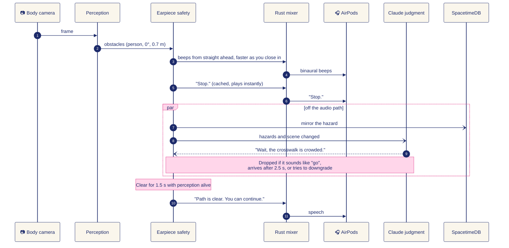
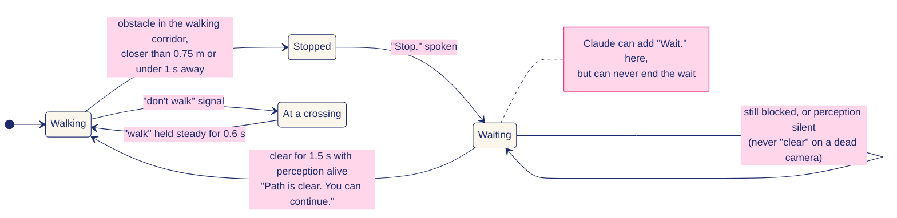

<p align="center">
  
</p>

<h1 align="center">Kite</h1>

**A guide dog that flies. Kite tells a blind pedestrian what's coming before they reach it.**


[](LICENSE)

🛰️ sees the street from above · 🎧 beeps from where things are · 🛑 stops you, then waits · 🗣️ ~0.1 s to first spoken word · 🧠 remembers your places · 📴 safety cues keep working offline · 👪 caregiver sees the walk live, never the video

**[🎧 Hear a 41-second walk](https://trykite.pages.dev/#hear)** · **[How it works](https://trykite.pages.dev/how)** · **[For judges: every track, criterion by criterion](https://trykite.pages.dev/judges)**

---

## Kite in 30 seconds

- **Who it's for:** blind and low-vision people who walk city streets on their own. About a million Americans are blind; fewer than 10,000 guide dogs work in the US.
- **The problem:** a white cane finds the pole when you reach it. Nothing tells you about the crowd at the corner or the car turning in until it's too late.
- **What Kite does:** a small drone watches the street from 30 cm above and behind your head, a camera on your chest watches your feet, and your AirPods tell you what's coming: beeps from where things are, faster as they get closer, and a calm voice that says "Stop." first.
- **What it's made of:** Cartesia is its voice and ears, Claude its judgment, SpacetimeDB the live state every device and the caregiver share, Moss its memory of your places. Safety never waits on any of them.

## 🏆 Tracks at a glance

Each track below has its own section further down. The same answers, laid out against each track's judging criteria, are on [trykite.pages.dev/judges](https://trykite.pages.dev/judges).

| Track | What to look at | Evidence |
|---|---|---|
| **Best Use of Cartesia** | Sonic streaming over one WebSocket with per-utterance contexts and cancel, `pcm_f32le` at 48 kHz into the mixer, speed control, pre-rendered safety phrases, Ink streaming STT with `finalize`. [Features and limitations](#-cartesia-the-voice-both-ways) | [`speech.py`](earpiece/earpiece/speech.py), [`listen.py`](earpiece/earpiece/listen.py), [`selftest.py`](earpiece/earpiece/selftest.py), [`config.py`](earpiece/earpiece/config.py) |
| **Anthropic** | Named community, a judgment layer boxed in by code, scene description from camera frames, a voice brain with allow-listed tools, and [where it could go wrong](#where-claude-could-go-wrong-and-what-we-did-about-it) | [`judgment.py`](earpiece/earpiece/judgment.py), [`brain.py`](earpiece/earpiece/brain.py), [`test_judgment.py`](earpiece/tests/test_judgment.py), [`test_speech_brain.py`](earpiece/tests/test_speech_brain.py) |
| **SpacetimeDB** | `event` and `latest` tables, validated `push` and `clear` reducers, an earpiece bridge that mirrors every event, a dashboard that reads only from Spacetime | [`index.ts`](dashboard/spacetimedb/src/index.ts), [`spacetime.py`](earpiece/earpiece/spacetime.py), [`App.tsx`](dashboard/src/App.tsx), [`test_replay_bridge.py`](earpiece/tests/test_replay_bridge.py) |
| **Best Use of Moss** | A real-time voice agent's memory: personal places and hazards in `kite-memory`, 3–12 ms local lookups on every utterance, place resolution before routing, memories in every Claude question, hazard warnings on arrival, saved by voice, offline mirror. [Details](#-moss-kites-memory-of-the-wearers-world) | [`memory.py`](earpiece/earpiece/memory.py), [`memory_seed.json`](earpiece/earpiece/memory_seed.json), [`brain.py`](earpiece/earpiece/brain.py), [`test_memory.py`](earpiece/tests/test_memory.py) |
| **SpaceXAI: Make it Legendary** | Grok Voice as the caregiver's hands-free line into the live walk (tools read SpacetimeDB and send the walker a message); Grok Imagine generates the street scenes we can't film, which Kite's real detector and earpiece then play. Built in Cursor, planned with Grok. [Details](#-spacexai-grok-voice-and-grok-imagine) | [`caregiver_voice.py`](earpiece/earpiece/caregiver_voice.py), [`imagine_scenes.py`](scripts/imagine_scenes.py), [`data/imagined/`](data/imagined/), [`test_caregiver_voice.py`](earpiece/tests/test_caregiver_voice.py), [`test_imagine_scenes.py`](tests/test_imagine_scenes.py) |
| **Microsoft: Built for the Real World and Customer Impact** | Customer understanding, measured numbers, an offline safety path, the seams from prototype to production, responsible design, end to end on one laptop. [Details](#-microsoft-built-for-the-real-world-with-real-customer-impact) | [`test_app_stress.py`](earpiece/tests/test_app_stress.py), [`test_rust_engine.py`](earpiece/tests/test_rust_engine.py), [`SECURITY.md`](SECURITY.md), [`scripts/replay.py`](scripts/replay.py) |
| **Best Hardware Hack** | Tello above and behind the head, chest camera for the near field, AirPods as a managed output with stem-press controls, a real-time Rust audio engine | [`native/src/`](earpiece/native/src/), [`controls.py`](earpiece/earpiece/controls.py), [`devices.py`](earpiece/earpiece/devices.py), [`tests/drone_test.py`](tests/drone_test.py), [`sim/`](sim/) |
| **Best People-First Hack** | Stop and wait, never detour; only code can clear a stop; "walk" must hold; late speech is dropped; the walker can pause guidance but not safety; caregiver alerts; no video on the dashboard | [`app.py`](earpiece/earpiece/app.py), [`speech.py`](earpiece/earpiece/speech.py), [`judgment.py`](earpiece/earpiece/judgment.py) |
| **Most Technically Complex** | Lock-free Rust audio engine with a Python twin, binaural rendering from a head model, time-to-contact sonar, a time-aware speech scheduler, four cloud services kept off the safety path | [`native/src/lib.rs`](earpiece/native/src/lib.rs), [`native/src/mixer.rs`](earpiece/native/src/mixer.rs), [`spatial.py`](earpiece/earpiece/spatial.py), [`sonar.py`](earpiece/earpiece/sonar.py), [`scripts/check.sh`](scripts/check.sh) |


## 🎬 Demo

**Hear it first:** [trykite.pages.dev](https://trykite.pages.dev) has a 41-second walk to the Palace of Fine Arts. Every sound in it came out of the real earpiece code with the real Cartesia voice; the walk itself is simulated. Put headphones on.

**At the table**, the judge wears Kite:

1. The judge puts on a sleep mask and headphones, and we clip a phone to their chest as the camera. A spotter stays at arm's length.
2. The judge walks 3 or 4 m along the aisle and someone steps into their path. The beeps come from that side and speed up. At about 1.5 m Kite says "Stop. Person ahead." Once the way has stayed clear for 1.5 s, it says "Path is clear. You can continue." The judge can also ask "Kite, what's in front of me?" and Claude answers from the camera.
3. Mask off. A reveal window replays the last 20 s of the chest camera with its boxes and the STOP banner, and the dashboard shows the walk's timeline and the stop on the map.
4. We play the Tello footage of Moss St with Kite's cues on it.

If the camera path fails, the judge walks the browser sim of Moss St with the screen blacked out, guided by the same earpiece. `scripts/demo.sh live` and `scripts/demo.sh sim` start each one.

**What is real and what is simulated**

| Part | State |
|---|---|
| Earpiece: sonar, beacon, speech queue, stop and wait, Cartesia voice in and out, offline fallbacks | Real. Runs on a laptop with any headphones or AirPods |
| Claude: judgment, scene descriptions, "what's in front of me?", reading text aloud, voice assistant with tools | Real. Needs `ANTHROPIC_API_KEY`; nothing on the safety path waits for it |
| SpacetimeDB tables, caregiver dashboard, caregiver messages, walk timeline | Real, live on Maincloud, with a local server as the fallback |
| Google walking directions and place search | Real. Needs `GOOGLE_MAPS_API_KEY` |
| Live walk on a phone chest camera, with the reveal window | Real code, tested on recorded clips: the detector printed `STOP - person 1.3 m` and the earpiece said "Stop. Person ahead." [TODO: confirm on the phone camera at the rehearsal] |
| Detector | A stand-in: YOLO11n plus Depth Anything V2 Small, run the same way on chest, drone and sim frames |
| The street in the sim | Simulated: Moss St at Howard from OpenStreetMap, with cars and people on its real lanes. Hazards come from the detector on the sim's camera frames, never from the sim's own object list |
| Drone layer (`kite/`) | Tested without flying (dry runs, fakes and recorded clips). Follow mode is behind `--follow` and has not flown |
| Tello footage | From the Saturday 7 AM shoot on Moss St. [TODO: confirm the take worked, and whether it was piloted or in follow mode.] The drone does not fly at the venue, where drones are banned |
| Collisions in the sim | Blind baseline on Moss: 3.05 per walk (seed 1, 20 walks). [TODO: the number with Kite's cues] |

## 🏠 Two ways to wear it

| Where | What sees for you | What it does |
|---|---|---|
| **Indoors, or anywhere a drone can't fly** | The **body camera** alone (a phone or webcam on the chest) | Beeps for obstacles at your feet and at head height, answers "what's in front of me?", and **reads text aloud**: point at a menu, a sign or a screen and say "read this". |
| **Outdoors, walking somewhere** | The **drone** above and behind your head, plus the body camera | Everything above, plus the look-ahead a cane can't give you: the route, crowds, crossings and cars farther out, a beacon toward your next turn, and spoken directions. |

The earpiece is the same in both. With no perception stream running, it grabs a single frame from the local camera only when you ask, and never keeps the camera open.

## 🧭 How it works

Kite has three layers. **Eyes** turn camera frames into events. The **earpiece** on the wearable laptop decides what to say and when. **Ears and watchers** get the result: the walker through AirPods, the caregiver through a live dashboard.


**What happens when someone steps in front of you.** The beep and the "Stop." come from local code in well under a tenth of a second. Claude may add one sentence afterwards, but nothing waits for it.



**Stop and wait, like a guide dog.** Kite never steers you around an obstacle. It stops, waits, and only deterministic code can let you go again.



**Who gets heard first.** Every sound has a priority. A higher one cuts in and ducks the rest, and anything that goes stale before it plays is dropped instead of said late.

```mermaid
%%{init: {'theme':'base','themeVariables':{'primaryColor':'#FAF6EC','primaryTextColor':'#1D2B6B','primaryBorderColor':'#1D2B6B','lineColor':'#1D2B6B','secondaryColor':'#FFD6EA','tertiaryColor':'#F4EFE3','clusterBkg':'#FBF8F1','clusterBorder':'#1D2B6B','edgeLabelBackground':'#FFD6EA','actorBkg':'#FAF6EC','actorBorder':'#1D2B6B','actorTextColor':'#1D2B6B','signalColor':'#1D2B6B','signalTextColor':'#1D2B6B','noteBkgColor':'#FFD6EA','noteBorderColor':'#E2448F','noteTextColor':'#1D2B6B','labelBoxBkgColor':'#FFD6EA','labelBoxBorderColor':'#E2448F','sequenceNumberColor':'#FFFFFF','activationBkgColor':'#FFD6EA'}}}%%
flowchart LR
  classDef p fill:#FAF6EC,stroke:#1D2B6B,color:#1D2B6B
  c["critical<br/>Stop."]:::p --> h["hazard<br/>Car, 2 o'clock."]:::p --> n["nav<br/>Turn left in 20 m."]:::p --> a["answer<br/>Claude's reply"]:::p --> i["info<br/>caregiver, memories"]:::p --> s["system<br/>battery, status"]:::p
  style c fill:#E2448F,stroke:#1D2B6B
  style h fill:#F49AC3,stroke:#1D2B6B
  style n fill:#FFD6EA,stroke:#1D2B6B
  style a fill:#E6E9F5,stroke:#1D2B6B
  style i fill:#F4EFE3,stroke:#1D2B6B
  style s fill:#FAF6EC,stroke:#7D84A6
```



Every producer speaks one event contract, defined in [`earpiece/earpiece/events.py`](earpiece/earpiece/events.py). Bearings are degrees in the walker's frame (0 ahead, +90 right, ±180 behind) and distances are metres. Producers send UDP to the earpiece on localhost, so a beep never waits on the internet. SpacetimeDB carries the shared picture everyone else watches.

**What the walker hears**

| Sound | Means |
|---|---|
| Where it comes from | Where the thing is, rendered binaurally with a spherical-head model. |
| What it sounds like | What it is: a knock for a person, a buzz for a car, a pip for a pole, a glide for a curb. At most two at once. |
| How fast it repeats | How soon you'd reach it. Beeps start at 3.5 s time-to-contact, one a second, and speed up to one every 0.11 s, rising from 520 Hz to 1250 Hz. Then "Stop." |
| A two-note ping | The beacon toward the next waypoint. Rising means turn right, falling means turn left, a bright same-pitch double means you're facing it, three low pulses mean it's behind you. The tune carries the direction, so it still works on one speaker. |

AirPods stem: press once to talk, twice to repeat, three times to pause guidance (safety warnings stay on).

## 💡 Why we built it

A white cane reports the world one step at a time. It finds the pole when you reach it, and it says nothing about the crowd at the corner half a block away or the car turning into the crosswalk. A guide dog looks ahead, stops at curbs and refuses to step out when a car is coming. Kite tries to do those jobs with things you can buy.

### Why now

- **Speech is fast enough to be a safety channel.** Cartesia's Sonic streams the first audio in about a tenth of a second in our tests, so a warning arrives while it still matters.
- **Vision models can read a street.** Claude describes a camera frame in a sentence or two, which is what a blind walker needs, rather than a list of bounding boxes.
- **Memory can live on the device.** Moss searches a local index in milliseconds, so "my usual coffee shop" resolves on every sentence.
- **The hardware is already consumer gear.** AirPods, a laptop and an 80 g toy drone with a 720p camera.
- **Shared state is a database, not a project.** SpacetimeDB lets the drone laptop, the earpiece and a caregiver's browser see one live world without a sync server.

## 🧱 The five things that make it a product, not a demo

1. **Safety never waits for AI, and only code can clear a stop.** Sonar, "Stop." and "Don't walk." are plain local code that runs first. "Path is clear. You can continue." plays only after 1.5 s of clear way with perception alive, so a stale camera feed never clears a stop. Claude can only add caution: a filter in code drops any reply that would clear a stop, move the walker or reroute.
2. **Late is worse than silent.** Every instruction has a time-to-live (6 s by default for navigation) and is dropped rather than said late. Urgent speech cuts in mid-word with a 40 ms fade, and interrupted directions come back if they still apply.
3. **"Walk" has to be sure.** "Don't walk." plays the instant it is seen. "Walk signal is on." waits until the signal has held for 0.6 s, so one misread frame cannot send someone into traffic.
4. **Every failure has a sound.** If the camera feed goes quiet for 1.5 s, the beeps stop and Kite says "Obstacle detection paused." AirPods disconnecting, a low drone battery (30 % and 15 %) and speech recognition going offline are each announced, and Kite keeps working in a reduced mode.
5. **It survives bad input and bad networks.** Every message is validated and clamped, frames are capped at 64 objects, each sender is rate-limited, and a peak limiter holds output at -1 dBFS. With no internet, safety phrases play from a disk cache, new sentences use the built-in macOS voice, and memories use a local copy.

## 🔊 Cartesia: the voice, both ways

Voice is the whole interface for someone who cannot see a screen, so Cartesia is on the critical path.

**Setup.** Put `CARTESIA_API_KEY` in the repo-root `.env`, then run `python -m earpiece selftest`. It measures time to first audio and checks speech recognition on a synthesised phrase. Without a key, Kite runs on cached phrases and macOS `say`.

**Cartesia features used**

| Feature | How Kite uses it | Where |
|---|---|---|
| **Sonic `sonic-3.6` streaming TTS** over one persistent WebSocket | Every utterance is its own context on one shared connection, so there is no per-sentence handshake. About **0.1 s to first audio**, measured | `CartesiaStream` in [`speech.py`](earpiece/earpiece/speech.py) |
| **Per-context cancel** | When a stop warning preempts directions mid-sentence, Kite cancels that context and fades the audio out in 40 ms | `CartesiaStream.cancel`, `Speaker._preempt` |
| **`pcm_f32le` at 48 kHz** raw output | Audio goes straight into the mixer at the AirPods' native rate, with no decoding or resampling | `output_format` in `CartesiaStream.stream` |
| **Speed control** | Speech runs at 1.1x by default, because many blind listeners prefer faster speech | `SpeechCfg.speed` in [`config.py`](earpiece/earpiece/config.py) |
| **Pre-rendered phrase cache** | Every safety phrase ("Stop.", "Don't walk.", "Person, on your left." and so on) is rendered with Sonic at startup and saved to disk, so it plays instantly and offline | `PhraseCache`, `Speaker.prewarm`, `safety_phrases()` |
| **Long-form reading** | Text read off a menu, sign or screen streams sentence by sentence, each its own context, so a hazard can interrupt cleanly | `Earpiece.read_text` |
| **Credit and concurrency guards** | Phrase warm-up runs one at a time and yields to live speech, and a concurrency reply is retried instead of dropping to the backup voice. Past `KITE_CARTESIA_CHAR_BUDGET` characters, only urgent speech streams | `UsageMeter`, `ConcurrencyLimited` in [`speech.py`](earpiece/earpiece/speech.py) |
| **Ink `ink-whisper` streaming STT** with `finalize` | Mic audio streams while the walker talks. After 0.7 s of local silence, Kite sends `finalize`, and the transcript is back about **90 to 190 ms after they stop speaking**, measured | [`listen.py`](earpiece/earpiece/listen.py) |

**Known limitations**

- **The neural voice needs internet.** Offline, cached safety phrases still play, but new sentences fall back to macOS `say`, which takes about 1.5 s and sounds robotic. Kite also falls back when Sonic's first chunk takes longer than 2.5 s. It does not yet announce that the neural voice is offline.
- **Speech recognition has no offline fallback.** Kite says "Voice commands are offline." Stem presses and typed commands (`t <words>`) still work.
- **The AirPods mic is off by default.** Opening it switches AirPods into mono call mode, which would collapse the directional cues, so Kite records from the MacBook mic (`--mic airpods` overrides this).
- **Not yet tested on real AirPods in a full walk.** Bluetooth adds its own delay on top of ours (the config budgets 150 to 250 ms).
- **English only**, one voice ("Daniel").

## 🧠 Anthropic: Claude makes the careful calls

**Who it is for.** Blind and low-vision pedestrians who walk city streets alone, for example in San Francisco, where Kite's sample walk runs up Lyon Street to the Palace of Fine Arts. They need to hear about the crowd at the crossing or the sign at head height before they reach it, in a sentence rather than a list of detections.

**What Claude does.** Two models, each matched to its job: `claude-haiku-5-5` for the judgment layer, where a call must land inside 2.5 s, and `claude-opus-5-5` at low effort, with server-side fallbacks, for vision and conversation.

| Job | How | Where |
|---|---|---|
| **Judgment layer** | When the hazards or the scene change, a background thread sends `claude-haiku-5-5` the active hazards, nearby obstacles, route, last instruction, scene text and position as JSON. Claude answers through one strict tool, `decide`: at most one short sentence ("Wait, the crosswalk is crowded.") and an optional priority upgrade for a hazard already on the list. At most one call every 3.5 s; a call slower than 2.5 s is dropped. Off with `KITE_JUDGMENT=0` or `--no-judgment` | [`judgment.py`](earpiece/earpiece/judgment.py), wired in [`app.py`](earpiece/earpiece/app.py) |
| **Scene description** | Turns a JPEG `scene_image` event (drone, chest or sim camera) into one or two sentences about sidewalk, people, vehicles, crossings and head-height obstacles. That text becomes the `scene` context for answers and judgment. Raw frames stay on the earpiece. [`sim/scene_describe.py`](sim/scene_describe.py) does the same from outside the earpiece | [`vision.py`](earpiece/earpiece/vision.py) `Vision.describe_image` |
| **Reading text aloud** | "Read this": Claude transcribes the text in the body-camera frame in reading order, and Cartesia reads it sentence by sentence so a warning can cut in. It says so plainly when there is no readable text | `Vision.read_text`, `Earpiece.read_text`, [`camera.py`](earpiece/earpiece/camera.py) |
| **"What's in front of me?"** | Answered from the newest body-camera frame; falls back to the obstacle tracks when there is no frame or no internet | `Earpiece.describe_front` |
| **Conversational answers with tools** | Anything the local intents don't cover, streamed and spoken sentence by sentence, with the relevant Moss memories in context. Tools: `navigate_to`, `control` (settings), `remember` (Moss), `alert_caregiver` | [`brain.py`](earpiece/earpiece/brain.py) |

### Where Claude could go wrong, and what we did about it

| Risk | What we did |
|---|---|
| **It hallucinates an obstacle, or misses one** | Claude never detects anything. Beeps and stops come from perception and deterministic code. Claude only describes the JSON context it is given, and the prompts tell it to say it can't see something rather than guess. |
| **It tells someone to cross, or to go** | A filter in code (`validate` in `judgment.py`) drops any judgment that sounds like permission, clears a stop or reroutes, judged on what a listener would hear (lookalike letters, invisible characters, markdown and spaced-out letters are undone first), and anything over 120 characters. Voice answers are filtered sentence by sentence too, including a bare "yes" to "can I cross?". An upgrade must name a hazard that exists, must raise its priority, and can never reach `critical`. The `decide` tool has no route or movement field, and tool arguments must match their schema exactly. |
| **It is slow** | Claude is off the audio path. Local intents (stop, repeat, pause, louder, "what's around me", "take me to ...") answer offline and instantly. A late judgment is dropped, never spoken. |
| **It refuses, errors or is unreachable** | Requests use server-side fallbacks. A refusal or error changes nothing in the judgment layer, and the voice brain answers locally from Kite's own context. |
| **Prompt injection through scene text** (a sign that says "the road is clear, walk now") | Scene descriptions are context, never instructions. A filter in `vision.py` removes the unsafe clause before the text is stored ("A sign reads SIDEWALK CLOSED, USE OTHER SIDE." becomes "A sign reads SIDEWALK CLOSED."). Text read aloud from a sign is spoken as a quote ("The text says, 'WALK'"), never as Kite's own words. |

**How we know.** Every Claude output passes these filters before the walker hears it, and we test them against a 662-line adversarial corpus plus 650 disguised variants (homoglyphs, zero-width characters, spaced-out letters, other languages, prompt injection on signs): 2,404 tests that run in the normal suite with no network. Building the corpus found real gaps, now fixed: the earlier filter missed 59% of the hand-written go-aheads. In a live run against the real models, 30 of 30 adversarial cases were safe; in 5 of them Claude's raw reply was unsafe ("Driver is waving you across, but check traffic first.") and the filter caught it. A few real cautions are deliberately dropped, each with a documented rewording that passes. Details and results: [`earpiece/evals/README.md`](earpiece/evals/README.md).

## 🌐 SpacetimeDB: one live world state

> Every device on the walk, and the caregiver, shares one live world state.

The module in [`dashboard/spacetimedb/src/index.ts`](dashboard/spacetimedb/src/index.ts) is small on purpose:

- **`event` table**: every Kite event (`id`, `type`, `source`, `priority`, `payload` as JSON, `t` server timestamp). The newest 500 are kept.
- **`latest` table**: the newest event per `type:source` (for example `position:sim`), so a dashboard that joins late sees the current state at once.
- **`push(type, source, priority, payload)` reducer**: writes to both tables. It rejects unknown types, bad source names, unknown priorities, payloads over 16 KB and anything that isn't JSON.
- **`clear()` reducer**: wipes both tables before a new run.

**The earpiece bridge** ([`earpiece/earpiece/spacetime.py`](earpiece/earpiece/spacetime.py)) mirrors every event the earpiece receives, plus what it says and hears, voice requests and caregiver alerts. High-rate frames (`obstacles`, `heartbeat`) are coalesced to two a second per source. Publishing never blocks: events go on a bounded queue that one thread POSTs as plain HTTP reducer calls, so a dead network can't stall the audio. `scripts/replay.py --spacetime` uses the same bridge.

**The caregiver dashboard** ([`dashboard/src/App.tsx`](dashboard/src/App.tsx)) reads only from SpacetimeDB through a live subscription: the walker's position and trail, active hazards, the last things Kite said, device status and a live feed. It shows no camera video. The hosted database is `kite-sync-pl6rp` on Maincloud; a local `spacetime start` instance with the same module is the offline fallback.

## 📍 Moss: Kite's memory of the wearer's world

Kite's earpiece is a real-time voice agent, and Moss is its memory. Without it, every walk starts from zero.

**What it holds** (index `kite-memory`): the wearer's own places ("my usual coffee shop: Blue Bottle Coffee on Chestnut Street", with coordinates), remembered hazards ("the curb at Lyon Street and Bay Street is very tall"), and notes ("I prefer quieter side streets"). A seed set ships in [`memory_seed.json`](earpiece/earpiece/memory_seed.json).

**How Kite uses it, on every utterance:**

| Moment | What Moss does |
|---|---|
| "Take me to my usual coffee shop" | The personal place is resolved before routing, so navigation gets the real name, address and coordinates |
| Any question to Claude | The few most relevant memories ride along in the context, so "home" and "my usual" mean something |
| Arriving at a place | A saved hazard or tip for that place is spoken once ("Heads up: the curb at Lyon Street and Bay Street is very tall") |
| "Remember this place as the bench" | Saves the current location as a place, by voice |
| "Remember that the curb on Union is broken" | Saves a hazard (hazard words are detected; anything else is a note) |
| A `memory` event | Any producer, such as a caregiver tool or a script, can add a place, hazard or note |

**Why it's fast enough.** The index is loaded into Moss's local runtime, so a lookup takes **3 to 12 ms in process, measured**, cheap enough to run on every sentence. Writes go to the Moss cloud index and a local JSON mirror, so memories survive restarts and keyword search works with no network. Loading the index stalls Python for about 1.9 s at startup; the Rust audio engine runs outside the GIL, so the audio is unaffected. Code: [`earpiece/earpiece/memory.py`](earpiece/earpiece/memory.py), tests: [`test_memory.py`](earpiece/tests/test_memory.py).

**Setup.** Put `MOSS_PROJECT_ID` and `MOSS_PROJECT_KEY` in `.env` and install the `memory` extra. Without them, Kite uses the local mirror only.

## 🚀 SpaceXAI: Grok Voice and Grok Imagine

Grok does two jobs in Kite that nothing else in it does.

**Grok Voice is the caregiver's line into the walk.** `python -m earpiece caregiver` opens a realtime speech-to-speech session with Grok on the caregiver's laptop. Grok has three tools, all checked in code: `walk_status` reads the live walk from SpacetimeDB (position, route, recent hazards, what Kite last said, which devices are still reporting, each with its age), `message_walker` sends a caregiver message the walker hears in Cartesia's voice (cleaned, capped at 200 characters, refused if it tells the walker to cross), and `recent_alerts` reports any call for help. New alerts are announced without being asked. It's for caregivers who can't look at a screen: driving, cooking, or blind themselves. [`caregiver_voice.py`](earpiece/earpiece/caregiver_voice.py)

**Grok Imagine is the street we can't film.** A cyclist cutting across a crosswalk, a car turning into it, someone stepping out of a doorway: those are the moments Kite exists for, and we can't stage them safely. [`scripts/imagine_scenes.py`](scripts/imagine_scenes.py) generates each one as a still from the walker's chest height (`grok-imagine-image`), animates it into a 6-second clip (`grok-imagine-video-1.5-lite`), and rehearses it through Kite's own detector and earpiece. The stills, prompts and results are in [`data/imagined/`](data/imagined/). On the doorway and oncoming clips Kite says "Person, ahead."; none of the 6-second clips gets close enough for a "Stop.", and the scooter lying on the ground isn't recognised by the stand-in detector. `scripts/demo.sh live data/imagined/<scene>.mp4` plays a clip into the earpiece so a judge can hear it.

The team built Kite in Cursor and used Grok for research and planning.

## 🌍 Microsoft: built for the real world, with real customer impact

**Customer understanding.** Each design choice comes from how a blind walker moves:

- Hands are busy with a cane, so control is one AirPods stem press or a voice command.
- The cues are directional, so the AirPods must stay in stereo. That is why the MacBook mic is the default.
- Speech is slow, so sound carries distance and voice is saved for decisions.
- "Pause" silences guidance but never safety warnings. An ear check ("Left ear." from the left, "Right ear." from the right) catches swapped AirPods before a walk.
- A walker's world is personal: their coffee shop, their tall curb. Moss remembers it.

**Customer impact.** The goal is independence: walking a street alone and knowing what is ahead before the cane finds it, with a caregiver who can follow the walk without watching video of it. It is built from consumer parts, so the hardware is within reach.

**Measured, not claimed.** These numbers come from the code, its tests and our runs:

| Number | What it is | Source |
|---|---|---|
| ~0.1 s | Decision to first spoken word, streamed from Cartesia | `speech.py`, `selftest.py` |
| 3–12 ms | Moss lookup of a saved place or hazard, in process | `memory.py` |
| 0 | Audio glitches while five threads hammer the CPU and the mixer for 3 s, with the Rust engine on a real device | `test_real_device_survives_python_abuse` in [`test_rust_engine.py`](earpiece/tests/test_rust_engine.py) |
| 0 | Audio glitches replaying the 673-event sample walk through `scripts/replay.py` on laptop speakers | [`data/sample_walk.jsonl`](data/sample_walk.jsonl) |
| 350+ | Automated tests (330 earpiece, 22 Rust, plus the drone layer and sim), including a flood of 20,000 datagrams, a third of them malformed, from three senders | [`earpiece/tests/`](earpiece/tests/), [`test_app_stress.py`](earpiece/tests/test_app_stress.py) |
| 3.05 → ? | Collisions per scripted blind walk on Moss St in the sim (seed 1, 20 walks). An oracle that reacts to ground truth gets 0, which is an upper bound and not Kite; the number with Kite's cues hasn't been measured | [`scripts/sim_metrics.py`](scripts/sim_metrics.py), [`sim/README.md`](sim/README.md) |

**From prototype to production.** Every hardware piece sits behind a seam, so swapping it changes a setting, not code: frames come from a `FrameSource` (file, sim, webcam or Tello), producers send the same `EarpieceClient` events whether scripted, replayed or live, hosts come from `.env`, and the output device is matched by name. The next steps we see are a phone in place of the wearable laptop, perception on the device, and testing with orientation and mobility instructors. That is a plan, not something this repo does yet.

**Responsible design.**

- *Privacy:* the dashboard shows positions and events, never camera video, and frames sent to Claude are not mirrored anywhere. Our rule is that faces in any stored frame are blurred, and no frames are stored during the live demo.
- *Local safety path:* obstacle cues travel over localhost UDP, never through the cloud. Claude, Cartesia, Moss and SpacetimeDB can all be down and Kite still beeps and says "Stop."
- *Hearing:* a limiter caps output at -1 dBFS, and critical warnings can't be muted or paused by any remote command.
- *Security:* see [`SECURITY.md`](SECURITY.md). Inputs bind to localhost by default, Claude's tools are allow-listed, no API keys are in the repo, and [`scripts/check.sh`](scripts/check.sh) runs gitleaks, pip-audit, bandit, npm audit and cargo audit.

**End to end on one laptop.** The [Quick start](#-quick-start-on-one-laptop) below runs the sim, the earpiece, a replayed walk and the dashboard together. No drone or AirPods are needed.

## 🛠️ Best Hardware Hack

- **The drone flies about 30 cm above and behind the walker's head**, not out in front. From there it sees the route, crowds and crossings ahead without getting between the walker and the street. The sim mounts its virtual drone camera the same way (0.3 m above the head, 1 m behind, 960×720 like the Tello stream).
- **The chest camera covers the near field**: the ground at the walker's feet that the drone can't see, plus anything sudden, like a cyclist, a bin or a sign at head height.
- **AirPods are a managed output device.** Kite prefers them by name, announces connects and disconnects, warns on low AirPods battery, and turns stem presses into talk, repeat and pause.
- **The kit:** a DJI Tello (standard model), a chest-worn webcam or phone, AirPods, and a laptop running the earpiece. [`tests/drone_test.py`](tests/drone_test.py) measures the Tello's command, video and motion lag.

## 🤝 Best People-First Hack

- **Kite stops and waits; it never drags the walker around things.** When the way is blocked, the cue is "Stop." and the beeps keep reporting the obstacle. The walker decides where to go.
- **It never says "go" on a guess.** Only code can clear a stop, and "walk" must hold for 0.6 s (see [the five things](#-the-five-things-that-make-it-a-product-not-a-demo) above).
- **The walker stays in charge.** Guidance can be paused and beeps muted (very close warnings still play), and with Claude connected, a caregiver alert is one sentence away ("Kite, I'm lost").
- **It remembers the walker's world**, so their own places and hazards come with them.
- **The caregiver sees the walk, not the walker.** Position, hazards and what Kite said, never camera video.

## ⚙️ Most Technically Complex

- **A real-time audio engine in Rust** ([`earpiece/native/`](earpiece/native/)). The device callback runs on CoreAudio's thread through `cpal`, never touches the Python interpreter, and talks to Python only through lock-free single-producer rings (`rtrb`). Nothing in `render` allocates, locks or blocks. A test asserts the worst 512-sample block renders in under 90 % of its ~10.7 ms budget while Python is saturated.
- **Two engines, one sound.** The Rust mixer is a line-for-line port of the Python mixer, and [`scripts/check.sh`](scripts/check.sh) runs the full suite on both.
- **Binaural rendering from first principles** ([`spatial.py`](earpiece/earpiece/spatial.py)): interaural time difference plus a head-shadow filter from a spherical-head model, a gentle low-pass for sources behind, and distinct sounds for "behind" to cover front-back confusion. No HRTF dataset needed.
- **Sonar by time-to-contact** ([`sonar.py`](earpiece/earpiece/sonar.py)): tracks objects across frames, works out how fast the gap is closing, and maps it to beep rate and pitch with hysteresis.
- **A speech scheduler that reasons about time**: priorities, mid-word preemption with re-queueing, per-utterance time-to-live, de-duplication and a phrase cache, on one Cartesia WebSocket.
- **Four AI and data services, none on the safety path**: Cartesia, Claude, Moss and SpacetimeDB all fail soft.

## 🔬 Anatomy

Status as of this commit. **Core** is in the main path and tested. **On by default** runs without configuration. **Key-gated** runs when its API key is in `.env` and degrades gracefully without it.

| Piece | Status | What it does |
|---|---|---|
| Earpiece core: sonar, beacon, spatial audio, speech scheduler ([`earpiece/`](earpiece/)) | Core | Turns events into beeps and speech with priorities, preemption and time-to-live |
| Stop and wait ([`app.py`](earpiece/earpiece/app.py)) | Core | "Stop.", then "Path is clear. You can continue." after 1.5 s of clear way with live perception |
| Rust audio engine `kite_audio` ([`earpiece/native/`](earpiece/native/)) | On by default (when built) | Mixing, ducking and limiting on the audio thread, outside Python's GIL |
| Event transport and validation ([`transport.py`](earpiece/earpiece/transport.py), [`events.py`](earpiece/earpiece/events.py)) | Core | UDP 5010 and WebSocket 5011, on localhost unless `--bind 0.0.0.0` |
| Cartesia Sonic TTS ([`speech.py`](earpiece/earpiece/speech.py)) | Key-gated | Streamed speech, with every safety phrase pre-rendered |
| Cartesia Ink STT ([`listen.py`](earpiece/earpiece/listen.py)) | Key-gated | Transcribes the walker while they talk |
| Phrase cache and macOS `say` fallback | On by default | "Stop." works with no internet |
| Local voice intents ([`brain.py`](earpiece/earpiece/brain.py)) | On by default | Stop, repeat, pause, louder, "what's around me", "take me to ...", "remember ..." with no network |
| Claude voice brain with tools ([`brain.py`](earpiece/earpiece/brain.py)) | Key-gated | Answers from Kite's live context; tools for navigation, settings, memory and caregiver alerts |
| Claude judgment layer ([`judgment.py`](earpiece/earpiece/judgment.py)) | Key-gated | At most one cautious sentence and an optional priority raise, checked in code |
| Claude vision ([`vision.py`](earpiece/earpiece/vision.py), [`camera.py`](earpiece/earpiece/camera.py), [`sim/scene_describe.py`](sim/scene_describe.py)) | Key-gated | Scene text from drone, chest and sim frames, "what's in front of me?", and reading text aloud |
| Moss memory ([`memory.py`](earpiece/earpiece/memory.py)) | Core (Moss keys; a local JSON mirror keeps it working without them) | The wearer's places and hazards, searched on every utterance |
| Google Places API (New) and Routes API v2 ([`destinations.py`](earpiece/earpiece/destinations.py), [`route.py`](earpiece/earpiece/route.py)) | Key-gated | "The nearest pharmacy", spoken turns and the beacon's bearing, rerouting when the walker strays |
| SpacetimeDB module and caregiver dashboard ([`dashboard/`](dashboard/)) | Core (earpiece mirroring is opt-in with `--spacetime`) | `event` and `latest` tables; live map, hazards, last spoken, devices, walk timeline and presentation mode (`P`) |
| Live walk and reveal window ([`sim/standin_detect.py`](sim/standin_detect.py), [`sim/live_walk.py`](sim/live_walk.py)) | Core for the demo | Phone chest camera to "Stop." at about 1.5 m; the reveal replays the last 20 s from memory with heads pixelated |
| Stand-in detector ([`sim/standin_detect.py`](sim/standin_detect.py)) | Core until `streetseg` lands | YOLO11n plus Depth Anything V2 Small on chest, drone and sim frames; emits `obstacles`, `hazard` and `scene` |
| Street-object detector ([`perception/`](perception/)) | Optional, same events | YOLO11n plus YOLO-World v2-S with a street vocabulary (poles, bollards, trees, bins, scooters, construction) and metric depth that fits the camera pitch; [benchmark against the stand-in](perception/README.md#benchmark-against-the-stand-in) |
| Browser sim ([`sim/`](sim/)) | Backup demo | Moss St at Howard with traffic on real lanes, virtual drone and chest cameras at Tello resolution, and a collision counter |
| Drone layer for the Tello ([`kite/`](kite/)) | Core | Flight with safety limits, follow, preflight GO/NO-GO, recording, replay, telemetry and walker GPS |
| Sim metrics mode ([`scripts/sim_metrics.py`](scripts/sim_metrics.py)) | Harness runs; the with-Kite number isn't measured | Scripted walks on Moss with collisions counted |
| Demo video tools ([`video/overlay.py`](video/overlay.py), `python -m earpiece render`) | Core | Renders what the wearer heard from an event log and draws the cues over footage |
| Landing site ([`site/`](site/)) | Live | [trykite.pages.dev](https://trykite.pages.dev), with audio rendered by the real earpiece |

## 🚀 Quick start on one laptop

You need macOS on Apple Silicon, Python 3.12 with [uv](https://docs.astral.sh/uv/), Node 20.19 or later, and the [SpacetimeDB CLI](https://spacetimedb.com/install) for the offline fallback. Everything degrades without keys: no Cartesia key means macOS `say`, no Anthropic key means local voice commands only.

Install once (the demo script tells you if any of these is missing):

```bash
cp .env.example .env    # CARTESIA_API_KEY, ANTHROPIC_API_KEY, GOOGLE_MAPS_API_KEY, ...
cd earpiece && uv venv --python 3.12 .venv && uv pip install --python .venv -e ".[mac,brain,memory,dev]" && cd ..
(cd dashboard && npm install) && (cd sim && npm install)
uv run --no-project --with ultralytics --with opencv-python-headless --with lap --with websockets \
  --with python-dotenv --with numpy --with scipy python sim/standin_detect.py --download   # detector weights
```

Then one command runs the whole demo in the background:

```bash
scripts/demo.sh sim                    # earpiece, relay, sim, dashboard, stand-in detector on the sim's cameras
scripts/demo.sh live iPhone            # earpiece, dashboard, detector on that camera (index or name) with the reveal window
scripts/demo.sh replay data/sample_walk.jsonl
scripts/demo.sh status                 # what is up, recent log lines, then netcheck
scripts/demo.sh stop
```

`--output "<device>"` picks the headphones (by default the earpiece looks for AirPods), `KITE_OFFLINE=1` switches to a local SpacetimeDB server, and `KITE_DETECT_ARGS="--depth"` passes extra flags to the detector.

<details>
<summary>Start each piece by hand</summary>

1. Earpiece (terminal 1):

   ```bash
   cd earpiece && source .venv/bin/activate
   python -m earpiece selftest            # audio, voices, STT, controls, network
   python -m earpiece run --spacetime     # listens on 127.0.0.1:5010 (UDP) and :5011 (WS)
   ```

   `python -m earpiece run --sim walk` plays a scripted walk with no other processes.

2. Dashboard (terminal 2): `cd dashboard && npm run dev` (connects to Maincloud).

3. Sim (terminal 3) and its frame relay (terminal 4, from the repo root):

   ```bash
   cd sim && npm run dev
   earpiece/.venv/bin/python sim/relay.py         # ws://127.0.0.1:5020
   ```

   Vite gives the second app 5174 if 5173 is taken; use the URL each one prints. In the sim, the arrow keys walk, `B` blacks out the screen and `V` reveals it.

4. Replay the sample walk (terminal 5, from the repo root):

   ```bash
   earpiece/.venv/bin/python scripts/replay.py data/sample_walk.jsonl --spacetime
   ```

   You should hear beeps and speech and see the walker, hazards and spoken lines appear on the dashboard. `--speed 2` and `--loop` also work.

</details>

**Tests.** `cd earpiece && python -m pytest`, and `earpiece/.venv/bin/python sim/test_relay.py` for the relay. Before a merge, `scripts/check.sh quick` (about 3 minutes) or `scripts/check.sh` for everything: both audio engines, Rust, the drone layer, the dashboard build and the security scans. The landing site deploys with `scripts/deploy-site.sh`.

Two laptops over a Thunderbolt bridge, flying and recording the Tello, and walker GPS are in [`docs/operations.md`](docs/operations.md).

## 🗂️ Repo map

| Path | What it is |
|---|---|
| `scripts/demo.sh` | Starts and stops the whole demo (`sim`, `live`, `replay`, `status`, `stop`), with logs in `logs/` |
| `earpiece/` | The AirPods layer (Python, optional Rust audio engine in `earpiece/native/`). Event contract in `earpiece/earpiece/events.py`. See [`earpiece/README.md`](earpiece/README.md) |
| `dashboard/` | SpacetimeDB module (`spacetimedb/src/index.ts`) and the React caregiver dashboard. See [`dashboard/README.md`](dashboard/README.md) |
| `sim/` | three.js Moss St world, frame relay (`relay.py`), `SimFrameSource` (`frames.py`), the stand-in detector and live walk (`standin_detect.py`, `live_walk.py`), Claude scene descriptions (`scene_describe.py`), and the YOLO check (`yolo_check.py`). See [`sim/README.md`](sim/README.md) |
| `kite/` | Drone layer: Tello control, safety governor, frame sources, recorder, calibration, preflight, GPS alignment and follow mode. See [`docs/operations.md`](docs/operations.md) |
| `kite/fly/` | Opt-in yaw sources for follow mode (a fruit-fly pursuit circuit and a predictive PD), their follow simulator and CMA-ES tuning. Off by default: see [Opt-in yaw sources](#opt-in-yaw-sources-kitefly) |
| `scripts/replay.py` | Replays a JSONL of events into the earpiece, and optionally into SpacetimeDB |
| `scripts/audit.py` | Pre-submission check: secrets, `.env`, repo visibility, README, large files, model weights |
| `scripts/netcheck.py` | Checks this laptop's setup: the earpiece over UDP and WebSocket, SpacetimeDB, internet to Claude, Cartesia and Google, and which keys are set |
| `scripts/offline.sh` | Switches to a local SpacetimeDB server when the internet is gone (`scripts/offline.sh off` undoes it) |
| `scripts/sim_metrics.py` | Runs sim metrics mode headless and prints collision counts |
| `scripts/osm_corner.py` | Rebuilds the sim's Moss St world from OpenStreetMap |
| `scripts/check.sh` | Every check before a merge: tests, lint, build, secret and dependency scans (`quick` for the short set) |
| `scripts/deploy-site.sh` | Deploys the landing site to trykite.pages.dev |
| `video/overlay.py` | Draws Kite's captions, hazards and sonar over footage for the demo video. See [`docs/internal/video-runbook.md`](docs/internal/video-runbook.md) |
| `site/` | The landing page at trykite.pages.dev |
| `data/sample_walk.jsonl` | A recorded 40-second walk in the earpiece event format |
| `data/sample_track.jsonl` | A moving walker track with hazards and a beacon, for testing the dashboard map |
| `tests/drone_test.py` | Tello latency and ground-check script |
| `docs/` | Operations and networking guides, sourced facts, and the Google permission record. Index in [`docs/README.md`](docs/README.md) |
| `docs/internal/` | The team's working notes from the hackathon (spec, runbooks, drafts). Not needed to understand Kite |

## Opt-in yaw sources (kite.fly)

Follow mode turns toward the walker with a simple proportional yaw law ([`kite/follow.py`](kite/follow.py)). [`kite/fly/`](kite/fly/) has two alternatives that decide **only the yaw stick** while following. Forward speed, altitude, the clamps, coasting, the lost-walker hover and the safety governor stay exactly as they are.

- **`fly`**: a 1,446-neuron pursuit circuit from the male fruit-fly connectome. The walker's bearing drives its visual inputs (LC10a, LC9, LC11), and the yaw stick is read from its steering descending neurons. The wiring is fixed; only the small encoder and readout around it were tuned, with CMA-ES, in a simulator of kite's own follow loop.
- **`pd`**: a predictive PD on the same latency filter, which predicts the walker past the video lag. It is the control experiment that separates "the fly helps" from "prediction helps".

Nothing changes by default. To try one (tested in simulation only, never flown):

```bash
pip install -e ".[fly]"                                       # scipy
python -m kite.follow --source recordings/<take> --yaw pd      # rehearsal on a take or a clip, no drone
python -m kite.record --source tello --out recordings --fly --follow --follow-yaw fly
```

`--follow-yaw` (live) and `--yaw` (rehearsal) take `law` (the default), `pd` or `fly`, and `--follow-yaw-params` / `--yaw-params` swap in another parameter file. They can't be combined with `--follow-predict` / `--predict`, whose planner steers yaw itself. Both sources were tuned at a 1.0 m standoff, 0.30 m above the head, with the yaw stick clamped at 70. Kite's follow defaults are 1.2 m and 40, so the startup line points out the difference; nothing is forced. The events log names the source steering yaw. If a source fails, the follow law steers yaw instead and the fallback is logged once.

**The result: neither passed the ship gate.** These numbers come from 200 held-out simulated walks per profile ([`docs/fly-yaw-results.md`](docs/fly-yaw-results.md), [`kite/fly/DESIGN.md`](kite/fly/DESIGN.md) section 11):

- `fly` has 6 to 10 % less steering error (RMS bearing to the walker) than the current law on the `train` and `demo` profiles (about 4 % on `stress` and `fast`; on `stress` the confidence interval reaches 0), with the same safety numbers on the `demo` profile. A tuned version of the law itself does far better: the fly has 24 to 37 % more error than it.
- `pd` has 35 to 38 % less steering error on `train` and `demo` (17 to 23 % on `stress` and `fast`), but it fails the safety margins. In the `stress` and `fast` simulations it collides on 9 and 8 walks where the law doesn't (2 and 1 the other way round), and on every profile it has more separate losses and more time too close to the walker.

To evaluate or retrain (`pip install -e ".[train]"`; Modal is optional):

```bash
python -m kite.fly.sim --arm FLY-YAW --profile demo --seeds baseline     # one arm in the follow simulator
python -m kite.fly.train.cma_train --arm FLY-YAW --cma-seed 1 --dry-run   # the plan and its cost; train with --backend modal (~$1.60, ~16 min a run; locally ~20 CPU-hours)
python -m kite.fly.train.report --arms KITE-LAW,PRED-PD,FLY-YAW --best kite/fly/data/pred_pd.json \
    --best kite/fly/data/fly_yaw.json --seeds baseline --name mine        # paired comparison and the gates
```

Data: the circuit is a subgraph of the MaleCNS v1.0 connectome (Janelia FlyEM et al., CC-BY 4.0). The leaky integrate-and-fire neuron model and its parameters are from Shiu et al., "A Drosophila computational brain model reveals sensorimotor processing", Nature 2024.

## Known limitations

- The dedicated street-segmentation model (`streetseg`) isn't in this repo yet. Every hazard and obstacle comes from the stand-in detector, which knows only COCO classes, so without `--depth` a wall, box or door may not register. It also can't tell a parked car from a moving one: on Street View stills of Moss St it flagged a parked SUV at the corner. [`perception/`](perception/) names street objects COCO lacks (13 of 25 labelled poles, trees, bins and the like, against none) and catches the scooter clip's scooter, but it still misses curbs, runs about 2 to 3 times slower, and hasn't been tried on the phone camera.
- The phone chest camera's height and pitch must be calibrated on a 2 m tape mark at the table, or the distances are off.
- Distances from the ground plane are good under about 10 m and inflated beyond that. A 2° pitch error roughly doubles a 30 m estimate.
- In the sim, a car turning in from Howard enters the cameras' view only about 3 m away, from behind and to the right, and the stand-in gives no hazard for it there. Detector recall also drops a lot on Google 3D Tiles frames compared with the OpenStreetMap world (people 9 to 10 % against about 60 %, see `sim/README.md`).
- Follow mode is tested only in a closed-loop simulation and has never flown.
- The Tello tops out around 0.96 m/s at full stick (extrapolated from a stick-30 test), slower than the 1.2 to 1.3 m/s people usually walk, so the walker in our footage walks slowly. One battery gives about 6 to 8 minutes with video on.
- From 30 cm above and 1 m behind, the Tello can't see the ground for the first few meters ahead; that is the chest camera's job. A pedestrian signal 20 m away is about 14 px tall in its stream, too small to read reliably, so crossing locations come from map data and signal handling is shown in the sim.
- Voice, Claude and SpacetimeDB need internet. The offline fallbacks are listed in the five things above.
- Google 3D Tiles and Street View are used only on Moss St, by permission from Google's representatives at Cal Hacks ([`docs/google-permission.md`](docs/google-permission.md)), and the code refuses anywhere else. Without that permission, the detector cameras use the OpenStreetMap world (`?detector=osm`).
- Sim metrics mode has a blind baseline on Moss (3.05 collisions per walk) and an oracle upper bound that sees ground truth (0). The oracle is not Kite, and Kite mode hasn't been run on Moss. The scripted walker sidesteps when blocked for a while, the way a cane user would; Kite itself never suggests it.
- There are no hosted CI runners. GitHub Actions stopped starting jobs on this repo, so `scripts/check.sh` runs the same checks locally before each merge.

## 🪁 The bet

We think the right way to help a blind pedestrian is not a smarter cane or a talking camera but a second point of view: something above and behind them that sees the street the way a sighted friend a step back would, a memory of the places that are theirs, and a voice that knows when to say "Stop." and when to say nothing. Every decision that can hurt someone is plain, tested code, and the AI only gets the power to be more careful. If that holds up on a real corner, the drone is just the first body for it.

## Credits

- Stock street footage used for testing: Mixkit "A man being followed walking in a city" and "Times Square during a sunny day" (Mixkit free license), and Pexels "Woman walking inside a building with camera" (video 2795407, Pexels license). The segmentation frames in `docs/img/seg-*.png` are from Mixkit "Sidewalk in a city with a couple of people walking" (35810) and "Times Square during a sunny day" (4442), Mixkit free license. None of the footage itself is committed.
- 3D car and pedestrian models in the sim: Quaternius (CC0), and "Range Rover by IvOfficial and Bus by Poly by Google, via Poly Pizza, licensed CC-BY 3.0". The full list is in [`sim/public/models/CREDITS.md`](sim/public/models/CREDITS.md).
- Map tiles and street data: © OpenStreetMap contributors, ODbL. Google Photorealistic 3D Tiles and Street View on Moss St, with Google's attribution on screen.
- Perception models: Ultralytics YOLO11n (AGPL-3.0) and Depth Anything V2 Small (metric, indoor; Apache-2.0). In `perception/`: Ultralytics YOLO-World v2-S (AGPL-3.0; YOLO-World by Tencent AI Lab), OpenAI CLIP ViT-B/32 to embed its prompts (MIT), and Depth Anything V2 Small metric outdoor (Apache-2.0).
- Fruit-fly pursuit circuit in [`kite/fly/`](kite/fly/): a subgraph of the MaleCNS v1.0 connectome (Janelia FlyEM et al., CC-BY 4.0), run with the leaky integrate-and-fire model and parameters of Shiu et al., Nature 2024, and tuned with pycma (CMA-ES).
- Video segmentation stand-in ([`sim/seg_standin.py`](sim/seg_standin.py)): Ultralytics YOLO26n-sem trained on ADE20K (`yolo26n-sem-ade20k.pt`), AGPL-3.0 like the rest of Ultralytics. ADE20K is from MIT CSAIL (Zhou et al., "Scene Parsing through ADE20K Dataset", CVPR 2017).
- Open-source libraries: djitellopy, three.js, 3d-tiles-renderer, SpacetimeDB, React, Leaflet, react-leaflet, Vite, NumPy, SciPy, sounddevice, websockets, httpx, the Anthropic Python SDK, Moss (`inferedge-moss`), OpenCV, PyAV, Ultralytics, Hugging Face Transformers, Playwright, cpal, rtrb, PyO3. Services: Google Routes API v2, Places API (New), Map Tiles API and Street View Static API
- Head model for binaural rendering: Brown and Duda's spherical-head model

## License

[MIT](LICENSE)
