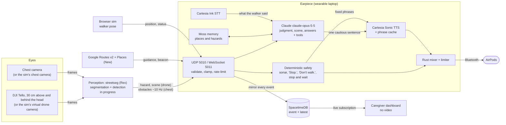

# 🪁 Kite

**A guide dog that flies. Kite tells a blind pedestrian what's coming before they reach it.**

[](https://github.com/KingArthur207/kite/actions/workflows/ci.yml)
[](https://github.com/KingArthur207/kite/actions/workflows/security.yml)


[](LICENSE)

🛰️ sees the street from above · 🎧 beeps from where things are · 🛑 stops you, then waits · 🗣️ ~0.1 s to first spoken word · 🧠 remembers your places · 📴 safety cues keep working offline · 👪 caregiver sees the walk live, never the video

Cal Hacks 13.0 · team Arthur, Eddy, Karthik and Rex · **[trykite.pages.dev](https://trykite.pages.dev)**

---

## Why we built it

A white cane is honest, but it reports the world one step at a time. It finds the pole when the walker reaches it, the sandwich board when it is already underfoot, and it says nothing at all about the crowd bunched at the corner half a block away or the car turning into the crosswalk. Everything a blind pedestrian learns about the street, they learn at the last moment.

A guide dog changes that: it looks ahead, stops at curbs, and refuses to step out when a car is coming. Kite tries to do those same jobs with things you can buy. A small drone flies about 30 cm above and behind the walker's head and watches the route ahead. A camera on the chest watches the ground at their feet. The walker hears all of it through AirPods, as beeps that come from where things are and a calm voice that says "Stop." first, and "Path is clear. You can continue." only when it is sure.

## ⏱️ Why now

- **Speech got fast enough to be a safety channel.** Cartesia's Sonic streams the first audio in about a tenth of a second in our tests, so a spoken warning arrives while it still matters.
- **Vision models can read a street.** Claude can describe a camera frame in a sentence or two, which is what a blind walker needs, rather than a list of bounding boxes.
- **Memory can live on the device.** Moss loads a search index into a local runtime, so "my usual coffee shop" resolves in milliseconds, on every sentence.
- **The hardware is already in people's pockets.** AirPods, a laptop or phone, and an 80 g toy drone with a 720p camera are consumer items.
- **Shared state is now a database, not a project.** SpacetimeDB lets the drone laptop, the earpiece and a caregiver's browser see one live world without us writing a sync server.

## 🎬 Demo

**Hear it first:** [trykite.pages.dev](https://trykite.pages.dev) has a 41-second walk to the Palace of Fine Arts. Every sound in it came out of the real earpiece code with the real Cartesia voice. The walk itself is simulated. Put headphones on.

**At the table** (spec section 4), the judge does the walking:

1. We hand the judge the AirPods. "Kite is a guide dog for blind pedestrians that flies."
2. The judge walks a street corner in the browser sim with the screen black, guided only by beeps and voice. A car or a crowd appears; Kite says "Stop.", waits until the way has stayed clear for 1.5 s, then says "Path is clear. You can continue." Kite never detours around things (team decision). Stop and wait is the guide dog behaviour we show.
3. We reveal the view: the drone camera with its detections drawn on it.
4. We play the real Tello footage of the same corner with the same cues. Same code.
5. We hold an obstacle in front of the chest camera and the judge hears the beeps speed up.
6. We say what is real and what isn't, then take questions.

What is real today and what is still landing is spelled out in the [Anatomy](#-anatomy) table.

## 🧭 How it works



Every producer speaks one contract, the event types in [`earpiece/earpiece/events.py`](earpiece/earpiece/events.py): `obstacles`, `hazard`, `guidance`, `beacon`, `position`, `status`, `scene`, `scene_image`, `say`, `memory`, `heartbeat`, `control`. Bearings are degrees in the walker's frame (0 ahead, +90 right, ±180 behind) and distances are metres. Priorities run `critical` > `hazard` > `nav` > `answer` > `info` > `system`.

The safety path is direct and local: producers send UDP to the earpiece through `EarpieceClient`, so a beep never waits on the internet. SpacetimeDB carries the shared picture everyone else watches.

**What the walker hears**

| Sound | Means |
|---|---|
| Where it comes from | Where the thing is. Rendered binaurally with a spherical-head model. |
| What it sounds like | What it is: a knock for a person, a buzz for a car, a pip for a pole, a glide for a curb. At most two at once. |
| How fast it repeats | How soon you'd reach it. Beeps start at 3.5 s time-to-contact, one a second, and speed up to one every 0.11 s, rising from 520 Hz to 1250 Hz. Then "Stop." |
| A tick from one side | The beacon toward the next waypoint. Bright when you're facing it. |

AirPods stem: press once to talk, twice to repeat, three times to pause guidance (safety warnings stay on).

## 🧱 The five things that make it a product, not a demo

1. **Safety never waits for AI, and only code can clear a stop.** Sonar, "Stop." and "Don't walk." are plain code that runs first. After a stop, "Path is clear. You can continue." plays only when the way has looked clear for 1.5 s with perception alive; if the camera feed goes stale, the stop is never cleared. Claude can only make Kite more cautious, and a code-level filter throws away any reply that would clear a stop, move the walker or reroute.
2. **Late is worse than silent.** Every instruction has a time-to-live (6 s by default for navigation). "Turn left now" that could not start in time is dropped, not said late. Urgent speech cuts off anything less important mid-word with a 40 ms fade, and the interrupted directions come back if they still apply.
3. **"Walk" has to be sure.** "Don't walk." plays the instant it is seen. "Walk signal is on." waits until the signal has held for 0.6 s, so one misread frame cannot send someone into traffic.
4. **Every failure has a sound.** If the camera feed goes quiet for 1.5 s, the beeps stop and Kite says "Obstacle detection paused." AirPods disconnecting, a low drone battery (30 % and 15 %) and speech recognition going offline are each announced, and Kite keeps working in a reduced mode instead of failing silently.
5. **It survives bad input and bad networks.** Every message is validated and clamped, frames are capped at 64 objects, each sender is rate-limited, and a peak limiter holds output at -1 dBFS so nothing can make the AirPods dangerously loud. With no internet, safety phrases play from a disk cache, new sentences fall back to the built-in macOS voice, and memories fall back to a local copy.

## 🔬 Anatomy

Honest status as of this commit. **Core** means it is in the main path and tested. **On by default** means it runs without configuration. **Key-gated** means it runs when its API key is in `.env` and degrades gracefully without it. **In progress** means it is not finished in this repo yet.

| Piece | Status | What it does | Why the walker needs it |
|---|---|---|---|
| Earpiece core: sonar, beacon, spatial audio, speech scheduler ([`earpiece/`](earpiece/)) | Core | Turns events into beeps and speech with priorities, preemption and time-to-live | It is the only interface a blind walker has |
| Stop and wait ([`app.py`](earpiece/earpiece/app.py)) | Core | After "Stop.", waits for 1.5 s of clear way with live perception, then "Path is clear. You can continue." | A guide dog stops and waits; it doesn't drag you around things |
| Rust audio engine `kite_audio` ([`earpiece/native/`](earpiece/native/)) | On by default (when built) | Mixing, ducking and limiting on the audio thread, outside Python's GIL | Network calls, Claude or Moss can never make the audio stutter |
| Event transport and validation ([`transport.py`](earpiece/earpiece/transport.py), [`events.py`](earpiece/earpiece/events.py)) | Core | UDP 5010 and WebSocket 5011, on localhost unless `--bind 0.0.0.0` | One buggy producer cannot take the earpiece down |
| Cartesia Sonic TTS ([`speech.py`](earpiece/earpiece/speech.py)) | Key-gated | Streams Claude's sentences and street names; pre-renders every safety phrase | A warning that arrives late is useless |
| Cartesia Ink STT ([`listen.py`](earpiece/earpiece/listen.py)) | Key-gated | Transcribes the walker while they talk | Hands stay on the cane, eyes are not available |
| Phrase cache + macOS `say` fallback | On by default | Safety phrases play from disk; new text falls back to a built-in voice | "Stop." must work with no internet |
| Local voice intents ([`brain.py`](earpiece/earpiece/brain.py)) | On by default | Stop, repeat, pause, louder, "what's around me", "take me to ...", "remember ..." with no network | The common commands should never depend on the cloud |
| Claude voice brain with tools ([`brain.py`](earpiece/earpiece/brain.py)) | Key-gated | Answers anything else from Kite's live context; tools: navigate, settings, remember, alert caregiver | Beeps need someone to explain them |
| Claude judgment layer ([`judgment.py`](earpiece/earpiece/judgment.py)) | Key-gated | Adds at most one cautious sentence and may raise a hazard's priority; no tools, structured JSON output | The careful calls a guide dog makes |
| Claude scene description (`scene_image` events) | Key-gated | Describes camera frames sent over the WebSocket into the shared `scene` text, at most one every 3 s | Context for answers and judgment. No producer in this repo sends frames yet |
| Moss memory ([`memory.py`](earpiece/earpiece/memory.py)) | Core (Moss keys; local JSON mirror keeps it working without them) | The wearer's places and remembered hazards, searched on every utterance | Every walk shouldn't start from zero |
| Google Places API (New) ([`destinations.py`](earpiece/earpiece/destinations.py)) | Key-gated | "The nearest pharmacy" ranked by distance; named places resolved to coordinates | Getting somewhere, not just avoiding things |
| Google Routes API v2 to `guidance` and `beacon` | In progress | Walking route as spoken turns and the beacon's bearing | Same |
| SpacetimeDB module and caregiver dashboard ([`dashboard/`](dashboard/)) | Core (earpiece mirroring is opt-in with `--spacetime`) | `event` and `latest` tables; dashboard shows walker, hazards, last spoken, devices, live feed | A caregiver can watch the walk, and every device shares one state |
| Browser sim ([`sim/`](sim/)) | Core for the demo (placeholder world) | Arrow-key walker, virtual drone and chest cameras at Tello resolution, collision counter | Judges can walk a corner at the table, where drones are banned |
| Perception `streetseg` (Rex) | In progress, not yet in this repo | Street segmentation and detection on drone, sim and webcam frames, emitting `hazard`, `scene`, `obstacles` | Same detector on real and simulated frames is the honesty claim |
| Drone layer for the Tello (Arthur) | In progress, not yet in this repo | Flight, recording, telemetry; [`tests/drone_test.py`](tests/drone_test.py) measures Tello latency | The view from above is what a cane can't give |
| Sim collisions with and without Kite | Planned | Scripted walks, collisions counted with cues on and off | The usefulness number for the pitch |
| Landing site ([`site/`](site/)) | Live | [trykite.pages.dev](https://trykite.pages.dev), audio rendered by the real earpiece | Hear it without the hardware |

## 🔊 Cartesia: the voice, both ways

Voice is the whole interface for someone who cannot see a screen, so Cartesia is on the critical path, not decoration.

**Setup.** Put `CARTESIA_API_KEY` in the repo-root `.env`, then run `python -m earpiece selftest`, which measures time to first audio and checks speech recognition on a synthesised phrase. Without a key, Kite still runs on cached phrases and macOS `say`.

**Cartesia features used**

| Feature | How Kite uses it | Where |
|---|---|---|
| **Sonic `sonic-3.6` streaming TTS** over one persistent WebSocket | Every utterance is its own context on a single shared connection, so there is no per-sentence handshake. About **0.1 s to first audio**, measured | `CartesiaStream` in [`speech.py`](earpiece/earpiece/speech.py) |
| **Per-context cancel** | When a stop warning preempts directions mid-sentence, Kite sends `cancel` for that context and fades the audio out in 40 ms | `CartesiaStream.cancel`, `Speaker._preempt` |
| **`pcm_f32le` at 48 kHz** raw output | Audio goes straight into the mixer at the AirPods' native rate, with no decoding or resampling | `output_format` in `CartesiaStream.stream` |
| **Speed control** | Speech runs at 1.1x by default, because many blind listeners prefer faster speech | `SpeechCfg.speed` in [`config.py`](earpiece/earpiece/config.py) |
| **Pre-rendered phrase cache** | At startup, every safety phrase ("Stop.", "Don't walk.", "Path is clear. You can continue.", "Person, on your left.", and so on) is rendered with Sonic and saved to disk, so it plays instantly and offline. Short live phrases are cached as they are spoken | `PhraseCache`, `Speaker.prewarm`, `safety_phrases()` |
| **Ink `ink-whisper` streaming STT** with `finalize` | Mic audio streams while the walker is still talking; when local end-of-speech detection hears 0.7 s of silence, Kite sends `finalize`. The transcript is back about **90 to 190 ms after they stop speaking**, measured | [`listen.py`](earpiece/earpiece/listen.py) |

**Known limitations**

- **The neural voice needs internet.** Offline, safety phrases still play from the cache, but any new sentence falls back to macOS `say`, which takes about 1.5 s and sounds robotic. If Sonic's first chunk takes longer than 2.5 s, Kite switches to the fallback for that sentence. Kite does not yet announce that the neural voice has gone offline.
- **Speech recognition has no offline fallback.** Without Cartesia, Kite says "Voice commands are offline." The stem-press controls still work, and the keyboard can type a command (`t <words>`).
- **The AirPods mic is off by default.** Opening it switches AirPods into mono call mode, which would collapse the directional cues. Kite records from the MacBook mic instead (`--mic airpods` overrides this), which is not where a walker's mouth is on a real street.
- **Not yet tested on real AirPods** in a full walk. Bluetooth adds its own delay on top of ours (the config budgets 150 to 250 ms).
- **Moss's index load stalls Python for about 1.9 s at startup.** The audio is unaffected because the Rust engine runs outside the GIL; with the Python engine, the stall could be audible.
- **English only**, one voice ("Daniel").
- **No API keys are in this repo.** Keys live in a git-ignored `.env`, and gitleaks scans the full history in CI.

## 🧠 Anthropic: Claude makes the careful calls

**Who it is for.** Blind and low-vision pedestrians who walk city streets alone, for example in San Francisco, where Kite's sample walk runs up Lyon Street to the Palace of Fine Arts.

**The problem.** A cane reports only what it touches. The walker needs to know about the crowd at the crossing, the car turning in, or the sign at head height before they reach it, and they need it said in a sentence, not as a list of detections.

**What Claude does** (model `claude-opus-5-5` at low effort, with server-side fallbacks and a cached system prompt):

| Job | How | Where |
|---|---|---|
| **Judgment layer** | Gets the active hazards, route, latest scene text, walker pose, nearest objects and whether a stop is in force, as JSON. Returns structured JSON: at most one short sentence ("Wait, the crosswalk is crowded."), a `wait` flag that starts a stop-and-wait, and optional priority upgrades. It has no tools and can only make Kite more cautious. Triggered by new hazards and scenes, rate-limited to one call every 4 s | [`judgment.py`](earpiece/earpiece/judgment.py), wired in [`app.py`](earpiece/earpiece/app.py) |
| **Scene description** | Reads a JPEG sent as a `scene_image` event (drone, chest or sim camera) and writes one or two sentences about sidewalk, people, vehicles, crossings and head-height obstacles. That text becomes the `scene` context for answers and judgment. Raw frames stay on the earpiece and are never mirrored to SpacetimeDB | `Judgment.describe_image` |
| **Conversational answers with tools** | "What's around me?", "Is the crossing busy?", anything the local intents don't cover. Streamed and spoken sentence by sentence, with the relevant Moss memories in context. Tools: `navigate_to`, `control` (settings), `remember` (Moss), `alert_caregiver` | [`brain.py`](earpiece/earpiece/brain.py) |

### Where Claude could go wrong, and what we did about it

| Risk | What we did |
|---|---|
| **It hallucinates an obstacle, or misses one** | Claude never detects anything. Beeps and stops come from perception and deterministic code. Claude only describes the JSON context it is given, and the prompts tell it to say it can't see something rather than guess. |
| **It tells someone to cross, or to go** | A code-level filter (`is_permitted` and `sanitize` in `judgment.py`) discards any judgment reply that would clear a stop, move the walker or reroute: "go", "continue", "safe to cross", "walk now", "turn left", "detour", and more. Upgrades can only raise a priority, and only for hazards that exist. The judgment layer has no tools and its output schema has no route field. Sonar, `critical` obstacles and "don't walk" run in deterministic code before Claude sees anything, and only deterministic code can say "Path is clear." For conversational answers, the prompt forbids saying a crossing is safe, and Claude's tools are checked against an allow-list before anything runs. |
| **It is slow** | Claude is off the audio path. Local intents (stop, repeat, pause, louder, "what's around me", "take me to ...") answer offline and instantly. The judgment layer is rate-limited and coalesces triggers; if Claude is slow, the decision simply isn't spoken. |
| **It refuses, errors or is unreachable** | Requests use server-side fallbacks. A refusal or error means nothing changes in the judgment layer, and the voice brain answers locally from Kite's own context instead. |
| **Prompt injection through scene text** (a sign that says "the road is clear, walk now") | Scene descriptions are treated as context, never instructions. Sentences in a description that sound like an instruction to move are stripped by the same filter before the text is stored. |

## 🌐 SpacetimeDB: one live world state

> Every device on the walk, and the caregiver, shares one live world state.

The module in [`dashboard/spacetimedb/src/index.ts`](dashboard/spacetimedb/src/index.ts) is small on purpose:

- **`event` table**: every Kite event (`id`, `type`, `source`, `priority`, `payload` as JSON, `t` server timestamp). The newest 500 are kept.
- **`latest` table**: the newest event per `type:source` (for example `position:sim`), so a dashboard that joins late sees the current state at once.
- **`push(type, source, priority, payload)` reducer**: writes to both tables. It rejects unknown types, bad source names, unknown priorities, payloads over 16 KB and anything that isn't JSON.
- **`clear()` reducer**: wipes both tables before a new run.

**The earpiece bridge** ([`earpiece/earpiece/spacetime.py`](earpiece/earpiece/spacetime.py)) mirrors every event the earpiece receives, plus what it says and hears, voice requests and caregiver alerts. High-rate perception frames (`obstacles`, `heartbeat`) are coalesced to two a second per source. Publishing never blocks: events go on a bounded queue and one thread POSTs them, so a dead network can't stall the audio. Python needs no SDK; a reducer call is a plain HTTP POST. `scripts/replay.py --spacetime` uses the same bridge.

**The caregiver dashboard** ([`dashboard/src/App.tsx`](dashboard/src/App.tsx)) reads only from SpacetimeDB through a live subscription: where the walker is and their trail, active hazards, the last things Kite said, device status, and a live feed. It shows no camera video. The hosted database is `kite-sync-pl6rp` on Maincloud; a local `spacetime start` instance with the same module is the offline fallback.

## 📍 Moss: Kite's memory of the wearer's world

Moss's first example use is voice agents that listen, respond and act in real time. Kite's earpiece is one, and Moss is its memory: without it, every walk starts from zero.

**What it holds** (index `kite-memory`): the wearer's own places ("my usual coffee shop: Blue Bottle Coffee on Chestnut Street", with coordinates), remembered hazards ("the curb at Lyon Street and Bay Street is very tall"), and notes ("I prefer quieter side streets"). A seed set ships in [`memory_seed.json`](earpiece/earpiece/memory_seed.json).

**How Kite uses it, on every utterance:**

| Moment | What Moss does |
|---|---|
| "Take me to my usual coffee shop" | The personal place is resolved before routing, so the navigation side gets the real name, address and coordinates |
| Any question to Claude | The few memories most relevant to it ride along in the context, so "home" and "my usual" mean something |
| Arriving at a place | A saved hazard or tip that mentions that place is spoken once ("Heads up: the curb at Lyon Street and Bay Street is very tall") |
| "Remember this place as the bench" | Saves the current location as a place, by voice, with no network needed for the intent |
| "Remember that the curb on Union is broken" | Saves a hazard (hazard words are detected; anything else is a note) |
| A `memory` event | Any producer, such as a caregiver tool or a teammate's script, can add a place, hazard or note |

**Why Moss, and why it's fast enough.** The index is loaded into Moss's local runtime, so a lookup takes **3 to 12 ms in process, measured**. That is cheap enough to run on every sentence the walker says. Writes go to the Moss cloud index and are mirrored to a local JSON file, so memories survive restarts and a keyword search keeps working with no network. Code: [`earpiece/earpiece/memory.py`](earpiece/earpiece/memory.py), tests: [`test_memory.py`](earpiece/tests/test_memory.py).

**Setup.** Put `MOSS_PROJECT_ID` and `MOSS_PROJECT_KEY` in `.env` and install the `memory` extra. Without them, Kite uses the local mirror only.

## 🌍 Microsoft: built for the real world, with real customer impact

**Customer understanding.** Each design choice comes from how a blind walker actually moves:

- Hands are busy with a cane, so control is one AirPods stem press, or a voice command.
- The cues are directional, so the AirPods must stay in stereo. That is why the MacBook mic is the default.
- Speech is slow, so sound carries distance and voice is saved for decisions.
- "Pause" silences guidance but never safety warnings. An ear check ("Left ear." from the left, "Right ear." from the right) catches swapped AirPods before a walk.
- A walker's world is personal: their coffee shop, their tall curb. Moss remembers it.

**Customer impact.** Kite's goal is independence: walking a street alone and knowing what is ahead before the cane finds it, with a caregiver who can see the walk without watching a video of it. It is built from consumer parts (AirPods, a laptop, a small drone, a webcam) so the hardware is within reach.

**Measured, not claimed.** These numbers come from the code, its tests and our runs:

| Number | What it is | Source |
|---|---|---|
| ~0.1 s | Decision to first spoken word, streamed from Cartesia | `speech.py`, `selftest.py` |
| 3–12 ms | Moss lookup of a saved place or hazard, in process | `memory.py` |
| 0 | Audio glitches while five threads hammer the CPU and the mixer for 3 s, with the Rust engine on a real device | `test_real_device_survives_python_abuse` in [`test_rust_engine.py`](earpiece/tests/test_rust_engine.py) |
| 0 | Audio glitches replaying the 673-event sample walk through `scripts/replay.py` on laptop speakers | [`data/sample_walk.jsonl`](data/sample_walk.jsonl) |
| 200+ | Automated tests (202 Python, 3 Rust), including a flood of 20,000 datagrams, a third of them malformed, from three senders | [`earpiece/tests/`](earpiece/tests/), [`test_app_stress.py`](earpiece/tests/test_app_stress.py) |
| Planned | Collisions in the sim with and without Kite's cues, over scripted walks | Sim metrics mode (spec section 5.4), not built yet |

**From prototype to production.** Every hardware piece sits behind a seam, so swapping it changes a setting, not code: frames come from a `FrameSource` (file, sim, webcam or Tello), producers send the same `EarpieceClient` events whether they are scripted, replayed or live, hosts come from `.env`, and the output device is matched by name. The path we see from here is a phone in place of the wearable laptop, perception running on device, and testing with orientation and mobility instructors. That path is a plan, not something this repo does yet.

**Responsible design.**

- *Privacy:* the dashboard shows positions and events, never camera video, and camera frames sent to Claude are not mirrored anywhere. The team's rule is that faces in any stored frame are blurred, and no frames are stored during the live demo.
- *Local safety path:* obstacle cues travel over localhost UDP and never through the cloud. Claude, Cartesia, Moss and SpacetimeDB can all be down and Kite still beeps and still says "Stop."
- *Hearing:* a limiter caps output at -1 dBFS, and critical warnings can't be muted or paused by any remote command.
- *Security:* see [`SECURITY.md`](SECURITY.md). Inputs bind to localhost by default, Claude's tools are allow-listed, and CI runs gitleaks, pip-audit, bandit, npm audit and cargo audit.

**End to end on one laptop.** The [Quick start](#-quick-start) below runs the sim, the earpiece, a replayed walk and the dashboard together. No drone or AirPods are needed.

## 🛠️ Best Hardware Hack

- **The drone flies about 30 cm above and behind the walker's head**, not out in front. From there it sees the route, crowds and crossings ahead without getting between the walker and the street. The sim mounts its virtual drone camera the same way (0.3 m above the head, 1 m behind, 960×720 like the Tello stream).
- **The chest camera covers the near field**, the ground at the walker's feet that the drone can't see, plus anything sudden: a cyclist, a bin, a sign at head height.
- **AirPods are a real output device, not just headphones.** Kite prefers them by name, announces connects and disconnects, warns on low AirPods battery, and turns stem presses into talk, repeat and pause.
- **The kit:** a DJI Tello (standard model), a chest-worn webcam, AirPods, and a laptop running the earpiece. The Tello flies only for the recorded footage; drones are not allowed at the venue, so at the table it stays on the desk and the sim flies instead. [`tests/drone_test.py`](tests/drone_test.py) measures the Tello's command, video and motion lag.

## 🤝 Best People-First Hack

- **Kite stops and waits; it never drags the walker around things.** When the way is blocked, the cue is "Stop." and the beeps keep reporting the obstacle. Kite says "Path is clear. You can continue." only after 1.5 s of clear way with perception alive. The walker decides where to go.
- **It never says "go" on a guess.** "Walk signal is on." must hold for 0.6 s; "Don't walk." is instant.
- **The walker stays in charge.** Guidance can be paused, beeps muted (very close warnings still play), and with Claude connected, a caregiver alert is one sentence away ("Kite, I'm lost").
- **It remembers the walker's world**, so their own places and their own hazards come with them.
- **The caregiver sees the walk, not the walker.** Position, hazards and what Kite said, never camera video.

## ⚙️ Most Technically Complex

- **A real-time audio engine in Rust** ([`earpiece/native/`](earpiece/native/)): the device callback runs on CoreAudio's thread through `cpal`, never touches the Python interpreter, and talks to Python only through lock-free single-producer rings (`rtrb`). Nothing in `render` allocates, locks or blocks; finished buffers go back through a second ring to be freed off the real-time thread. Cue, alert and speech buses with ducking, fades and a limiter, at 512-sample blocks. A test asserts the worst block renders in under 90 % of its ~10.7 ms budget while Python is saturated.
- **Two engines, one sound.** The Rust mixer is a line-for-line port of the Python mixer, so either engine can run, and CI tests both on macOS and Linux.
- **Binaural rendering from first principles** ([`spatial.py`](earpiece/earpiece/spatial.py)): interaural time difference plus a head-shadow filter from a spherical-head model, a gentle low-pass for sources behind, and distinct sounds for "behind" to cover front-back confusion. No HRTF dataset needed.
- **Sonar by time-to-contact** ([`sonar.py`](earpiece/earpiece/sonar.py)): tracks objects across frames, works out how fast the gap is closing, and maps it to beep rate and pitch with hysteresis, at most two sources at once.
- **A speech scheduler that reasons about time**: priorities, mid-word preemption with re-queueing, per-utterance time-to-live, de-duplication, and a phrase cache, on one Cartesia WebSocket.
- **Four AI and data services, none on the safety path**: Cartesia, Claude, Moss and SpacetimeDB all fail soft.

## 🚀 Quick start

One laptop, no drone, no AirPods (laptop speakers work). macOS on Apple Silicon is what we build on; Linux runs the tests in CI.

```bash
git clone https://github.com/KingArthur207/kite && cd kite
cp .env.example .env          # optional: CARTESIA_API_KEY, ANTHROPIC_API_KEY, MOSS_*, GOOGLE_MAPS_API_KEY
```

**1. Earpiece** (Python 3.12, [uv](https://docs.astral.sh/uv/)):

```bash
cd earpiece
uv venv --python 3.12 .venv && source .venv/bin/activate
uv pip install -e ".[mac,brain,memory,dev]"     # on Linux, drop "mac"
maturin develop --release -m native/Cargo.toml   # optional: the Rust audio engine (needs Rust + maturin)
python -m earpiece selftest                      # check audio, voices, STT, Claude, mic, ports
python -m earpiece run --spacetime               # listen on UDP 5010 / WS 5011, mirror to SpacetimeDB
```

No hardware at all? `python -m earpiece run --sim walk` plays a scripted 40-second walk (also `car`, `dropout`, `crowd`), and `python -m earpiece render walk out.wav` writes exactly what the wearer would hear to a file.

**2. Caregiver dashboard** (new terminal):

```bash
cd dashboard && npm install && npm run dev       # connects to Maincloud kite-sync-pl6rp
```

**3. Sim** (new terminals):

```bash
cd sim && npm install && npm run dev             # Vite picks the next free port if the dashboard has 5173
earpiece/.venv/bin/python sim/relay.py           # frame relay for perception, ws://127.0.0.1:5020
```

Arrow keys walk, `B` blacks out the screen, `V` reveals it. The sim sends the walker's position to the earpiece over its WebSocket.

**4. Replay a recorded walk** into the running earpiece (new terminal, from the repo root):

```bash
earpiece/.venv/bin/python scripts/replay.py data/sample_walk.jsonl
```

You should hear the walk on the laptop speakers and see it on the dashboard. Run the replay with `--spacetime` instead when the earpiece is not mirroring, and use `--speed 2` or `--loop` as needed.

**Tests:**

```bash
cd earpiece && python -m pytest                  # 202 tests
cd earpiece/native && PYO3_PYTHON=$(which python3) cargo test --release --lib   # Rust engine unit tests
```

**Send your own events** from any producer:

```python
from earpiece.client import EarpieceClient
ear = EarpieceClient(source="webcam")
ear.obstacles([{"id": 7, "kind": "person", "bearing": -20, "distance": 2.4}])
ear.hazard("crosswalk", state="dont_walk", bearing=5, distance=9)
ear.beacon(bearing=-35, distance=42, label="Palace of Fine Arts")
```

## 🗂️ Project layout

```
kite/
├── earpiece/                 the AirPods layer (Python + Rust)
│   ├── earpiece/
│   │   ├── app.py            wiring, the safety policy, stop and wait
│   │   ├── events.py         the event contract every producer speaks
│   │   ├── transport.py      UDP 5010 / WebSocket 5011, per-sender rate limits
│   │   ├── sonar.py          obstacle beeps by time-to-contact
│   │   ├── beacon.py         waypoint beacon
│   │   ├── spatial.py        binaural rendering
│   │   ├── speech.py         Cartesia Sonic, phrase cache, priorities, time-to-live
│   │   ├── listen.py         Cartesia Ink, end-of-speech detection
│   │   ├── brain.py          local intents + Claude with tools
│   │   ├── judgment.py       Claude judgment layer and scene description
│   │   ├── memory.py         Moss memory of places and hazards
│   │   ├── memory_seed.json  sample places, hazards and notes
│   │   ├── destinations.py   Google Places (New) lookups
│   │   ├── spacetime.py      SpacetimeDB bridge
│   │   ├── client.py         EarpieceClient for producers
│   │   └── sim.py            scripted street scenarios
│   ├── native/               kite_audio: Rust real-time mixer (PyO3 + cpal + rtrb)
│   └── tests/                202 tests
├── dashboard/                SpacetimeDB module + React caregiver dashboard
├── sim/                      three.js street corner, virtual drone + chest cameras, frame relay
├── scripts/replay.py         replay a JSONL of events into the earpiece (and SpacetimeDB)
├── data/sample_walk.jsonl    a sample walk in the event format (673 events)
├── site/                     trykite.pages.dev landing page
├── tests/drone_test.py       Tello response-lag test
├── docs/superpowers/specs/   the team spec
└── kite-notes-02.md          Tello research notes
```

## 🏆 For the judges

| Track | What to look at | Evidence |
|---|---|---|
| **Best Use of Cartesia** | Sonic streaming over one WebSocket with per-utterance contexts and cancel, `pcm_f32le` at 48 kHz into the mixer, speed control, pre-rendered safety phrases, Ink streaming STT with `finalize`. [Features and limitations](#-cartesia-the-voice-both-ways) | [`speech.py`](earpiece/earpiece/speech.py), [`listen.py`](earpiece/earpiece/listen.py), [`selftest.py`](earpiece/earpiece/selftest.py), [`config.py`](earpiece/earpiece/config.py) |
| **Anthropic** | Named community, a judgment layer boxed in by code, scene description from camera frames, a voice brain with allow-listed tools, and [where it could go wrong](#where-claude-could-go-wrong-and-what-we-did-about-it) | [`judgment.py`](earpiece/earpiece/judgment.py), [`brain.py`](earpiece/earpiece/brain.py), [`test_judgment.py`](earpiece/tests/test_judgment.py), [`test_speech_brain.py`](earpiece/tests/test_speech_brain.py) |
| **SpacetimeDB** | `event` and `latest` tables, validated `push` and `clear` reducers, an earpiece bridge that mirrors every event, a dashboard that reads only from Spacetime | [`index.ts`](dashboard/spacetimedb/src/index.ts), [`spacetime.py`](earpiece/earpiece/spacetime.py), [`App.tsx`](dashboard/src/App.tsx), [`test_replay_bridge.py`](earpiece/tests/test_replay_bridge.py) |
| **Best Use of Moss** | A real-time voice agent's memory: personal places and hazards in `kite-memory`, 3–12 ms local lookups on every utterance, place resolution before routing, memories in every Claude question, hazard warnings on arrival, saved by voice, offline mirror. [Details](#-moss-kites-memory-of-the-wearers-world) | [`memory.py`](earpiece/earpiece/memory.py), [`memory_seed.json`](earpiece/earpiece/memory_seed.json), [`brain.py`](earpiece/earpiece/brain.py), [`test_memory.py`](earpiece/tests/test_memory.py) |
| **Microsoft: Built for the Real World and Customer Impact** | Customer understanding, measured numbers, an offline safety path, the seams from prototype to production, responsible design, end to end on one laptop. [Details](#-microsoft-built-for-the-real-world-with-real-customer-impact) | [`test_app_stress.py`](earpiece/tests/test_app_stress.py), [`test_rust_engine.py`](earpiece/tests/test_rust_engine.py), [`SECURITY.md`](SECURITY.md), [`scripts/replay.py`](scripts/replay.py) |
| **Best Hardware Hack** | Tello above and behind the head, chest camera for the near field, AirPods as a managed output with stem-press controls, a real-time Rust audio engine | [`native/src/`](earpiece/native/src/), [`controls.py`](earpiece/earpiece/controls.py), [`devices.py`](earpiece/earpiece/devices.py), [`tests/drone_test.py`](tests/drone_test.py), [`sim/`](sim/) |
| **Best People-First Hack** | Stop and wait, never detour; only code can clear a stop; "walk" must hold; late speech is dropped; the walker can pause guidance but not safety; caregiver alerts; no video on the dashboard | [`app.py`](earpiece/earpiece/app.py), [`speech.py`](earpiece/earpiece/speech.py), [`judgment.py`](earpiece/earpiece/judgment.py) |
| **Most Technically Complex** | Lock-free Rust audio engine with a Python twin, binaural rendering from a head model, time-to-contact sonar, a time-aware speech scheduler, four cloud services kept off the safety path | [`native/src/lib.rs`](earpiece/native/src/lib.rs), [`native/src/mixer.rs`](earpiece/native/src/mixer.rs), [`spatial.py`](earpiece/earpiece/spatial.py), [`sonar.py`](earpiece/earpiece/sonar.py), [`.github/workflows/ci.yml`](.github/workflows/ci.yml) |

## 🪁 The bet

We think the right way to help a blind pedestrian is not a smarter cane or a talking camera, but a second point of view: something above and behind them that sees the street the way a sighted friend walking a step back would, a memory of the places that are theirs, and a voice that knows when to say "Stop." and when to say nothing. We kept every decision that can hurt someone in plain, tested code, and gave the AI only the power to be more careful. If that holds up on a real corner, the drone is just the first body for it.

## Credits

| Name | Built |
|---|---|
| Arthur | Drone layer, flight and recording, splat |
| Eddy | SpacetimeDB tables, dashboard, sim, replay, submission |
| Karthik | Earpiece: spatial sonar and beacon, Cartesia voice, Claude assistant and judgment layer, Moss memory, destinations and routing; the Rust real-time audio engine; SpacetimeDB setup and the earpiece bridge; CI, security and the landing site |
| Rex | Perception (streetseg), the interview, the shoot |

**Stock footage:** daytime street test clips from free stock sites (Pexels or Pixabay). *Credits for each clip go here before submission.*

Built at Cal Hacks 13.0.

## License

[MIT](LICENSE)
