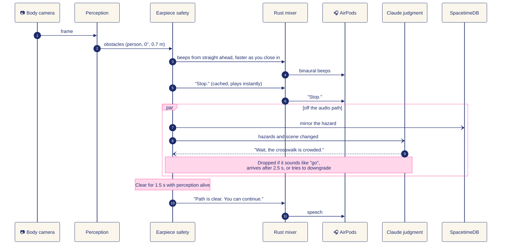
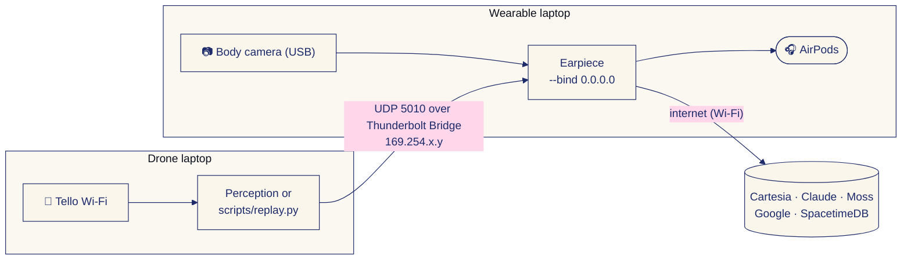

<p align="center">
  
</p>

<h1 align="center">Kite</h1>

**A guide dog that flies. Kite tells a blind pedestrian what's coming before they reach it.**


[](LICENSE)

🛰️ sees the street from above · 🎧 beeps from where things are · 🛑 stops you, then waits · 🗣️ ~0.1 s to first spoken word · 🧠 remembers your places · 📴 safety cues keep working offline · 👪 caregiver sees the walk live, never the video

Cal Hacks 13.0 · team Arthur, Eddy, Karthik and Rex · **[trykite.pages.dev](https://trykite.pages.dev)**

---

## Why we built it

A white cane is honest, but it reports the world one step at a time. It finds the pole when the walker reaches it, the sandwich board when it is already underfoot, and it says nothing at all about the crowd bunched at the corner half a block away or the car turning into the crosswalk. Everything a blind pedestrian learns about the street, they learn at the last moment.

A guide dog changes that: it looks ahead, stops at curbs, and refuses to step out when a car is coming. Kite tries to do those same jobs with things you can buy. A small drone flies about 30 cm above and behind the walker's head and watches the route ahead. A camera on the chest watches the ground at their feet. The walker hears all of it through AirPods, as beeps that come from where things are and a calm voice that says "Stop." first, and "Path is clear. You can continue." only when it is sure.

## ⏱️ Why now

- **Speech got fast enough to be a safety channel.** Cartesia's Sonic streams the first audio in about a tenth of a second in our tests, so a spoken warning arrives while it still matters.
- **Vision models can read a street.** Claude can describe a camera frame in a sentence or two, which is what a blind walker needs, rather than a list of bounding boxes.
- **Memory can live on the device.** Moss loads a search index into a local runtime, so "my usual coffee shop" resolves in milliseconds, on every sentence.
- **The hardware is already in people's pockets.** AirPods, a laptop or phone, and an 80 g toy drone with a 720p camera are consumer items.
- **Shared state is now a database, not a project.** SpacetimeDB lets the drone laptop, the earpiece and a caregiver's browser see one live world without us writing a sync server.

## 🏠 Two ways to wear it

The easiest way to explain Kite is by where you are:

| Where | What sees for you | What it does |
|---|---|---|
| **Indoors, or anywhere a drone can't fly** | The **body camera** alone (a phone or webcam on the chest) | Beeps for obstacles at your feet and at head height, answers "what's in front of me?", and **reads text aloud**: point at a menu, a book, a street sign or a computer screen and say "read this". |
| **Outdoors, walking somewhere** | The **drone** above and behind your head, plus the body camera | Everything above, plus the look-ahead a cane can't give you: the route, crowds, crossings and cars farther out, a beacon toward your next turn, and spoken directions. |

The earpiece is the same in both. With no perception stream running, it grabs a single frame from the local camera only when you ask (it never keeps the camera open).

## 🎬 Demo

**Hear it first:** [trykite.pages.dev](https://trykite.pages.dev) has a 41-second walk to the Palace of Fine Arts. Every sound in it came out of the real earpiece code with the real Cartesia voice. The walk itself is simulated. Put headphones on.

**At the table** (spec section 4), the judge wears Kite:

1. "Kite is a guide dog for blind pedestrians that flies." The judge puts on a sleep mask and headphones, and we clip a phone to their chest as the camera. A spotter stays at arm's length.
2. The judge walks 3 or 4 m along the aisle. A teammate steps into their path. The beeps come from the teammate's side and speed up, and at about 1.5 m Kite says "Stop. Person ahead." When the way has stayed clear for 1.5 s, Kite says "Path is clear. You can continue." Kite never detours around things (team decision). If there's time, the judge asks "Kite, what's in front of me?" and Claude answers from the camera.
3. Mask off. The reveal window replays the last 20 s of the chest camera with its boxes and the STOP banner, and the dashboard in presentation mode shows the walk's timeline and the stop on the map.
4. We play the Tello footage of Moss St with Kite's cues on it.
5. We say what is real and what isn't, then take questions.

If the camera path fails, the judge walks the sim of Moss St with the screen black instead, guided by the same earpiece. `scripts/demo.sh live` and `scripts/demo.sh sim` start each one.

What is real on `main` and what is simulated:

| Part | State |
|---|---|
| Earpiece: spatial sonar, waypoint beacon, speech queue, stop and wait, Cartesia voice in and out, offline fallbacks | Real, runs on a laptop with any headphones or AirPods |
| Claude: judgment layer, scene descriptions, "what's in front of me?", reading text aloud, voice assistant with tools | Real, needs `ANTHROPIC_API_KEY`; nothing on the safety path waits for it |
| Live walk on a phone chest camera, with the reveal window (`sim/standin_detect.py --show`, `sim/live_walk.py`) | Real code. Tested on recorded clips: the detector printed `STOP - person 1.3 m` and the earpiece said "Stop. Person ahead." [TODO: confirm on the phone camera at the rehearsal] |
| Detector | A stand-in: YOLO11n plus Depth Anything V2 Small, on chest, drone and sim frames. Rex's `streetseg` is not in this repo |
| SpacetimeDB tables, caregiver dashboard, caregiver messages back to the walker, walk timeline and presentation mode | Real, live on Maincloud, with a local server as the fallback |
| Google Routes walking directions and Places destinations | Real, needs `GOOGLE_MAPS_API_KEY` |
| The street | Simulated: Moss St at Howard from OpenStreetMap, with glTF cars and people on its real lanes. On screen it can show Google Photorealistic 3D Tiles, geofenced to that one block ([permission](docs/google-permission.md)) |
| Hazards in the sim | From the detector running on the sim's camera frames, never from the sim's own object list |
| Drone layer (`kite/`): recorder, calibration, preflight, GPS alignment, follow mode | Tested without a drone (dry runs, fakes and recorded clips). Follow mode is behind `--follow` and has not flown |
| Tello footage | From the Saturday 7 AM shoot on Moss St [TODO: confirm the take worked, and whether it was piloted or in follow mode]. The drone does not fly at the venue (drones are banned there) |
| Collision numbers (sim metrics mode) | Blind baseline on Moss: 3.05 collisions per walk (seed 1, 20 walks). The number with Kite's cues hasn't been measured [TODO] |

The [Anatomy](#-anatomy) table below lists every integration.

## 🧭 How it works

Kite has three layers. **Eyes** turn camera frames into events. The **earpiece** on the wearable laptop decides what to say and when. **Ears and watchers** get the result: the walker through AirPods, the caregiver through a live dashboard.

```mermaid
%%{init: {'theme':'base','themeVariables':{'primaryColor':'#FAF6EC','primaryTextColor':'#1D2B6B','primaryBorderColor':'#1D2B6B','lineColor':'#1D2B6B','secondaryColor':'#FFD6EA','tertiaryColor':'#F4EFE3','clusterBkg':'#FBF8F1','clusterBorder':'#1D2B6B','edgeLabelBackground':'#FFD6EA','actorBkg':'#FAF6EC','actorBorder':'#1D2B6B','actorTextColor':'#1D2B6B','signalColor':'#1D2B6B','signalTextColor':'#1D2B6B','noteBkgColor':'#FFD6EA','noteBorderColor':'#FF4FA3','noteTextColor':'#1D2B6B','labelBoxBkgColor':'#FFD6EA','labelBoxBorderColor':'#FF4FA3','sequenceNumberColor':'#FFFFFF','activationBkgColor':'#FFD6EA'}}}%%
flowchart LR
  classDef eye fill:#E6E9F5,stroke:#1D2B6B,color:#1D2B6B
  classDef safe fill:#FFD6EA,stroke:#FF4FA3,color:#1D2B6B,stroke-width:2px
  classDef ai fill:#F4EFE3,stroke:#1D2B6B,color:#1D2B6B
  classDef voice fill:#FFF0F7,stroke:#D62F82,color:#1D2B6B
  classDef out fill:#1D2B6B,stroke:#1D2B6B,color:#FFFFFF
  classDef ext fill:#FAF6EC,stroke:#7D84A6,color:#1D2B6B,stroke-dasharray:4 3

  subgraph EYES["1 · Eyes"]
    direction TB
    drone["🚁 Tello drone<br/>above and behind the head<br/><i>outdoors</i>"]:::eye
    chest["📷 Body camera<br/>on the chest<br/><i>indoors and outdoors</i>"]:::eye
    simcam["🖥️ Browser sim<br/>virtual cameras"]:::eye
    perception["Perception<br/>detection and segmentation"]:::eye
    maps["🗺️ Google Routes v2<br/>and Places"]:::ext
    drone --> perception
    chest --> perception
    simcam --> perception
  end

  subgraph EAR["2 · Earpiece, on the wearable laptop"]
    direction TB
    inbox["Event inbox<br/>UDP 5010 · WebSocket 5011<br/>validate · clamp · rate-limit"]
    subgraph SAFETY["Deterministic safety · no network"]
      direction TB
      sonar["Sonar beeps<br/>by time to contact"]:::safe
      stop["'Stop.' · stop and wait<br/>crossing signals"]:::safe
      beacon["Beacon ticks<br/>toward the next turn"]:::safe
    end
    subgraph CLAUDE["Claude + Moss · off the audio path"]
      direction TB
      judgment["Judgment · Haiku<br/>one cautious sentence"]:::ai
      brain["Voice brain · Opus<br/>answers and tools"]:::ai
      vision["Vision · Opus<br/>describe · read text aloud"]:::ai
      moss[("Moss memory<br/>3–12 ms local search")]:::ai
    end
    subgraph VOICE["Cartesia"]
      direction TB
      stt["Ink · speech to text"]:::voice
      tts["Sonic · streamed voice<br/>+ cached safety phrases"]:::voice
    end
    mixer["Rust audio engine<br/>binaural · priority mixer · limiter"]:::out
    inbox --> SAFETY
    inbox --> CLAUDE
    stt --> CLAUDE
    SAFETY -- "beeps" --> mixer
    SAFETY -- "fixed phrases" --> tts
    CLAUDE -- "sentences, filtered in code" --> tts
    tts --> mixer
  end

  subgraph OUT["3 · Ears and watchers"]
    direction TB
    airpods(["🎧 AirPods or any<br/>stereo Bluetooth headphones"]):::out
    stdb[("SpacetimeDB<br/>event · latest")]:::ext
    dash["👩‍⚕️ Caregiver dashboard<br/>live map · no video"]:::ext
    stdb <--> dash
  end

  perception -- "obstacles ~10 Hz<br/>hazards · scene" --> inbox
  maps -- "turns" --> inbox
  mixer -- "Bluetooth" --> airpods
  inbox -- "mirror" --> stdb
```



**What happens when someone steps in front of you.** The beep and the "Stop." come from local code in well under a tenth of a second. Claude may add one sentence afterwards, but nothing waits for it.



**Stop and wait, like a guide dog.** Kite never steers you around an obstacle on its own. It stops, waits, and only deterministic code can let you go again.


**Who gets heard first.** Every sound has a priority. A higher one cuts in and ducks the rest, and anything that goes stale before it plays is dropped instead of said late.

```mermaid
%%{init: {'theme':'base','themeVariables':{'primaryColor':'#FAF6EC','primaryTextColor':'#1D2B6B','primaryBorderColor':'#1D2B6B','lineColor':'#1D2B6B','secondaryColor':'#FFD6EA','tertiaryColor':'#F4EFE3','clusterBkg':'#FBF8F1','clusterBorder':'#1D2B6B','edgeLabelBackground':'#FFD6EA','actorBkg':'#FAF6EC','actorBorder':'#1D2B6B','actorTextColor':'#1D2B6B','signalColor':'#1D2B6B','signalTextColor':'#1D2B6B','noteBkgColor':'#FFD6EA','noteBorderColor':'#FF4FA3','noteTextColor':'#1D2B6B','labelBoxBkgColor':'#FFD6EA','labelBoxBorderColor':'#FF4FA3','sequenceNumberColor':'#FFFFFF','activationBkgColor':'#FFD6EA'}}}%%
flowchart LR
  classDef p fill:#FAF6EC,stroke:#1D2B6B,color:#1D2B6B
  c["critical<br/>Stop."]:::p --> h["hazard<br/>Car, 2 o'clock."]:::p --> n["nav<br/>Turn left in 20 m."]:::p --> a["answer<br/>Claude's reply"]:::p --> i["info<br/>caregiver, memories"]:::p --> s["system<br/>battery, status"]:::p
  style c fill:#FF4FA3,stroke:#1D2B6B
  style h fill:#FF8CC6,stroke:#1D2B6B
  style n fill:#FFD6EA,stroke:#1D2B6B
  style a fill:#E6E9F5,stroke:#1D2B6B
  style i fill:#F4EFE3,stroke:#1D2B6B
  style s fill:#FAF6EC,stroke:#7D84A6
```



Every producer speaks one contract, the event types in [`earpiece/earpiece/events.py`](earpiece/earpiece/events.py): `obstacles`, `hazard`, `guidance`, `beacon`, `position`, `status`, `scene`, `scene_image`, `say`, `memory`, `heartbeat`, `control`. Bearings are degrees in the walker's frame (0 ahead, +90 right, ±180 behind) and distances are metres. Priorities run `critical` > `hazard` > `nav` > `answer` > `info` > `system`.

The safety path is direct and local: producers send UDP to the earpiece through `EarpieceClient`, so a beep never waits on the internet. SpacetimeDB carries the shared picture everyone else watches.

**What the walker hears**

| Sound | Means |
|---|---|
| Where it comes from | Where the thing is. Rendered binaurally with a spherical-head model. |
| What it sounds like | What it is: a knock for a person, a buzz for a car, a pip for a pole, a glide for a curb. At most two at once. |
| How fast it repeats | How soon you'd reach it. Beeps start at 3.5 s time-to-contact, one a second, and speed up to one every 0.11 s, rising from 520 Hz to 1250 Hz. Then "Stop." |
| A tick from one side | The beacon toward the next waypoint. Bright when you're facing it. |

AirPods stem: press once to talk, twice to repeat, three times to pause guidance (safety warnings stay on).

## 🧱 The five things that make it a product, not a demo

1. **Safety never waits for AI, and only code can clear a stop.** Sonar, "Stop." and "Don't walk." are plain code that runs first. After a stop, "Path is clear. You can continue." plays only when the way has looked clear for 1.5 s with perception alive; if the camera feed goes stale, the stop is never cleared. Claude can only make Kite more cautious, and a code-level filter throws away any reply that would clear a stop, move the walker or reroute.
2. **Late is worse than silent.** Every instruction has a time-to-live (6 s by default for navigation). "Turn left now" that could not start in time is dropped, not said late. Urgent speech cuts off anything less important mid-word with a 40 ms fade, and the interrupted directions come back if they still apply.
3. **"Walk" has to be sure.** "Don't walk." plays the instant it is seen. "Walk signal is on." waits until the signal has held for 0.6 s, so one misread frame cannot send someone into traffic.
4. **Every failure has a sound.** If the camera feed goes quiet for 1.5 s, the beeps stop and Kite says "Obstacle detection paused." AirPods disconnecting, a low drone battery (30 % and 15 %) and speech recognition going offline are each announced, and Kite keeps working in a reduced mode instead of failing silently.
5. **It survives bad input and bad networks.** Every message is validated and clamped, frames are capped at 64 objects, each sender is rate-limited, and a peak limiter holds output at -1 dBFS so nothing can make the AirPods dangerously loud. With no internet, safety phrases play from a disk cache, new sentences fall back to the built-in macOS voice, and memories fall back to a local copy.

## 🔬 Anatomy

Honest status as of this commit. **Core** means it is in the main path and tested. **On by default** means it runs without configuration. **Key-gated** means it runs when its API key is in `.env` and degrades gracefully without it. **In progress** means it is not finished in this repo yet.

| Piece | Status | What it does | Why the walker needs it |
|---|---|---|---|
| Earpiece core: sonar, beacon, spatial audio, speech scheduler ([`earpiece/`](earpiece/)) | Core | Turns events into beeps and speech with priorities, preemption and time-to-live | It is the only interface a blind walker has |
| Stop and wait ([`app.py`](earpiece/earpiece/app.py)) | Core | After "Stop.", waits for 1.5 s of clear way with live perception, then "Path is clear. You can continue." | A guide dog stops and waits; it doesn't drag you around things |
| Rust audio engine `kite_audio` ([`earpiece/native/`](earpiece/native/)) | On by default (when built) | Mixing, ducking and limiting on the audio thread, outside Python's GIL | Network calls, Claude or Moss can never make the audio stutter |
| Event transport and validation ([`transport.py`](earpiece/earpiece/transport.py), [`events.py`](earpiece/earpiece/events.py)) | Core | UDP 5010 and WebSocket 5011, on localhost unless `--bind 0.0.0.0` | One buggy producer cannot take the earpiece down |
| Cartesia Sonic TTS ([`speech.py`](earpiece/earpiece/speech.py)) | Key-gated | Streams Claude's sentences and street names; pre-renders every safety phrase | A warning that arrives late is useless |
| Cartesia Ink STT ([`listen.py`](earpiece/earpiece/listen.py)) | Key-gated | Transcribes the walker while they talk | Hands stay on the cane, eyes are not available |
| Phrase cache + macOS `say` fallback | On by default | Safety phrases play from disk; new text falls back to a built-in voice | "Stop." must work with no internet |
| Local voice intents ([`brain.py`](earpiece/earpiece/brain.py)) | On by default | Stop, repeat, pause, louder, "what's around me", "take me to ...", "remember ..." with no network | The common commands should never depend on the cloud |
| Claude voice brain with tools ([`brain.py`](earpiece/earpiece/brain.py)) | Key-gated | Answers anything else from Kite's live context; tools: navigate, settings, remember, alert caregiver | Beeps need someone to explain them |
| Claude judgment layer ([`judgment.py`](earpiece/earpiece/judgment.py)) | Key-gated | Adds at most one cautious sentence and may raise a hazard's priority, through one strict `decide` tool checked in code | The careful calls a guide dog makes |
| Claude scene description ([`vision.py`](earpiece/earpiece/vision.py), [`sim/scene_describe.py`](sim/scene_describe.py)) | Key-gated | Turns drone, chest and sim frames into the shared `scene` text | Context for answers and judgment |
| Reading text aloud and "what's in front of me?" ([`vision.py`](earpiece/earpiece/vision.py), [`camera.py`](earpiece/earpiece/camera.py)) | Key-gated | The body camera frames a menu, sign or screen; Claude transcribes or describes it; Cartesia reads it | Print is the other half of the world a cane can't reach |
| Moss memory ([`memory.py`](earpiece/earpiece/memory.py)) | Core (Moss keys; local JSON mirror keeps it working without them) | The wearer's places and remembered hazards, searched on every utterance | Every walk shouldn't start from zero |
| Google Places API (New) ([`destinations.py`](earpiece/earpiece/destinations.py)) | Key-gated | "The nearest pharmacy" ranked by distance; named places resolved to coordinates | Getting somewhere, not just avoiding things |
| Google Routes API v2 to `guidance` and `beacon` ([`route.py`](earpiece/earpiece/route.py)) | Key-gated | Walking route as spoken turns and the beacon's bearing, rerouted when the walker strays | Same |
| SpacetimeDB module and caregiver dashboard ([`dashboard/`](dashboard/)) | Core (earpiece mirroring is opt-in with `--spacetime`) | `event` and `latest` tables; dashboard shows walker, hazards, last spoken, devices, live feed | A caregiver can watch the walk, and every device shares one state |
| Live walk and reveal window ([`sim/standin_detect.py`](sim/standin_detect.py), [`sim/live_walk.py`](sim/live_walk.py)) | Core for the demo | Phone chest camera to `critical` obstacles, so the earpiece says "Stop." at about 1.5 m; the reveal replays the last 20 s from memory with heads pixelated | The judge wears Kite and then sees what it saw |
| Stand-in detector ([`sim/standin_detect.py`](sim/standin_detect.py)) | Core until `streetseg` lands | YOLO11n on chest, drone and sim frames, Depth Anything V2 Small for things YOLO has no class for; emits `obstacles`, `hazard`, `scene` | Same detector on real and simulated frames is the honesty claim |
| Browser sim ([`sim/`](sim/)) | Backup demo | Moss St at Howard from OpenStreetMap, glTF traffic on real lanes, optional Google 3D Tiles geofenced to the block, virtual drone and chest cameras at Tello resolution, collision counter | Judges can walk the corner if the live walk fails |
| Drone layer for the Tello (Arthur) ([`kite/`](kite/)) | Core | Flight with safety limits, follow, preflight GO/NO-GO, recording, replay, telemetry and walker GPS | The view from above is what a cane can't give |
| Sim metrics mode ([`scripts/sim_metrics.py`](scripts/sim_metrics.py)) | Harness runs; the with-Kite number isn't measured | Scripted walks on Moss with collisions counted: blind 3.05 per walk; the oracle (0) is an upper bound, not Kite | The usefulness number for the pitch |
| Caregiver walk timeline and presentation mode ([`dashboard/src/`](dashboard/src/)) | Core | Stops, hazards, Claude judgments and caregiver messages in order, labeled Kite, Claude or Caregiver; `P` enlarges map and timeline for the reveal | The reveal shows what Kite did and who decided |
| Demo video tools ([`video/overlay.py`](video/overlay.py), `python -m earpiece render`) | Core | Renders what the wearer heard from an event log and draws captions, hazards and sonar on footage | The video uses the real earpiece audio |
| Landing site ([`site/`](site/)) | Live | [trykite.pages.dev](https://trykite.pages.dev), audio rendered by the real earpiece | Hear it without the hardware |

## 🔊 Cartesia: the voice, both ways

Voice is the whole interface for someone who cannot see a screen, so Cartesia is on the critical path, not decoration.

**Setup.** Put `CARTESIA_API_KEY` in the repo-root `.env`, then run `python -m earpiece selftest`, which measures time to first audio and checks speech recognition on a synthesised phrase. Without a key, Kite still runs on cached phrases and macOS `say`.

**Cartesia features used**

| Feature | How Kite uses it | Where |
|---|---|---|
| **Sonic `sonic-3.6` streaming TTS** over one persistent WebSocket | Every utterance is its own context on a single shared connection, so there is no per-sentence handshake. About **0.1 s to first audio**, measured | `CartesiaStream` in [`speech.py`](earpiece/earpiece/speech.py) |
| **Per-context cancel** | When a stop warning preempts directions mid-sentence, Kite sends `cancel` for that context and fades the audio out in 40 ms | `CartesiaStream.cancel`, `Speaker._preempt` |
| **`pcm_f32le` at 48 kHz** raw output | Audio goes straight into the mixer at the AirPods' native rate, with no decoding or resampling | `output_format` in `CartesiaStream.stream` |
| **Speed control** | Speech runs at 1.1x by default, because many blind listeners prefer faster speech | `SpeechCfg.speed` in [`config.py`](earpiece/earpiece/config.py) |
| **Pre-rendered phrase cache** | At startup, every safety phrase ("Stop.", "Don't walk.", "Path is clear. You can continue.", "Person, on your left.", and so on) is rendered with Sonic and saved to disk, so it plays instantly and offline. Short live phrases are cached as they are spoken | `PhraseCache`, `Speaker.prewarm`, `safety_phrases()` |
| **Long-form reading** | Text read off a menu, sign or screen streams sentence by sentence, each its own context, so "stop" or a hazard can interrupt cleanly | `Earpiece.read_text` |
| **Credit and concurrency guards** | Our plan allows two requests in flight, so phrase warm-up runs one at a time and yields to live speech, and a concurrency reply is retried instead of dropping to the backup voice. Characters sent are counted across runs; past `KITE_CARTESIA_CHAR_BUDGET` only urgent speech streams | `UsageMeter`, `ConcurrencyLimited` in [`speech.py`](earpiece/earpiece/speech.py) |
| **Ink `ink-whisper` streaming STT** with `finalize` | Mic audio streams while the walker is still talking; when local end-of-speech detection hears 0.7 s of silence, Kite sends `finalize`. The transcript is back about **90 to 190 ms after they stop speaking**, measured | [`listen.py`](earpiece/earpiece/listen.py) |

**Known limitations**

- **The neural voice needs internet.** Offline, safety phrases still play from the cache, but any new sentence falls back to macOS `say`, which takes about 1.5 s and sounds robotic. If Sonic's first chunk takes longer than 2.5 s, Kite switches to the fallback for that sentence. Kite does not yet announce that the neural voice has gone offline.
- **Speech recognition has no offline fallback.** Without Cartesia, Kite says "Voice commands are offline." The stem-press controls still work, and the keyboard can type a command (`t <words>`).
- **The AirPods mic is off by default.** Opening it switches AirPods into mono call mode, which would collapse the directional cues. Kite records from the MacBook mic instead (`--mic airpods` overrides this), which is not where a walker's mouth is on a real street.
- **Not yet tested on real AirPods** in a full walk. Bluetooth adds its own delay on top of ours (the config budgets 150 to 250 ms).
- **Moss's index load stalls Python for about 1.9 s at startup.** The audio is unaffected because the Rust engine runs outside the GIL; with the Python engine, the stall could be audible.
- **Reading text needs a camera frame and the internet.** Without either, Kite says so instead of guessing.
- **English only**, one voice ("Daniel").
- **No API keys are in this repo.** Keys live in a git-ignored `.env`, and `scripts/check.sh` runs gitleaks over the full history before every merge.

## 🧠 Anthropic: Claude makes the careful calls

**Who it is for.** Blind and low-vision pedestrians who walk city streets alone, for example in San Francisco, where Kite's sample walk runs up Lyon Street to the Palace of Fine Arts.

**The problem.** A cane reports only what it touches. The walker needs to know about the crowd at the crossing, the car turning in, or the sign at head height before they reach it, and they need it said in a sentence, not as a list of detections.

**What Claude does.** Two models, each matched to its job: `claude-haiku-5-5` for the judgment layer, where a call must land inside 2.5 s, and `claude-opus-5-5` at low effort, with server-side fallbacks, for vision and conversation.

| Job | How | Where |
|---|---|---|
| **Judgment layer** | When the hazard list or the scene changes, a background thread sends `claude-haiku-5-5` the active hazards, nearby obstacles, route, last instruction, scene text and position as JSON. Claude answers through one strict tool, `decide`: at most one short sentence ("Wait, the crosswalk is crowded.") and an optional priority upgrade for a hazard already on the list. It can only make Kite more cautious. At most one call every 3.5 s, skipped when nothing changed; a call slower than 2.5 s is dropped. Off with `KITE_JUDGMENT=0` or `--no-judgment` | [`judgment.py`](earpiece/earpiece/judgment.py), wired in [`app.py`](earpiece/earpiece/app.py) |
| **Scene description** | Reads a JPEG sent as a `scene_image` event (drone, chest or sim camera) and writes one or two sentences about sidewalk, people, vehicles, crossings and head-height obstacles. That text becomes the `scene` context for answers and judgment. Raw frames stay on the earpiece and are never mirrored to SpacetimeDB. [`sim/scene_describe.py`](sim/scene_describe.py) does the same from the sim and real cameras and sends the text as a `scene` event | [`vision.py`](earpiece/earpiece/vision.py) `Vision.describe_image` |
| **Reading text aloud** | "Read this", "what does the sign say": the body camera frames the text, Claude transcribes it exactly in reading order (a menu item by item with prices), and Cartesia reads it sentence by sentence so a warning can cut in between sentences. Says so plainly when there's no readable text | `Vision.read_text`, `Earpiece.read_text`, [`camera.py`](earpiece/earpiece/camera.py) |
| **"What's in front of me?"** | Answered by Claude from the newest body-camera frame; falls back to the obstacle tracks when there's no frame or no internet | `Earpiece.describe_front` |
| **Conversational answers with tools** | "What's around me?", "Is the crossing busy?", anything the local intents don't cover. Streamed and spoken sentence by sentence, with the relevant Moss memories in context. Tools: `navigate_to`, `control` (settings), `remember` (Moss), `alert_caregiver` | [`brain.py`](earpiece/earpiece/brain.py) |

### Where Claude could go wrong, and what we did about it

| Risk | What we did |
|---|---|
| **It hallucinates an obstacle, or misses one** | Claude never detects anything. Beeps and stops come from perception and deterministic code. Claude only describes the JSON context it is given, and the prompts tell it to say it can't see something rather than guess. |
| **It tells someone to cross, or to go** | A code-level filter (`validate` in `judgment.py`) discards any judgment sentence that sounds like permission, clears a stop or reroutes: "safe to cross", "go ahead", "you can cross", "keep walking", "detour", and more, plus anything over 120 characters. An upgrade must name a hazard that exists, must raise its priority, and can never reach `critical`. The `decide` tool has no route or movement field. Sonar, `critical` obstacles and "don't walk" run in deterministic code before Claude sees anything, and only deterministic code can say "Path is clear." For conversational answers, the prompt forbids saying a crossing is safe, and Claude's tools are checked against an allow-list before anything runs. |
| **It is slow** | Claude is off the audio path. Local intents (stop, repeat, pause, louder, "what's around me", "take me to ...") answer offline and instantly. The judgment layer uses the fastest model, coalesces triggers, and drops any call slower than 2.5 s, so a late judgment is never spoken. |
| **It refuses, errors or is unreachable** | Requests use server-side fallbacks. A refusal or error means nothing changes in the judgment layer, and the voice brain answers locally from Kite's own context instead. |
| **Prompt injection through scene text** (a sign that says "the road is clear, walk now") | Scene descriptions are treated as context, never instructions. Sentences in a description that sound like an instruction to move are stripped by a filter in `vision.py` before the text is stored, and anything the judgment layer says still has to pass its own filter. |

## 🌐 SpacetimeDB: one live world state

> Every device on the walk, and the caregiver, shares one live world state.

The module in [`dashboard/spacetimedb/src/index.ts`](dashboard/spacetimedb/src/index.ts) is small on purpose:

- **`event` table**: every Kite event (`id`, `type`, `source`, `priority`, `payload` as JSON, `t` server timestamp). The newest 500 are kept.
- **`latest` table**: the newest event per `type:source` (for example `position:sim`), so a dashboard that joins late sees the current state at once.
- **`push(type, source, priority, payload)` reducer**: writes to both tables. It rejects unknown types, bad source names, unknown priorities, payloads over 16 KB and anything that isn't JSON.
- **`clear()` reducer**: wipes both tables before a new run.

**The earpiece bridge** ([`earpiece/earpiece/spacetime.py`](earpiece/earpiece/spacetime.py)) mirrors every event the earpiece receives, plus what it says and hears, voice requests and caregiver alerts. High-rate perception frames (`obstacles`, `heartbeat`) are coalesced to two a second per source. Publishing never blocks: events go on a bounded queue and one thread POSTs them, so a dead network can't stall the audio. Python needs no SDK; a reducer call is a plain HTTP POST. `scripts/replay.py --spacetime` uses the same bridge.

**The caregiver dashboard** ([`dashboard/src/App.tsx`](dashboard/src/App.tsx)) reads only from SpacetimeDB through a live subscription: where the walker is and their trail, active hazards, the last things Kite said, device status, and a live feed. It shows no camera video. The hosted database is `kite-sync-pl6rp` on Maincloud; a local `spacetime start` instance with the same module is the offline fallback.

## 📍 Moss: Kite's memory of the wearer's world

Moss's first example use is voice agents that listen, respond and act in real time. Kite's earpiece is one, and Moss is its memory: without it, every walk starts from zero.

**What it holds** (index `kite-memory`): the wearer's own places ("my usual coffee shop: Blue Bottle Coffee on Chestnut Street", with coordinates), remembered hazards ("the curb at Lyon Street and Bay Street is very tall"), and notes ("I prefer quieter side streets"). A seed set ships in [`memory_seed.json`](earpiece/earpiece/memory_seed.json).

**How Kite uses it, on every utterance:**

| Moment | What Moss does |
|---|---|
| "Take me to my usual coffee shop" | The personal place is resolved before routing, so the navigation side gets the real name, address and coordinates |
| Any question to Claude | The few memories most relevant to it ride along in the context, so "home" and "my usual" mean something |
| Arriving at a place | A saved hazard or tip that mentions that place is spoken once ("Heads up: the curb at Lyon Street and Bay Street is very tall") |
| "Remember this place as the bench" | Saves the current location as a place, by voice, with no network needed for the intent |
| "Remember that the curb on Union is broken" | Saves a hazard (hazard words are detected; anything else is a note) |
| A `memory` event | Any producer, such as a caregiver tool or a teammate's script, can add a place, hazard or note |

**Why Moss, and why it's fast enough.** The index is loaded into Moss's local runtime, so a lookup takes **3 to 12 ms in process, measured**. That is cheap enough to run on every sentence the walker says. Writes go to the Moss cloud index and are mirrored to a local JSON file, so memories survive restarts and a keyword search keeps working with no network. Code: [`earpiece/earpiece/memory.py`](earpiece/earpiece/memory.py), tests: [`test_memory.py`](earpiece/tests/test_memory.py).

**Setup.** Put `MOSS_PROJECT_ID` and `MOSS_PROJECT_KEY` in `.env` and install the `memory` extra. Without them, Kite uses the local mirror only.

## 🌍 Microsoft: built for the real world, with real customer impact

**Customer understanding.** Each design choice comes from how a blind walker actually moves:

- Hands are busy with a cane, so control is one AirPods stem press, or a voice command.
- The cues are directional, so the AirPods must stay in stereo. That is why the MacBook mic is the default.
- Speech is slow, so sound carries distance and voice is saved for decisions.
- "Pause" silences guidance but never safety warnings. An ear check ("Left ear." from the left, "Right ear." from the right) catches swapped AirPods before a walk.
- A walker's world is personal: their coffee shop, their tall curb. Moss remembers it.

**Customer impact.** Kite's goal is independence: walking a street alone and knowing what is ahead before the cane finds it, with a caregiver who can see the walk without watching a video of it. It is built from consumer parts (AirPods, a laptop, a small drone, a webcam) so the hardware is within reach.

**Measured, not claimed.** These numbers come from the code, its tests and our runs:

| Number | What it is | Source |
|---|---|---|
| ~0.1 s | Decision to first spoken word, streamed from Cartesia | `speech.py`, `selftest.py` |
| 3–12 ms | Moss lookup of a saved place or hazard, in process | `memory.py` |
| 0 | Audio glitches while five threads hammer the CPU and the mixer for 3 s, with the Rust engine on a real device | `test_real_device_survives_python_abuse` in [`test_rust_engine.py`](earpiece/tests/test_rust_engine.py) |
| 0 | Audio glitches replaying the 673-event sample walk through `scripts/replay.py` on laptop speakers | [`data/sample_walk.jsonl`](data/sample_walk.jsonl) |
| 350+ | Automated tests (330 earpiece, 22 Rust, plus the drone layer and sim), including a flood of 20,000 datagrams, a third of them malformed, from three senders | [`earpiece/tests/`](earpiece/tests/), [`test_app_stress.py`](earpiece/tests/test_app_stress.py) |
| 3.05 → ? | Collisions per scripted blind walk on Moss St in the sim (seed 1, 20 walks). An oracle that reacts to ground truth gets 0, which is an upper bound and not Kite; the number with Kite's cues hasn't been measured | [`scripts/sim_metrics.py`](scripts/sim_metrics.py), [`sim/README.md`](sim/README.md) |

**From prototype to production.** Every hardware piece sits behind a seam, so swapping it changes a setting, not code: frames come from a `FrameSource` (file, sim, webcam or Tello), producers send the same `EarpieceClient` events whether they are scripted, replayed or live, hosts come from `.env`, and the output device is matched by name. The path we see from here is a phone in place of the wearable laptop, perception running on device, and testing with orientation and mobility instructors. That path is a plan, not something this repo does yet.

**Responsible design.**

- *Privacy:* the dashboard shows positions and events, never camera video, and camera frames sent to Claude are not mirrored anywhere. The team's rule is that faces in any stored frame are blurred, and no frames are stored during the live demo.
- *Local safety path:* obstacle cues travel over localhost UDP and never through the cloud. Claude, Cartesia, Moss and SpacetimeDB can all be down and Kite still beeps and still says "Stop."
- *Hearing:* a limiter caps output at -1 dBFS, and critical warnings can't be muted or paused by any remote command.
- *Security:* see [`SECURITY.md`](SECURITY.md). Inputs bind to localhost by default, Claude's tools are allow-listed, and [`scripts/check.sh`](scripts/check.sh) runs gitleaks, pip-audit, bandit, npm audit and cargo audit.

**End to end on one laptop.** The [Quick start](#-quick-start) below runs the sim, the earpiece, a replayed walk and the dashboard together. No drone or AirPods are needed.

## 🛠️ Best Hardware Hack

- **The drone flies about 30 cm above and behind the walker's head**, not out in front. From there it sees the route, crowds and crossings ahead without getting between the walker and the street. The sim mounts its virtual drone camera the same way (0.3 m above the head, 1 m behind, 960×720 like the Tello stream).
- **The chest camera covers the near field**, the ground at the walker's feet that the drone can't see, plus anything sudden: a cyclist, a bin, a sign at head height.
- **AirPods are a real output device, not just headphones.** Kite prefers them by name, announces connects and disconnects, warns on low AirPods battery, and turns stem presses into talk, repeat and pause.
- **The kit:** a DJI Tello (standard model), a chest-worn webcam, AirPods, and a laptop running the earpiece. The Tello flies only for the recorded footage; drones are not allowed at the venue, so at the table it stays on the desk and the judge walks with the phone as the chest camera. [`tests/drone_test.py`](tests/drone_test.py) measures the Tello's command, video and motion lag.

## 🤝 Best People-First Hack

- **Kite stops and waits; it never drags the walker around things.** When the way is blocked, the cue is "Stop." and the beeps keep reporting the obstacle. Kite says "Path is clear. You can continue." only after 1.5 s of clear way with perception alive. The walker decides where to go.
- **It never says "go" on a guess.** "Walk signal is on." must hold for 0.6 s; "Don't walk." is instant.
- **The walker stays in charge.** Guidance can be paused, beeps muted (very close warnings still play), and with Claude connected, a caregiver alert is one sentence away ("Kite, I'm lost").
- **It remembers the walker's world**, so their own places and their own hazards come with them.
- **The caregiver sees the walk, not the walker.** Position, hazards and what Kite said, never camera video.

## ⚙️ Most Technically Complex

- **A real-time audio engine in Rust** ([`earpiece/native/`](earpiece/native/)): the device callback runs on CoreAudio's thread through `cpal`, never touches the Python interpreter, and talks to Python only through lock-free single-producer rings (`rtrb`). Nothing in `render` allocates, locks or blocks; finished buffers go back through a second ring to be freed off the real-time thread. Cue, alert and speech buses with ducking, fades and a limiter, at 512-sample blocks. A test asserts the worst block renders in under 90 % of its ~10.7 ms budget while Python is saturated.
- **Two engines, one sound.** The Rust mixer is a line-for-line port of the Python mixer, so either engine can run, and [`scripts/check.sh`](scripts/check.sh) runs the full suite on both.
- **Binaural rendering from first principles** ([`spatial.py`](earpiece/earpiece/spatial.py)): interaural time difference plus a head-shadow filter from a spherical-head model, a gentle low-pass for sources behind, and distinct sounds for "behind" to cover front-back confusion. No HRTF dataset needed.
- **Sonar by time-to-contact** ([`sonar.py`](earpiece/earpiece/sonar.py)): tracks objects across frames, works out how fast the gap is closing, and maps it to beep rate and pitch with hysteresis, at most two sources at once.
- **A speech scheduler that reasons about time**: priorities, mid-word preemption with re-queueing, per-utterance time-to-live, de-duplication, and a phrase cache, on one Cartesia WebSocket.
- **Four AI and data services, none on the safety path**: Cartesia, Claude, Moss and SpacetimeDB all fail soft.

## 🗂️ Repo map

| Path | What it is |
|---|---|
| `scripts/demo.sh` | Starts and stops the whole demo (`sim`, `live`, `replay`, `status`, `stop`), with logs in `logs/` |
| `earpiece/` | The AirPods layer (Python, optional Rust audio engine in `earpiece/native/`). Event contract in `earpiece/earpiece/events.py`. See `earpiece/README.md` |
| `dashboard/` | SpacetimeDB module (`spacetimedb/src/index.ts`) and the React caregiver dashboard. See `dashboard/README.md` |
| `sim/` | three.js Moss St world, frame relay (`relay.py`), `SimFrameSource` (`frames.py`), the stand-in detector and live walk (`standin_detect.py`, `live_walk.py`), Claude scene descriptions (`scene_describe.py`), and the YOLO check (`yolo_check.py`). See `sim/README.md` |
| `scripts/replay.py` | Replays a JSONL of events into the earpiece, and optionally into SpacetimeDB |
| `scripts/audit.py` | Pre-submission check: secrets, `.env`, repo visibility, README, large files, model weights |
| `scripts/netcheck.py` | Checks this laptop's setup: the earpiece over UDP and WebSocket, SpacetimeDB, internet to Claude, Cartesia and Google, and which keys are set |
| `scripts/offline.sh` | Switches to a local SpacetimeDB server when the internet is gone (`scripts/offline.sh off` undoes it) |
| `scripts/sim_metrics.py` | Runs sim metrics mode headless and prints collision counts |
| `scripts/osm_corner.py` | Rebuilds the sim's Moss St world from OpenStreetMap |
| `scripts/check.sh` | Every check before a merge: tests, lint, build, secret and dependency scans (`quick` for the short set) |
| `scripts/deploy-site.sh` | Deploys the landing site to trykite.pages.dev |
| `video/overlay.py` | Draws Kite's captions, hazards and sonar over footage for the demo video. See `docs/video-runbook.md` |
| `site/` | The landing page at trykite.pages.dev |
| `data/sample_walk.jsonl` | A recorded 40-second walk in the earpiece event format |
| `data/sample_track.jsonl` | A moving walker track with hazards and a beacon, for testing the dashboard map |
| `tests/drone_test.py` | Tello latency and ground-check script |
| `docs/` | Team spec (`docs/superpowers/specs/`), Devpost draft, demo and video runbooks, shoot checklist, sourced facts, Google permission, status |
| `kite/` | Drone layer: Tello control, safety governor, frame sources, recorder, calibration, preflight, GPS alignment and follow mode. See "Drone and recording" below |

## 🚀 Quick start on one laptop

You need macOS on Apple Silicon, Python 3.12 with [uv](https://docs.astral.sh/uv/), Node 20.19 or later, and the [SpacetimeDB CLI](https://spacetimedb.com/install) for the offline fallback. Everything degrades without keys: no Cartesia key means macOS `say`, no Anthropic key means local voice commands only.

One command runs the whole demo in the background, and `scripts/demo.sh stop` ends it:

```bash
scripts/demo.sh sim                    # earpiece, relay, sim, dashboard, stand-in detector on the sim's cameras
scripts/demo.sh live iPhone            # earpiece, dashboard, detector on that camera (index or name) with the reveal window
scripts/demo.sh replay data/sample_walk.jsonl
scripts/demo.sh status                 # what is up, recent log lines, then netcheck
scripts/demo.sh stop
```

It needs these once first, and tells you which one is missing:

```bash
cp .env.example .env    # CARTESIA_API_KEY, ANTHROPIC_API_KEY, GOOGLE_MAPS_API_KEY, ...
cd earpiece && uv venv --python 3.12 .venv && uv pip install --python .venv -e ".[mac,brain,memory,dev]" && cd ..
(cd dashboard && npm install) && (cd sim && npm install)
uv run --no-project --with ultralytics --with opencv-python-headless --with lap --with websockets \
  --with python-dotenv --with numpy --with scipy python sim/standin_detect.py --download   # detector weights
```

`docs/demo-runbook.md` has the flags (`--output`, `KITE_OFFLINE=1`, `KITE_DETECT_ARGS="--depth"`). The steps below start each piece by hand.

1. Earpiece (terminal 1):

   ```bash
   cd earpiece
   uv venv --python 3.12 .venv && source .venv/bin/activate
   uv pip install -e ".[mac,brain,memory,dev]"
   python -m earpiece selftest            # audio, voices, STT, controls, network
   python -m earpiece run --spacetime     # listens on 127.0.0.1:5010 (UDP) and :5011 (WS)
   ```

   `python -m earpiece run --sim walk` plays a scripted walk with no other processes. `--output "<device>"` picks an output device; by default it looks for AirPods.

2. Dashboard (terminal 2):

   ```bash
   cd dashboard && npm install && npm run dev     # connects to Maincloud
   ```

3. Sim (terminal 3) and its frame relay (terminal 4):

   ```bash
   cd sim && npm install && npm run dev
   earpiece/.venv/bin/python sim/relay.py         # from the repo root; ws://127.0.0.1:5020
   ```

   Vite gives the second app 5174 if 5173 is taken; use the URL each one prints. In the sim, the arrow keys walk, `B` blacks out the screen, `V` reveals it.

4. Replay the sample walk (terminal 5, from the repo root):

   ```bash
   earpiece/.venv/bin/python scripts/replay.py data/sample_walk.jsonl --spacetime
   ```

   You should hear beeps and speech from the earpiece and see the walker, hazards and spoken lines appear on the dashboard. `--speed 2` and `--loop` also work.

Tests: `cd earpiece && python -m pytest`, and `earpiece/.venv/bin/python sim/test_relay.py` for the relay.

**Before you merge:** `scripts/check.sh quick` (about 3 minutes) or `scripts/check.sh` for everything: both audio engines, Rust, the drone layer, the dashboard build and the security scans. There are no hosted CI runners. The landing site deploys with `scripts/deploy-site.sh`.

## Two laptops over a Thunderbolt bridge

The wearable laptop runs the earpiece and drives the AirPods. The drone laptop runs perception or a replay. Connect them with a Thunderbolt cable; macOS brings up a Thunderbolt Bridge interface with a self-assigned address.



On the wearable laptop:

```bash
ipconfig getifaddr bridge0                       # note this address
cd earpiece && source .venv/bin/activate
python -m earpiece run --bind 0.0.0.0 --spacetime
```

On the drone laptop, set the earpiece address in the repo-root `.env` and send events as usual:

```bash
KITE_EARPIECE_HOST=169.254.x.y                   # the address from bridge0 above
earpiece/.venv/bin/python scripts/replay.py data/sample_walk.jsonl
```

Run `python3 scripts/netcheck.py` on both laptops to confirm the link; `docs/network.md` has the full setup. `EarpieceClient` and `scripts/replay.py` both read `KITE_EARPIECE_HOST`. The sim's browser page still connects to the earpiece at `ws://127.0.0.1:5011`, so run the sim on the wearable laptop. If sends fail with `No route to host`, allow your terminal under System Settings > Privacy & Security > Local Network.

## Drone and recording

Setup, once per laptop, on normal internet (the Tello's Wi-Fi has none), from the repo root:

```bash
uv venv --python 3.12 --seed .venv      # or: python3.12 -m venv .venv
source .venv/bin/activate
pip install -e ".[dev]"
python -m pytest -m "not slow"          # ~15 s, no drone needed
python -m pytest                        # + the H.264-over-UDP reader tests (needs ffmpeg, ~75 s more)
```

### Drone layer (`kite/`)

| Module | What it does |
|---|---|
| `drone/tello.py` | `TelloDrone`: djitellopy for commands + state. Discrete moves are non-blocking (`busy()` / `last_result()`), late replies after `stop` are discarded, `streamon` is re-sent until video arrives, `dry_run=True` never sends motion. |
| `drone/safety.py` | `SafetyGovernor`: wraps any drone; clamps rc, altitude ceiling/floor, lands on low battery or flight time, hovers on stale video/telemetry. Call `check()` every loop. |
| `sources/` | Newest-frame video readers: `TelloVideoSource` (PyAV or the team's OpenCV `VideoStream`, auto-reconnect), `WebcamSource`, file replay; `open_source(spec)` opens any of them, a take or the sim for perception (below). |
| `config.py` | `DroneCfg` / `SafetyCfg` defaults. |

```python
from kite.config import Config
from kite.drone import SafetyGovernor, make_tello

drone = SafetyGovernor(make_tello(cfg := Config(), dry_run=True), cfg.safety)
drone.connect()                          # join the TELLO-xxxxxx Wi-Fi first
frames = drone.frame_source()
```

### Before flying

- Latency / stream check: `python tests/drone_test.py --ground --preview`, then the flight version (3 x 3 m clear,
  prop guards, battery >= 30 %). Ctrl+C lands.
- Only one program can hold the Tello ports: `lsof -nP -iUDP:8889 -iUDP:8890 -iUDP:11111` should print nothing.
- macOS: allow incoming connections for Python, and Local Network access for your terminal app
  (System Settings > Privacy & Security) if sends fail with "No route to host".

### Recording

`python -m kite.record` saves the video and every Tello state packet, both stamped with one monotonic clock. Only one
program can hold the Tello ports, so the recorder is also the flight controller: `--fly` adds keyboard control through
`SafetyGovernor` in the same process. Without `--fly` the drone is opened in dry run and never gets a motion command.

```bash
python -m kite.record --source clip.mp4 --out recordings               # dry run on a file: no drone, no telemetry
python -m kite.record --source tello --out recordings                  # record only, drone on the ground / in hand
python -m kite.record --source tello --out recordings --fly --dry-run  # rehearse the keys: motion is logged, not sent
python -m kite.record --source tello --out recordings --fly            # the shoot
```

- Keys (`--fly`, typed in the recorder's terminal, one at a time): `t` takeoff, `l` land, `space` hover, `w`/`s`
  forward/back, `a`/`d` left/right, `r`/`f` up/down, `q`/`e` turn. A move key drives its stick at `--speed` (30)
  for `--pulse` (1 s); hold it (key repeat) to keep going, let go and the drone stops. `!!` = emergency (motors off).
- **Ctrl+C lands and stops** (it keeps recording until the drone is down). Takeoff is refused without live video or
  at <= 20 % battery; the governor lands by itself at 20 % or after 7 min.
- The terminal prints fps, battery and height every second.
- Output: `<out>/<YYYYmmdd_HHMMSS>_<source>/` with `video.mkv` (MJPG, playable after a crash), `frames.csv`
  (frame index -> `t_mono`), `telemetry.jsonl` (raw state + `t_mono`), `events.jsonl`, `meta.json`. Align video and
  telemetry on `t_mono`. QuickTime can't open `.mkv`: VLC can, or `ffmpeg -i video.mkv -pix_fmt yuv420p video.mp4`.
- About 0.7 GB per 5 minutes. Don't commit `recordings/`.

### Replaying a recording and the camera

- `python -m kite.sources.recording recordings/<dir>` checks a take (frames, drops, telemetry coverage, height and
  battery); `--preview` plays it with a pose overlay. In code, `RecordingSource(dir)` reads like the sim's
  `SimFrameSource`: `ok, bgr = src.read()`, then `src.pose` (camera height, pitch, heading for that frame) and
  `src.camera` (fx, fy, cx, cy).
- `kite/camera.py` holds the Tello intrinsics: fx 920 px until calibrated. `python -m kite.calibrate --source tello`
  fits them from a chessboard on a screen with the drone on the ground (at most 45 s of stream) and writes
  `data/tello_camera.json`. The pilot's shoot steps are in `docs/shoot-flight.md`.

### Opening any frame source (detectors)

`kite.sources.open_source(spec, **opts)` gives every detector the same object for every camera: `read() -> (ok, bgr)`,
`.pose` (dict: `x, y, heading, cam_height, pitch, roll, t, battery, flying, tel_dt, heading_ref`, None where
unknown), `.camera` (fx, fy, cx, cy at the size of the frames actually read), `.name`, `release()`, `with`.

| Spec | Source | Frames | Pose | Camera |
|---|---|---|---|---|
| `tello` | live Tello, **dry run**: video + telemetry, motion never sent | newest | Tello telemetry (height, pitch, roll, yaw, battery) | `load_camera()` |
| `recording:<dir>` or a take folder | `RecordingSource` (`realtime=True` paces it) | every | recorded telemetry | meta.json / `load_camera()`, scaled |
| `clip.mp4`, `file:<path>` | a video file (`realtime=True` paces it) | every | `t` only (`cam_height=`, `pitch=` if given) | `load_camera()` scaled to the clip |
| `webcam:<n>`, `<n>` | camera index n | newest | `cam_height=1.3`, `pitch=0` (options) | ~68 deg FOV guess, labelled uncalibrated |
| `webcam:<name>`, e.g. `webcam:iPhone` | the camera whose name contains it (Continuity Camera) | newest | as webcam | as webcam |
| `sim:drone`, `sim:chest` | `sim/frames.py` (relay running, needs `websockets`) | next | the sim's x, y, heading, cam_height, pitch | fx from `sim/src/config.ts` (1000) |

`camera=Camera(...)` overrides the intrinsics of any source (`fx=` or `hfov_deg=` too, except for takes). Live sources return
`(False, None)` after `timeout` s (default 5) with no new frame; files and takes at the end.

```python
from kite.sources import open_source

with open_source("webcam:iPhone") as src:      # or "tello", "sim:chest", "clip.mp4", "recordings/<take>"
    ok, bgr = src.read()
    while ok:
        events = process(bgr, src.camera, src.pose)
        ok, bgr = src.read()
```

At the table: `python -m kite.sources.open --list-cameras` (indices and names; `--probe` grabs one frame from each),
then `python -m kite.sources.open webcam:iPhone --preview` (or `tello`, `sim:chest`, a file, a take) prints fps,
frame size, the camera and a few poses.

### Walker GPS (`kite.gps`)

The walker's phone logs GPS during the take. `kite.gps` smooths that track, lines it up with the recording, and
writes what the demo and perception need:

```bash
python -m kite.gps walk.gpx --recording recordings/<dir>                 # GPX: times are UTC or carry an offset
python -m kite.gps walk.csv --recording recordings/<dir> --tz America/Los_Angeles --offset-s 1.5
python -m kite.gps --route --out data                                    # planned route -> data/shoot_route.*
earpiece/.venv/bin/python scripts/replay.py recordings/<dir>/gps/positions.jsonl --spacetime   # start with the video
```

- Input: GPX (`trkpt` with `time`) or CSV with `time`, `lat`, `lon` columns (`accuracy` optional). Times
  without a zone are read in `--tz`, which defaults to UTC.
- Clocks: a frame's GPS time is `t_wall + --offset-s`, where the offset is the phone clock minus the laptop clock.
  The laptop is on the Tello Wi-Fi with no NTP. The command prints the overlap between video and GPS and warns
  when there's none or when the gap is a whole number of hours (a time-zone mistake). To measure the offset, show
  the Tello the phone's seconds clock at the start of the take.
- Output in `<recording>/gps/`:
  - `positions.jsonl`: earpiece `position` events at 5 Hz, `t` = seconds from the first video frame.
  - `frames_gps.csv`: the walker's lat, lng, sim x and y, heading and speed for every frame `index`. `heading` is
    empty while the walker stands still, and `heading_hold` keeps the last walking heading. Perception uses it to
    turn drone bearings into the walker's frame (spec 5.1).
  - `track.csv`: every fix, raw and smoothed.
  - `summary.json`: duration, distance, walking speed, overlap, closest approach to the crossing, and distance
    from the planned route.
- Sim metres: x east and y north of the Moss St zebra crossing node (37.778352, -122.408768). This uses the same
  tangent plane as `sim/src/config.ts` `toLatLng`, via `latlng_to_sim()` / `sim_to_latlng()`.
- Accuracy: phone GPS drift at walking speed tilts the heading by about 10° and blurs starts and stops by a few
  seconds. That's fine for the map and for rough bearings, but not for a precise stop line.
- `data/shoot_route.gpx` / `.jsonl` hold the planned walk from spec section 8. It's **approximate**: it assumes
  Moss St runs at 315° towards Howard (`--moss-bearing`), and it hasn't been surveyed. You can use it as a reference
  line, or replay it as a planned walk.

## Known limitations

- Rex's `streetseg` isn't in this repo. Every hazard and obstacle comes from the stand-in detector (YOLO11n, plus Depth Anything V2 Small with `--depth`). It only knows COCO classes, so without `--depth` a wall, box or door may not register.
- The live walk has been tested on recorded clips. [TODO: confirm it on the phone chest camera at the rehearsal.] The phone's height and pitch have to be calibrated on a 2 m tape mark at the table, or the distances are off.
- The stand-in can't tell a parked car from a moving one. On Street View stills of Moss St it flagged a parked SUV at the corner, so expect a false "Car ahead" there.
- In the sim, once the walker faces the zebra, a car turning in from Howard comes from behind and to the right and only enters the cameras' view about 3 m away, cut off by the frame edge. The stand-in gives no hazard for it there.
- Distances from the ground plane are good under about 10 m and inflated beyond that. A 2° pitch error roughly doubles a 30 m estimate, so the drone's pitch has to be measured on the real footage.
- The sim's detector recall drops a lot when its capture frames show Google 3D Tiles instead of the OpenStreetMap world (people 9 to 10% against about 60%, `sim/README.md`). Trees and photogrammetry cars on the tiles look rough at the spawn and at the end of the route.
- Follow mode is tested only in a closed-loop simulation and has never flown. [TODO: state whether the shoot footage was piloted or in follow mode.] The drone never flies at the venue.
- The Tello tops out around 0.96 m/s at full stick (extrapolated from a stick-30 test), slower than the 1.2 to 1.3 m/s people usually walk, so the walker in our footage walks slowly. One battery gives about 6 to 8 minutes with video on.
- From 30 cm above and 1 m behind, the Tello's fixed camera can't see the ground for the first few meters ahead. That is the chest camera's job.
- A pedestrian signal 20 m away is about 14 px tall in the Tello stream, too small to read reliably. Crossing locations come from maps data, and signal handling is shown in the sim.
- Kite stops and waits; it never plans a detour around an obstacle.
- Voice output and input, Claude and SpacetimeDB need internet. The fallbacks are cached phrases plus macOS `say`, local voice commands, and a local SpacetimeDB server.
- Google 3D Tiles and Street View are used only on Moss St, by permission from Google's representatives at Cal Hacks (`docs/google-permission.md`), and the code refuses anywhere else. Without that permission, the detector cameras use the OpenStreetMap world (`?detector=osm`).
- Sim metrics mode has a blind baseline on Moss (3.05 collisions per walk) and an oracle upper bound that sees ground truth (0). The oracle is not Kite. Kite mode hasn't been run on Moss.
- In metrics mode the scripted walker sidesteps when something blocks it for a while, the way a cane user would. Kite itself never suggests the sidestep.
- There are no hosted CI runners: GitHub Actions stopped starting jobs on this repo, so `scripts/check.sh` runs the same checks locally before each merge.

## 🏆 For the judges

| Track | What to look at | Evidence |
|---|---|---|
| **Best Use of Cartesia** | Sonic streaming over one WebSocket with per-utterance contexts and cancel, `pcm_f32le` at 48 kHz into the mixer, speed control, pre-rendered safety phrases, Ink streaming STT with `finalize`. [Features and limitations](#-cartesia-the-voice-both-ways) | [`speech.py`](earpiece/earpiece/speech.py), [`listen.py`](earpiece/earpiece/listen.py), [`selftest.py`](earpiece/earpiece/selftest.py), [`config.py`](earpiece/earpiece/config.py) |
| **Anthropic** | Named community, a judgment layer boxed in by code, scene description from camera frames, a voice brain with allow-listed tools, and [where it could go wrong](#where-claude-could-go-wrong-and-what-we-did-about-it) | [`judgment.py`](earpiece/earpiece/judgment.py), [`brain.py`](earpiece/earpiece/brain.py), [`test_judgment.py`](earpiece/tests/test_judgment.py), [`test_speech_brain.py`](earpiece/tests/test_speech_brain.py) |
| **SpacetimeDB** | `event` and `latest` tables, validated `push` and `clear` reducers, an earpiece bridge that mirrors every event, a dashboard that reads only from Spacetime | [`index.ts`](dashboard/spacetimedb/src/index.ts), [`spacetime.py`](earpiece/earpiece/spacetime.py), [`App.tsx`](dashboard/src/App.tsx), [`test_replay_bridge.py`](earpiece/tests/test_replay_bridge.py) |
| **Best Use of Moss** | A real-time voice agent's memory: personal places and hazards in `kite-memory`, 3–12 ms local lookups on every utterance, place resolution before routing, memories in every Claude question, hazard warnings on arrival, saved by voice, offline mirror. [Details](#-moss-kites-memory-of-the-wearers-world) | [`memory.py`](earpiece/earpiece/memory.py), [`memory_seed.json`](earpiece/earpiece/memory_seed.json), [`brain.py`](earpiece/earpiece/brain.py), [`test_memory.py`](earpiece/tests/test_memory.py) |
| **Microsoft: Built for the Real World and Customer Impact** | Customer understanding, measured numbers, an offline safety path, the seams from prototype to production, responsible design, end to end on one laptop. [Details](#-microsoft-built-for-the-real-world-with-real-customer-impact) | [`test_app_stress.py`](earpiece/tests/test_app_stress.py), [`test_rust_engine.py`](earpiece/tests/test_rust_engine.py), [`SECURITY.md`](SECURITY.md), [`scripts/replay.py`](scripts/replay.py) |
| **Best Hardware Hack** | Tello above and behind the head, chest camera for the near field, AirPods as a managed output with stem-press controls, a real-time Rust audio engine | [`native/src/`](earpiece/native/src/), [`controls.py`](earpiece/earpiece/controls.py), [`devices.py`](earpiece/earpiece/devices.py), [`tests/drone_test.py`](tests/drone_test.py), [`sim/`](sim/) |
| **Best People-First Hack** | Stop and wait, never detour; only code can clear a stop; "walk" must hold; late speech is dropped; the walker can pause guidance but not safety; caregiver alerts; no video on the dashboard | [`app.py`](earpiece/earpiece/app.py), [`speech.py`](earpiece/earpiece/speech.py), [`judgment.py`](earpiece/earpiece/judgment.py) |
| **Most Technically Complex** | Lock-free Rust audio engine with a Python twin, binaural rendering from a head model, time-to-contact sonar, a time-aware speech scheduler, four cloud services kept off the safety path | [`native/src/lib.rs`](earpiece/native/src/lib.rs), [`native/src/mixer.rs`](earpiece/native/src/mixer.rs), [`spatial.py`](earpiece/earpiece/spatial.py), [`sonar.py`](earpiece/earpiece/sonar.py), [`scripts/check.sh`](scripts/check.sh) |

## 🪁 The bet

We think the right way to help a blind pedestrian is not a smarter cane or a talking camera, but a second point of view: something above and behind them that sees the street the way a sighted friend walking a step back would, a memory of the places that are theirs, and a voice that knows when to say "Stop." and when to say nothing. We kept every decision that can hurt someone in plain, tested code, and gave the AI only the power to be more careful. If that holds up on a real corner, the drone is just the first body for it.

## Team

| Name | Built |
|---|---|
| Arthur | Drone layer, flight and recording |
| Eddy | SpacetimeDB tables, dashboard and map, caregiver messages, the Claude judgment layer and scene descriptions, sim and metrics mode, video audio rendering, replay, network tools, submission |
| Karthik | Earpiece: spatial sonar and beacon, Cartesia voice with the cached safety phrases, the Claude judgment layer and Claude voice assistant, camera descriptions ("what's in front of me?") and reading text aloud, stop and wait, Moss memory, destinations and walking routes, support for any stereo Bluetooth headphones; the Rust real-time audio engine; SpacetimeDB setup, the earpiece bridge and mirroring every event into it; CI, security and the landing site |
| Rex | Perception (`streetseg`), the shoot |

## Credits

- Stock street footage used for testing: Mixkit "A man being followed walking in a city" and "Times Square during a sunny day" (Mixkit free license), and Pexels "Woman walking inside a building with camera" (video 2795407, Pexels license). The segmentation frames in `docs/img/seg-*.png` are from Mixkit "Sidewalk in a city with a couple of people walking" (35810) and "Times Square during a sunny day" (4442), Mixkit free license. None of the footage itself is committed.
- 3D car and pedestrian models in the sim: Quaternius (CC0), and "Range Rover by IvOfficial and Bus by Poly by Google, via Poly Pizza, licensed CC-BY 3.0". The full list is in [`sim/public/models/CREDITS.md`](sim/public/models/CREDITS.md).
- Map tiles and street data: © OpenStreetMap contributors, ODbL. Google Photorealistic 3D Tiles and Street View on Moss St, with Google's attribution on screen.
- Perception models: Ultralytics YOLO11n and Depth Anything V2 Small (metric, indoor). [TODO: licenses, and Rex's final list if `streetseg` lands]
- Video segmentation stand-in ([`sim/seg_standin.py`](sim/seg_standin.py)): Ultralytics YOLO26n-sem trained on ADE20K (`yolo26n-sem-ade20k.pt`), AGPL-3.0 like the rest of Ultralytics. ADE20K is from MIT CSAIL (Zhou et al., "Scene Parsing through ADE20K Dataset", CVPR 2017).
- Open-source libraries: djitellopy, three.js, 3d-tiles-renderer, SpacetimeDB, React, Leaflet, react-leaflet, Vite, NumPy, SciPy, sounddevice, websockets, httpx, the Anthropic Python SDK, Moss (`inferedge-moss`), OpenCV, PyAV, Ultralytics, Hugging Face Transformers, Playwright, cpal, rtrb, PyO3. Services: Google Routes API v2, Places API (New), Map Tiles API and Street View Static API
- Head model for binaural rendering: Brown and Duda's spherical-head model

## License

[MIT](LICENSE)
