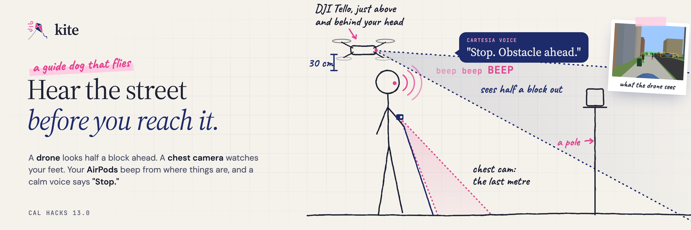

<p align="center"></p>

Kite is a guide dog that flies, built at Cal Hacks 13.0. Project page: [Devpost](https://devpost.com/software/kite-od2vmu).

## Inspiration

Over a million Americans are blind (JAMA Ophthalmology, 2021), and fewer than 10,000 guide dogs work in the US, enough for less than 1% of them. A guide dog can cost over $100,000 to raise, train and support over its life, and the wait for one is about a year. So we built a guide dog that flies, detects obstacles, and helps the blind navigate their surroundings through computer vision and real-time Speech AI.

## What it does

Imagine a caregiver, a guide dog, and navigator all in one. Kite scans your surroundings and guides you to exactly where you want to go. Through the intersection of two computer vision angles; a DJI Tello flies 1.8 m behind you and 20 cm above your head, looking down the street, and a Logitech C270 webcam on your chest that watches the area directly in front of you, powered by embedded systems in an Arduino. Both perspectives combine to a robust system that scans the surroundings at 18 frames per second. Cameras convert this visual input into a conversational guide, like a caregiver helping you walk around, through your headphones.

Intelligence through live vision. Kite detects your surroundings proactively, updating at up to 18 times per second. A caregiver that stops you from running into obstacles. Using Cartesia, it informs you "Stop. Person ahead.", or advises you to veer left and right, in about 0.1 s after it decides. Once you've navigated through that, it guides you forward.

Your caregiver always behind you. It initiates by recognising you, and holds its place behind you. It's pretty smart and even if you lose track of it; it pings you and adjusts the yaw to scan its surroundings to reconnect. All on its own!

Better than Google Maps. "What's in front of me?", "Find me the nearest shopping centre?" and "Take me to my usual coffee shop" are answered through Speech AI after vision analysis. Walking directions are supported through Gemini API and Google Maps API, allowing you to navigate without leaving your phone.

## How we built it

- Hardware: DJI Tello, Arduino UNO Q with a Logitech webcam, an iPhone for GPS, AirPods, a MacBook, and a Windows laptop that flies the drone.
- Perception: Python, GPS, YOLO11n and YOLO-World with a street vocabulary, Depth Anything V2, and our own near-field distance estimator.
- Voice and AI: Cartesia Sonic and Ink, Claude Haiku 5.5 and Claude Opus 5.5, Google Routes and Places for walking directions, Grok Imagine for test scenes.
- Shared state: a SpacetimeDB module on Maincloud and a React dashboard.
- Drone control: Python on the Tello SDK, with a 1,446-neuron circuit steering the yaw.
- Testing: Hours and hours of fumbling around Berkeley at night, finding how our vision model surprisingly works in the dark.

## Challenges we ran into

Our drone's video fell apart. We were testing indoors in an apartment packed with Wi-Fi networks, and the Tello's 2.4 GHz video turned into blocky frames. Video packets kept dropping, and the drone couldn't really transmit a steady image. We took a train out to Berkeley's open fields to test. We also bought a $30 USB antenna and plugged it into a Windows laptop.

Also, our drone fell apart (literally) over and over again and we had to fix the bumpers again and again.

We tried to RESET our own Arduino with a staple. The UNO Q wouldn't take our password, and we were sure we'd locked ourselves out. Our fix was to force the chip into its emergency download (EDL) mode and reflash it, which meant shorting two tiny test pads with a bent staple, over and over. It never worked. When we finally tried flashing through Arduino App Lab, it told us the password had never been set in the first place.

By Sunday morning the drone, the Arduino, the phone and the AirPods were working together as one guide. After everything above, that's what we're proudest of.

## What we learned

- A crowded 2.4 GHz band is a fight, and a drone's video loses it.
- Distance from one camera comes from several weak clues, and most of the accuracy comes from knowing when to stop trusting each one.
- Anything that has to happen on time can't wait on Python, which is why Kite's audio runs in Rust.
- Before you reach for a staple, check whether the password exists.

## What's next for Kite

The very next thing is putting Kite in the hands of the people it's built for. We'll walk real routes with blind travelers and the orientation and mobility instructors who teach them, and ask how Kite compares to a white cane or a guide dog. Their answers will decide how early Kite warns, when it beeps instead of speaking, and which sounds are impossible to mix up.

After that:

- Landing zones in pilot areas like college campuses, where drones recharge between walks. A walker asks for a guide through their AirPods, and Kite sends a drone to their phone's location.
- Perception on the phone, so a walker carries only a phone, a chest camera and headphones.
- A segmentation model for curbs, steps and doorways.
- A faster drone with longer flights.

## Individual contributions

Karthik built the earpiece that every other part feeds: the spatial sonar, the beacon toward the next turn, the Cartesia voice in and out, and stop and wait. He moved beep synthesis and the sonar thread into Rust, built the closeness detector that turns one webcam into three priority tones, and benchmarked depth models for it. He also built the Arduino UNO Q link for the body camera, the SpacetimeDB database, the Claude safety evals and the site.

Arthur owned the drone. He wrote the Tello layer, camera calibration, replay, preflight checks and the fix for Tello video on macOS. He then built follow mode, tested it in a follow simulator and flew it on the real Tello, and built the fruit-fly yaw controller. He leads the demo and the pitch.

Eddy built the phone link: an iPhone app that sends GPS over Bluetooth to receivers on the laptop and the UNO Q, which keep the newest position in SpacetimeDB. He added "take me to", which turns a spoken destination into a walking route, and built the Moss St simulator, the demo scripts and the video tools. He wrote the team spec and owns the demo video and the Devpost.

Rex built the map view that routes the walker's live phone GPS to a destination on Mapbox, and the UNO Q code that publishes that GPS to SpacetimeDB. He fixed the drone recorder's controls on Windows, and his laptop ran as Kite's main computer during integration.

## How Kite fits each prize

### Best Use of SpacetimeDB

Five devices, one live state, no sync server of our own. SpacetimeDB holds the live state of every walk for the drone laptop, the earpiece, the UNO Q body camera, the walker's phone and the dashboard.

The module has two public tables. `event` keeps the walk's recent history as a 500-row ring, and `latest` keeps the newest state for each device, so a dashboard opened mid-walk is current immediately. The `push` reducer checks every write against an allowed list of event types, a source-name pattern, a priority and a 16 KB limit, and `clear` resets a run with a 60-second cooldown.

The earpiece mirrors every event through a bounded queue with a token bucket and backoff, so a dead network slows the mirror down without ever stalling the audio. The phone's GPS reaches the database through the UNO Q. The UNO Q also uses SpacetimeDB for discovery: every two seconds it posts an HMAC-signed heartbeat that the laptop reads to find the body camera on campus Wi-Fi, so nobody types an IP address, and stale or replayed heartbeats are rejected. The dashboard reads only through a live subscription.

Code: [`dashboard/spacetimedb/src/index.ts`](dashboard/spacetimedb/src/index.ts), [`earpiece/earpiece/spacetime.py`](earpiece/earpiece/spacetime.py).

### Best Use of Cartesia

The walker can't look at a screen, so Kite's interface is voice: everything the walker hears is Sonic, and everything they say is heard by Ink.

Sonic `sonic-3.6` streams over one persistent WebSocket with a separate context for each utterance, which gets the first audio out in about 0.1 s with no handshake per sentence. When "Stop." has to cut off a direction, Kite cancels that context, fades the audio out in 40 ms, and brings the direction back later if it still applies. Audio arrives as 48 kHz float PCM, the AirPods' native rate, and goes straight into our mixer. Speech plays at 1.1x, because many blind listeners prefer it faster. Every warning phrase is rendered with Sonic at startup and cached on disk, so "Stop." plays instantly in the same voice even with no signal.

Ink `ink-whisper` streams the walker's speech while they talk. After 0.7 s of silence Kite sends `finalize`, and the transcript is back 90 to 190 ms later. We listen through the MacBook mic, because opening the AirPods mic drops them into mono and would flatten the directional beeps.

Known limitations:

- New sentences need a connection, and offline Kite switches to the macOS voice.
- Ink has no offline fallback, so Kite says "Voice commands are offline" and the AirPod buttons keep working.
- English only for now.

Code: [`earpiece/earpiece/speech.py`](earpiece/earpiece/speech.py), [`listen.py`](earpiece/earpiece/listen.py).

### Make it Legendary with SpaceXAI

The moments Kite exists for are the ones nobody can stage: a car turning into the crosswalk, a cyclist cutting across, a man stepping out of a doorway, people walking straight at you, a scooter lying across the sidewalk. Grok Imagine generated all five from chest height. The stills are 5 of the 16 labelled frames in our detector benchmark, and our Claude tests paint fake "cross now" signs onto them to check that Kite never reads a sign as an instruction. Rex used Cursor as his coding agent for the UNO Q code that sends the phone's GPS to SpacetimeDB, the Mapbox walking preview and the drone recorder on Windows. The team used Grok Bot for research and planning.

Code: [`scripts/imagine_scenes.py`](scripts/imagine_scenes.py), [`data/imagined/`](data/imagined/).

### Anthropic: Claude for Public Benefit

Kite is for blind and low-vision adults who walk city streets on their own. Claude handles the parts that need judgment. Claude Haiku 5.5 reads the current hazards and scene and can add one short sentence such as "Wait, the crosswalk is crowded," through a single strict tool and within 2.5 s. Claude Opus 5.5 describes the camera view, reads signs and menus aloud, and answers questions with tools for directions and settings.

Where it could go wrong. Claude doesn't detect obstacles, so a bad answer can't hide one. A filter in code drops any reply that sounds like permission to go, judged on what a listener would hear after undoing lookalike letters and hidden characters, and text read off a sign is spoken as a quote. We tested that filter against 662 hand-written ways to say "go ahead" plus 650 disguised variants.

Code: [`earpiece/earpiece/judgment.py`](earpiece/earpiece/judgment.py), [`vision.py`](earpiece/earpiece/vision.py), [`earpiece/evals/`](earpiece/evals/).

### Best Hardware Hack

Four off-the-shelf devices work as one guide: a DJI Tello, an Arduino UNO Q with a Logitech webcam, an iPhone and a pair of AirPods.

The Tello flies follow mode. It locks onto the walker once they show up in three of five detections, holds 1.8 m behind and 20 cm above head height, uses its downward time-of-flight sensor for altitude, and turns toward where the walker was when a frame drops. If it loses them, it searches in 30° turns. A safety governor clamps every stick command, keeps altitude between 0.5 and 2.3 m, hovers after one second without video, and lands at 20% battery, after seven minutes of flight or past a 100 m geofence. We fought its 2.4 GHz video link all weekend and won with band planning, a lighter stream and our own packet-loss-tolerant reader.

The UNO Q is a body camera that sets itself up. At boot a systemd unit switches its USB port into host mode, it picks up any webcam plugged in later, and it streams MJPEG to the laptop. It finds the laptop through a signed heartbeat in SpacetimeDB, and it only sends its access token to Tailscale addresses.

The iPhone runs our Kite app, which sends GPS over Bluetooth LE and starts with one press of the Action button. The AirPods are managed as a device: Kite picks them by name, plays "Left ear" and "Right ear" so you can check they're the right way round, warns when the battery is low, and turns stem presses into talk, repeat and pause.

Code: [`kite/`](kite/), [`hardware/arduino/unoq_link/`](hardware/arduino/unoq_link/), [`phone/`](phone/), [`phone-app/`](phone-app/).

### Most Technically Complex Hack

Kite runs a drone controller, two vision pipelines, a spatial audio engine and a speech scheduler that all have to agree within a fraction of a second.

Distance from one webcam. For every object in the walker's path, the near-field estimator computes up to five distances in log space, each with its own uncertainty. Two come from the pinhole model using the object's known height and width, with an upper bound when the frame edge cuts the box off. One is a ray to the point where the object touches the ground. One is Depth Anything V2, rescaled so the floor sits at the camera's known height. The last is looming: a least-squares fit of how fast the object grows over 0.9 s. A weighted-median gate throws out outliers, the rest are combined by inverse variance, and a Kalman filter per track follows log-distance and its rate of change, which is minus one over the time to contact. A time to contact under 1.5 s jumps straight to the top priority. When the detector can't name something, an occupancy check over 0.25 m slices of the path still catches the obstacle, along with walls, curbs and steps down. Code: [`perception/near/`](perception/near/).

Audio that keeps time. The audio engine is Rust (cpal and rtrb, bound to Python with PyO3). Its device callback never blocks on Python: commands arrive through lock-free single-producer rings, and finished sample buffers go back through a third ring to be freed off the audio thread. A test plays on the real output device while five threads load the CPU and the mixer, and requires zero glitches. A native sonar thread runs in macOS's real-time scheduling band and places every beep at an absolute sample frame. When Python held its lock for 500 ms in a test, every beep still landed within one 512-frame block. To keep the Rust and Python paths identical, we reimplemented numpy's PCG64 generator and ziggurat sampler in Rust, so even the seeded noise inside a cue matches sample for sample. Code: [`earpiece/native/`](earpiece/native/).

3D sound and a scheduler for speech. Spatial audio uses interaural time differences and a head-shadow filter from a spherical head model (Brown and Duda, 1998), with a low-pass that marks sounds behind you, so no head-related transfer function dataset is needed. Speech runs through a scheduler with six priority levels, mid-word preemption with a 40 ms fade, and an expiry time on directions so they're never spoken late.

A fruit fly flies the drone. Follow mode estimates the walker's range from four cues, including the angle to their head computed from the drone's own pitch telemetry. Yaw is steered by a 1,446-neuron leaky integrate-and-fire pursuit circuit from the fruit-fly connectome, built on the open-source FlyDrones network, with a predictor that covers the video's 0.25 s lag. We flew it on the real Tello. Code: [`kite/follow_behind.py`](kite/follow_behind.py), [`kite/flybrain/`](kite/flybrain/).

Pytest collects about 6,100 tests across the stack, including Hypothesis property tests on the drone's safety governor.

### Best People-First Social Impact Hack

A cane can't feel a mirror or a branch at head height. Kite's chest camera covers that height, and its drone looks past the next step to the crosswalk. The rest is built so the walker stays in charge: Kite says "Stop." and waits instead of pulling you around obstacles, holds back "walk" until the signal has been steady for 0.6 s, and drops a direction that would arrive too late. Urgency comes through as one of three tones, which you can react to faster than a sentence, and you can pause guidance at any time. It all runs on consumer hardware, for a fraction of what one guide dog costs. Next we want blind travellers and orientation and mobility instructors to decide when Kite beeps, speaks and stays quiet.

### Most Creative Hack

A guide dog that flies. Kite puts a second pair of eyes behind your head, turns the street into sound that comes from where things are, and uses a fruit fly's pursuit circuit to keep the drone pointed at you.

## Run it

```bash
python run/epic.py --model v3b-joint
```

## Built with

AirPods, Anthropic, Arduino, Arduino UNO Q, Cartesia, Claude, Cursor, Depth Anything, DJI Tello, Google Maps, Grok, Mapbox, OpenCV, OpenStreetMap, Python, PyTorch, React, SpacetimeDB, three.js, TypeScript, Vite, WebSockets, YOLO.

## License

[MIT](LICENSE). Third-party model and asset credits are in [`sim/public/models/CREDITS.md`](sim/public/models/CREDITS.md).
