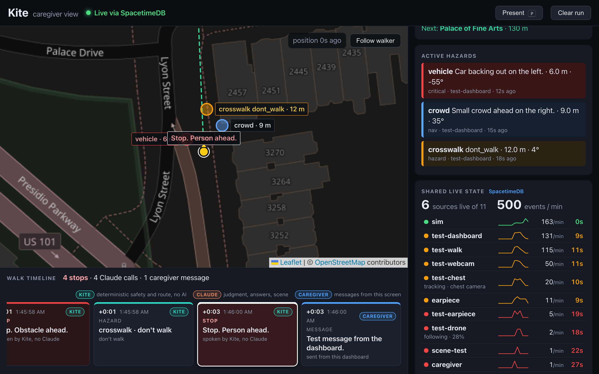
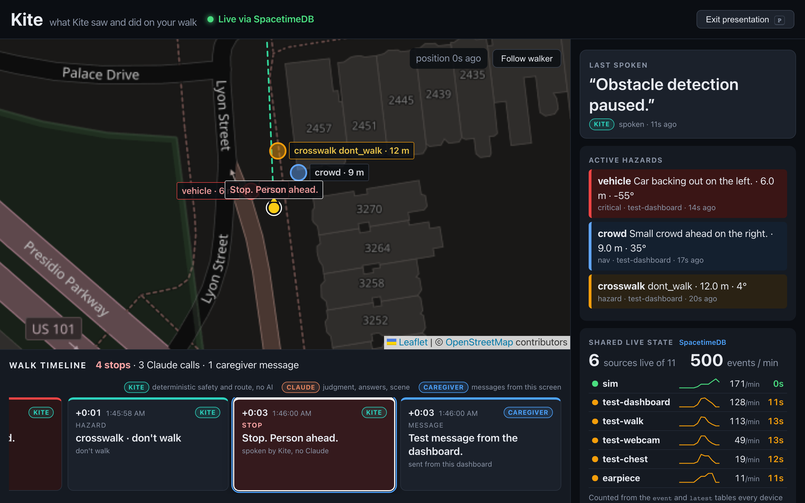

# Kite sync and dashboard

Real-time shared state for Kite, built on [SpacetimeDB](https://spacetimedb.com). The drone laptop, the wearable laptop and the demo dashboard all read and write the same database, so they stay in sync even though the two cameras are on different WiFi networks.

- `spacetimedb/src/index.ts`: the server module (tables and reducers)
- `src/`: the React dashboard, which subscribes to tables and re-renders live
- `src/module_bindings/`: generated client code; regenerate after changing the module

The hosted database is `kite-sync-pl6rp` on Maincloud ([dashboard](https://spacetimedb.com/kite-sync-pl6rp)).

## Run the dashboard

```bash
npm install
npm run dev        # connects to Maincloud by default
```

### Analytics view (the default)

The page opens on the demo display: the map with every phone on the left, and the walker's camera and the drone's camera on the right, with a strip below showing phones live, accuracy, speed, events per minute, the last spoken line and active hazards. Press `P` to present it full screen (`Esc` leaves). The walk view described below (map, walk timeline and shared state) is at `/?view=walk`.

The camera panes are MJPEG URLs shown in a plain ``. Set them in the URL or in the Feeds popover in the header, which saves them in this browser:

```
/?webcam=http://<board-ip>:8765/video.mjpg?token=<token>&drone=http://localhost:8090/video.mjpg
```

The walker camera comes from the UNO Q board service (`hardware/arduino/unoq_link/board.py`). A pane that has no URL says so, and one that fails retries every 3 s.

For the drone pane, serve any frame source as MJPEG from the repo root:

```bash
python -m kite.sources.mjpeg --source recordings/<take> --port 8090    # a recorded take, looped
python -m kite.sources.mjpeg --source out/pov/pov_sim.mp4 --port 8090  # any video file, looped
python -m kite.sources.mjpeg --source tello --port 8090                # the live Tello, only while run/app.py is NOT running
```

The Tello's UDP video can only be read by one program, so while `run/app.py` flies the drone it owns the stream. A live drone feed during a flight needs the app to publish its own frames as MJPEG. Ask Arthur.



The page uses the Kite logo's colours: cream paper, navy ink, one pink accent. The map (Leaflet, OpenStreetMap tiles muted toward cream in CSS) shows every client that sends `position` events, one per source (`phone-3fa2`, `phone-9c01`, plain `phone`, or `sim` during a replay). Each gets its own colour, a dot with its accuracy circle, its recent trail and a dashed predicted path 10 s ahead: from `speed` and `course` when the phone sends them and is moving at 0.5 m/s or more, else from its last few fixes, and hidden when it is standing still or its fix is stale. The Phones card lists them with accuracy, speed and how long since each last reported; click one to follow it. The map view buttons are "All phones" (fits every live client), "Follow" and "Whole walk". Hazards and the beacon are placed around the newest client, from their walker-frame `bearing` and `distance` plus that client's compass `heading`. On the right: the walker's status, the phones, the last spoken line with who said it, the latest stop, active hazards (with distance and direction in words, such as "8 m ahead right"), the devices and the live feed (collapsed).

To see several phones without real ones, run `npm run dev` and open `/?fixture=two-phones`: two fake phones walk circles near Sproul Plaza and a third went quiet 40 s ago. They are drawn in this page only and never written to SpacetimeDB (dev builds only).

Under the map, the walk timeline lists the last walk's key moments in order: stops (spoken "Stop." lines and critical hazards, merged into one stop worded as the walker heard it), hazards, Claude's judgments, answers and scene text, and route guidance. A walk is everything after the last 45 s gap in the event table. A ribbon above the cards shows the whole walk at a glance, with stops marked in red. Each card has a badge for who acted, Kite (deterministic code, no AI) or Claude, and the header counts each. Click a card or a ribbon mark to fly the map to where the walker was at that moment; stops stay marked on the map. Times come from the producer's own `t` when it is an epoch time, so a burst delivered late by a busy bridge still spreads out correctly.

"Devices" counts sources that wrote in the last 15 s and events in the last minute, with a sparkline per source, all from the `event` and `latest` tables. Each source is green under 5 s since its last write, amber under 15 s, red ("silent") after. The event table keeps only the newest 500 rows, so when every row falls inside the last minute the rate shows as a lower bound (≥).

The header always says whether the page is live, connecting, reconnecting (the SDK reconnects by itself; the last data stays on screen) or offline, and a banner says so when no device has written for 30 s.

Press `P` (or the Present button) for presentation mode at the reveal; `Esc` leaves it. It hides the raw feed, the walker panel and the Clear button, frames the whole walk on the map, and makes the timeline, the last spoken line ("Kite just said") and the latest stop bigger. `#present` in the URL opens it that way.

Accessibility: every control works from the keyboard with a visible focus ring, section titles are real headings, the timeline cards are buttons, and text colours meet WCAG AA contrast (checked with axe-core). New spoken lines are announced politely to screen readers; stops are announced assertively. Only changes after the page loads are announced, never the backlog. Motion is reduced when the system asks for it, and `prefers-contrast: more` brightens the secondary text. Payloads are untrusted: they are parsed defensively, clipped, and rendered as text, never as HTML.



The pure logic (timeline, payload parsing, freshness and distances) has self-checks with no extra dependencies: `npm run check` (Node 22+).

To see it move without hardware, from the repo root:

```bash
earpiece/.venv/bin/python scripts/replay.py data/sample_track.jsonl --spacetime --speed 2
```

`data/sample_track.jsonl` is a 45 s synthetic walk up Lyon Street (source `test-dashboard`) with a beacon, three hazards and two status sources.

## Change the module

```bash
npm run spacetime:publish    # needs `spacetime login` as the database owner
npm run spacetime:generate   # refresh src/module_bindings
```

## Tables

- `event`: every Kite event, newest 500 kept. Columns are `id`, `type`, `source`, `priority`, `payload` (the full event as a JSON string, same shapes as `earpiece/earpiece/events.py`) and `t` (server timestamp).
- `latest`: the newest event per type and source, keyed `"type:source"` (for example `"position:sim"`), so a dashboard that joins late sees current state right away.

Reducers: `push(type, source, priority, payload)` writes to both tables, and `clear()` wipes them before a new run. The dashboard reads both tables. It calls `clear` from its "Clear run" button; the producers call `push`.

## Write from Python (drone or vision laptop)

No SDK needed. Reducers are plain HTTP calls with a JSON object of arguments. `payload` is itself a JSON string:

```bash
HOST=https://maincloud.spacetimedb.com   # or http://127.0.0.1:3000 for a local server
TOKEN=$(curl -s -X POST $HOST/v1/identity | jq -r .token)
curl -X POST $HOST/v1/database/kite-sync-pl6rp/call/push \
  -H "Authorization: Bearer $TOKEN" -H 'Content-Type: application/json' \
  -d '{"type":"position","source":"sim","priority":"info",
       "payload":"{\"type\":\"position\",\"lat\":37.80,\"lng\":-122.45,\"heading\":270,\"place\":\"Lyon St\"}"}'
```

## Work offline against a local server

```bash
spacetime start --listen-addr 127.0.0.1:3000
npm run spacetime:publish:local
printf 'VITE_SPACETIMEDB_HOST=ws://localhost:3000\n' > .env.local
npm run dev
```
