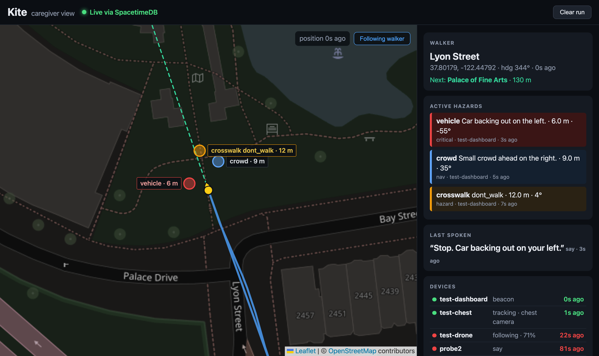

# Kite sync and dashboard

Real-time shared state for Kite, built on [SpacetimeDB](https://spacetimedb.com). The drone laptop, the wearable laptop and the caregiver dashboard all read and write the same database, so they stay in sync even though the two cameras are on different WiFi networks.

- `spacetimedb/src/index.ts`: the server module (tables and reducers)
- `src/`: the React dashboard, which subscribes to tables and re-renders live
- `src/module_bindings/`: generated client code; regenerate after changing the module

The hosted database is `kite-sync-pl6rp` on Maincloud ([dashboard](https://spacetimedb.com/kite-sync-pl6rp)).

## Run the dashboard

```bash
npm install
npm run dev        # connects to Maincloud by default
```



The map (Leaflet, OpenStreetMap tiles darkened in CSS) follows the walker from the newest `position` event that has `lat`/`lng`, and draws the recent trail. Active hazards are placed from their walker-frame `bearing` and `distance` plus the walker's compass `heading`, coloured by priority. The latest `beacon` shows as a green marker with a dashed line. Dragging the map stops auto-follow; the button turns it back on. On the right: walker, hazards, last spoken line, devices (green under 5 s since their last write, amber under 15 s, red after) and the live feed.

To see it move without hardware, from the repo root:

```bash
earpiece/.venv/bin/python scripts/replay.py data/sample_track.jsonl --spacetime --speed 2
```

`data/sample_track.jsonl` is a 45 s synthetic walk up Lyon Street (source `test-dashboard`) with a beacon, three hazards and two status sources.

## Change the module

```bash
npm run spacetime:publish    # needs `spacetime login` as the database owner
npm run spacetime:generate   # refresh src/module_bindings
```

## Tables

- `event`: every Kite event, newest 500 kept. Columns are `id`, `type`, `source`, `priority`, `payload` (the full event as a JSON string, same shapes as `earpiece/earpiece/events.py`) and `t` (server timestamp).
- `latest`: the newest event per type and source, keyed `"type:source"` (for example `"position:sim"`), so a dashboard that joins late sees current state right away.

Reducers: `push(type, source, priority, payload)` writes to both tables, and `clear()` wipes them before a new run. The dashboard reads both tables. It calls `clear` from its "Clear run" button and `push` from "Message the walker".

## Caregiver messages

"Message the walker" sends free text (trimmed, 200 characters max) or one of the quick buttons as a `say` event, source `caregiver`, priority `info`, payload `{"type":"say","source":"caregiver","priority":"info","text":"...","key":"caregiver-<ms>"}`. The last three sent show under the box and in the live feed (in blue).

An earpiece run with `--spacetime` polls for these about once a second and reads them aloud, prefixed "Message from your caregiver:". It uses the HTTP SQL endpoint:

```bash
curl -X POST $HOST/v1/database/kite-sync-pl6rp/sql -H "Authorization: Bearer $TOKEN" \
  -d "SELECT * FROM event WHERE source = 'caregiver'"
```

The earpiece clamps them to `info`, ignores anything other than `say`, skips rows that were already there when it started, and doesn't mirror them back into Spacetime.

## Write from Python (drone or vision laptop)

No SDK needed. Reducers are plain HTTP calls with a JSON object of arguments. `payload` is itself a JSON string:

```bash
HOST=https://maincloud.spacetimedb.com   # or http://127.0.0.1:3000 for a local server
TOKEN=$(curl -s -X POST $HOST/v1/identity | jq -r .token)
curl -X POST $HOST/v1/database/kite-sync-pl6rp/call/push \
  -H "Authorization: Bearer $TOKEN" -H 'Content-Type: application/json' \
  -d '{"type":"position","source":"sim","priority":"info",
       "payload":"{\"type\":\"position\",\"lat\":37.80,\"lng\":-122.45,\"heading\":270,\"place\":\"Lyon St\"}"}'
```

## Work offline against a local server

```bash
spacetime start --listen-addr 127.0.0.1:3000
npm run spacetime:publish:local
printf 'VITE_SPACETIMEDB_HOST=ws://localhost:3000\n' > .env.local
npm run dev
```
