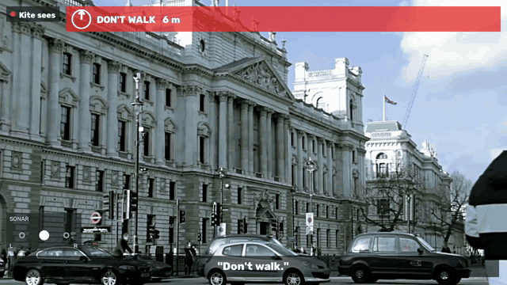
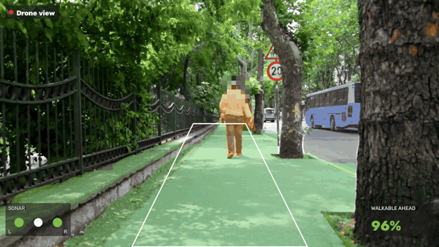
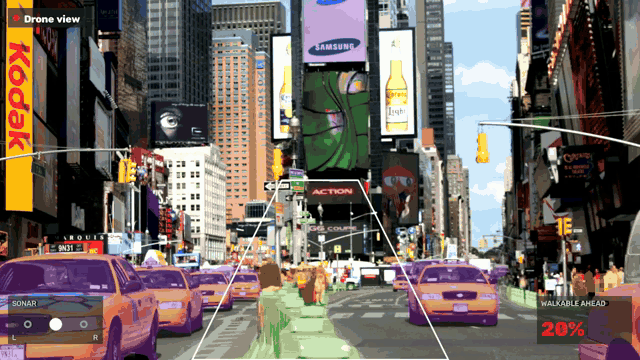

# Video runbook: from the shoot to the demo video

What ends up in the video is real. The audio track is the earpiece's own output: `python -m earpiece render` runs the full earpiece app (sonar, beacon, speech queue, hazard rules) against the detector's events and records what it would have played into the AirPods, mixed binaurally. The captions are the lines the earpiece actually spoke during that render, with their times. Nothing is typed in by hand.




Both frames are from the test run on a stock street clip with `data/sample_walk.jsonl`, so the cues don't match what's in the picture. On the shoot footage they come from the detector running on that footage.

## Setup, once

- ffmpeg: `brew install ffmpeg`. Without it the overlay still writes an mp4, but with no audio track.
- The earpiece venv (`earpiece/.venv`) renders the audio. Run it from the main checkout so it picks up `.env`. With `CARTESIA_API_KEY` set and internet up, the voice is Cartesia. Offline, the earpiece falls back to its phrase cache and then macOS `say`, exactly as it does on a walk.
- The overlay needs Python with `opencv-python` and `numpy` (the repo's root `kite` package already depends on both).
- Face blur needs `ultralytics` and `weights/yolo11n.pt` (`python sim/standin_detect.py --download`). It pixelates the top of every person box, so the backs and sides of heads get covered too. With OpenCV 4 and no YOLO it falls back to Haar face detection, which misses faces, so check the output. Always pass `--blur-faces` for street footage (spec 5.3: faces in any frame we store get blurred).
- Downloaded test clips go in `clips/`, outputs in `out/`. Both are gitignored.

## The pipeline

Set the take directory that `kite.record` wrote, then run the four steps from the repo root.

```bash
TAKE=recordings/20261025_070312_tello

# 1. Detector on the footage, events with t (seconds of video) to a JSONL.
#    Stand-in detector (sim/standin_detect.py). --camera both gives the drone
#    hazards and the obstacles that drive the sonar dots; --cam-height is the drone's height in m.
python sim/standin_detect.py --source $TAKE/video.mkv --camera both --cam-height 2.0 \
    --jsonl out/events.jsonl --no-send --fast

# 2. What the walker hears, rendered from those events (runs in real time: a 5 minute take takes 5 minutes).
cd earpiece && .venv/bin/python -m earpiece render --jsonl ../out/events.jsonl ../out/heard.wav && cd ..
#    Writes out/heard.wav and out/heard.captions.jsonl.

# 3 and 4. Overlay plus audio, one mp4.
python video/overlay.py $TAKE --events out/events.jsonl --wav out/heard.wav \
    --blur-faces --badge "Drone view" -o out/drone_cues.mp4
```

Check the result before cutting:

```bash
ffprobe -v error -show_entries format=duration:stream=codec_type -of compact out/drone_cues.mp4
```

It should list one video stream and one audio stream, with the duration of the take.

### Timing

Every tool uses the same t=0, the first event in the JSONL. The detector stamps events in seconds of video, with the first frame at 0, so `--offset 0` (the default) lines everything up. If the events come from somewhere else, such as a log from the live walk, set `--offset` to the video time in seconds where the first event belongs. A negative offset is fine. The same offset moves the WAV and the captions.

For a take directory, the overlay places frame i at i / fps, which matches how the detector reads `video.mkv`. If a detector stamped its events with the recorder's `t_mono` clock (for example through `kite.sources.recording.RecordingSource`), add `--wall-clock` so frames are placed by `frames.csv` instead.

### What the overlay draws

- Bottom: the line Kite is speaking, in quotes.
- Top banner, red: each active hazard (`hazard` events, held for their `ttl`, 20 s if none, the same as the earpiece). The arrow inside the circle points at the hazard's bearing, straight up meaning straight ahead, and the distance follows the label.
- Bottom left, the sonar panel: the walker's head in the middle with a dot on each side. A dot grows and turns from green to orange to red as the nearest obstacle on that side gets closer (green past 3 m, red under 1.5 m). Something within 10° of straight ahead lights both dots. Grey rings mean nothing is there.
- Top left: the badge. Use `--badge "Drone view"` on Tello footage and `--badge "Kite sees"` on the chest camera or the sim.

Use `--seconds` to stop early while trying settings, and `--captions` to point at a different captions file. Without a WAV, captions fall back to the text in the events themselves.

### Test run without the shoot

```bash
cd earpiece && .venv/bin/python -m earpiece render --jsonl ../data/sample_walk.jsonl ../out/walk_heard.wav --seconds 21 && cd ..
python video/overlay.py clips/london_street.mp4 --events data/sample_walk.jsonl --wav out/walk_heard.wav \
    --blur-faces --badge "Kite sees" -o out/demo_test.mp4 --seconds 20
```

The clip was a free Pexels street clip (`videos.pexels.com/video-files/1721294`). Any street mp4 works.

### POV video for the table (spec section 4)

One command takes walker-eye footage to the finished POV mp4: the stand-in detector runs on the frames (chest path, with the Depth Anything fallback so bins and signs count), the earpiece renders what the walker hears from those events, and the overlay adds captions, sonar panel, face blur and the audio.

```bash
scripts/pov.sh <video> [-o out/pov/name.mp4] [--fx 700] [--pitch 10] [--cam-height 1.3] [--jsonl events.jsonl] [--seconds N]
```

It writes `<out>.events.jsonl`, `<out>.wav`, `<out>.captions.jsonl` and `<out>` (default `out/pov/<video name>.mp4`). `--jsonl` skips the detector and uses those events instead. `--seconds` trims the render and the overlay; the detector always reads the whole video. The render runs in real time. Run it from the main checkout so the earpiece venv and `.env` are there; in a worktree, point `KITE_EARPIECE_PY` at the main checkout's `earpiece/.venv/bin/python` and `KITE_TTS_CACHE` at its `earpiece/.cache/tts` so cached phrases cost no Cartesia calls.

The lens settings matter, because distance comes from where things meet the ground. The defaults match the sim shot. For a phone held at chest height, measure the height and how far it tilts down, and keep `--fx 700` for an iPhone at 1x.

The sim walk (no drone, no phone):

```bash
uv run --no-project --with playwright python scripts/record_shot.py pov --fps 25   # out/shots/pov-moss.mp4, about 4 min
scripts/pov.sh out/shots/pov-moss.mp4 -o out/pov/pov_sim.mp4
```

`?shot=pov` is a 58 s walk up Moss's NE sidewalk at 1.3 m, 10° down, ending at the zebra curb. It uses the metrics walk's obstacles (seed 1): a person crossing the walker's line at about 13 s, the bin at about 37 s and the head-height sign at about 47 s. The walker is scripted and never reacts. Record it at 25 or 50 fps, because the metrics obstacles step in 0.02 s and other rates speed them up.

On the first sim render the detector caught the person ("Person, ahead." at 14 s, closest 3.3 m), the bin ("Stop. Obstacle ahead." at 37 s) and the sign (47 s), then two more stops near the curb pole and wall. The audio peaks at -1 dB with a mean of -28 dB. It is silent from 0 to 13 s and from 15 to 37 s, because sonar only beeps for close things and nothing is close then.

### Segmentation under the cues (stand-in)

Add `--seg` for the Waymo-style look: walkable ground in green, road in dark grey, people orange, vehicles purple, all translucent and drawn under the captions, banner and sonar. A white trapezoid marks the walker's corridor, and a panel at the bottom right shows how much of it is sidewalk ("walkable ahead"). Heads are blurred before the tint goes on, so they stay blurred.

The masks come from `sim/seg_standin.py`, a stand-in until Rex's `streetseg` lands. It runs Ultralytics YOLO26n-sem with the ADE20K weights. We tried the Cityscapes weights first, but they are trained on dashcam footage and labelled a sidewalk seen from behind a walker as road (3% sidewalk in the corridor). The ADE20K weights got 87 to 97% on the same frames. Neither dataset has a crosswalk class, so zebra stripes show as road. Rex's model can replace it by providing the same `segment(frame)` output.

```bash
uv run --no-project --with ultralytics python sim/seg_standin.py --download   # once: weights/yolo26n-sem-ade20k.pt
uv run --no-project --with ultralytics python video/overlay.py $TAKE --events out/events.jsonl --wav out/heard.wav \
    --seg --blur-faces --badge "Drone view" -o out/drone_cues.mp4
```

`--events` is optional, so `video/overlay.py clip.mp4 --seg --blur-faces -o out/seg.mp4` renders the masks alone. `python sim/seg_standin.py clip.mp4` prints the speed and the `scene` hints ("Sidewalk narrows ahead.", "No sidewalk ahead.") it would send. A hint has to hold for 5 frames before it goes out, and it never triggers a stop. On an M-series Mac, `segment()` takes about 49 ms per 960×720 frame on `mps` (20 fps), model and mask cleanup included. The corridor shape is a guess for a drone 1 m behind and 0.3 m above the walker, so check it on the shoot footage (`CORRIDOR_*` in `sim/seg_standin.py`).




Both frames are stock footage, not the shoot: Mixkit "Sidewalk in a city with a couple of people walking" (`assets.mixkit.co/videos/35810/35810-720.mp4`) and "Times Square during a sunny day" (`assets.mixkit.co/videos/4442/4442-720.mp4`), both under the Mixkit free license. The sonar and captions in the first one come from `data/sample_walk.jsonl` and don't match the picture.
