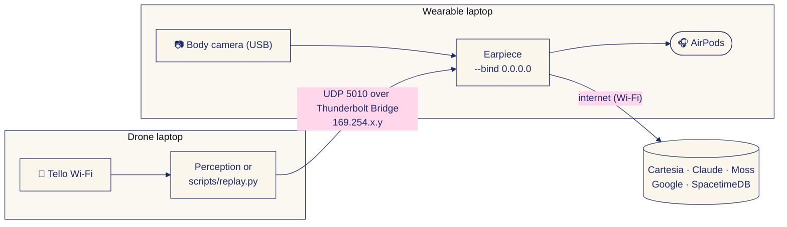

# Operations: two laptops, the drone, recording and GPS

The team's runbook for the hardware side. The judge-facing overview is the [README](../README.md).

## Two laptops over a Thunderbolt bridge

The wearable laptop runs the earpiece and drives the AirPods. The drone laptop runs perception or a replay. Connect them with a Thunderbolt cable; macOS brings up a Thunderbolt Bridge interface with a self-assigned address.



On the wearable laptop:

```bash
ipconfig getifaddr bridge0                       # note this address
cd earpiece && source .venv/bin/activate
python -m earpiece run --bind 0.0.0.0 --spacetime
```

On the drone laptop, set the earpiece address in the repo-root `.env` and send events as usual:

```bash
KITE_EARPIECE_HOST=169.254.x.y                   # the address from bridge0 above
earpiece/.venv/bin/python scripts/replay.py data/sample_walk.jsonl
```

Run `python3 scripts/netcheck.py` on both laptops to confirm the link; `docs/network.md` has the full setup. `EarpieceClient` and `scripts/replay.py` both read `KITE_EARPIECE_HOST`. The sim's browser page still connects to the earpiece at `ws://127.0.0.1:5011`, so run the sim on the wearable laptop. If sends fail with `No route to host`, allow your terminal under System Settings > Privacy & Security > Local Network.

## Drone and recording

Setup, once per laptop, on normal internet (the Tello's Wi-Fi has none), from the repo root:

```bash
uv venv --python 3.12 --seed .venv      # or: python3.12 -m venv .venv
source .venv/bin/activate
pip install -e ".[dev]"
python -m pytest -m "not slow"          # ~15 s, no drone needed
python -m pytest                        # + the H.264-over-UDP reader tests (needs ffmpeg, ~75 s more)
```

If the repo is on an iCloud-synced Desktop or Documents folder, iCloud marks everything inside `.venv` hidden, and Python 3.12.14 and later skip hidden `.pth` files, so `import kite` fails outside pytest ("No module named 'kite'"). Keep the venv where iCloud doesn't touch it, behind the usual name:

```bash
mv .venv .venv.nosync && ln -s .venv.nosync .venv && chflags -R nohidden .venv.nosync
```

The same applies to `earpiece/.venv`.

### Drone layer (`kite/`)

| Module | What it does |
|---|---|
| `drone/tello.py` | `TelloDrone`: djitellopy for commands + state. Discrete moves are non-blocking (`busy()` / `last_result()`), late replies after `stop` are discarded, `streamon` is re-sent until video arrives, `dry_run=True` never sends motion. |
| `drone/safety.py` | `SafetyGovernor`: wraps any drone; clamps rc, altitude ceiling/floor, lands on low battery or flight time, hovers on stale video/telemetry. Call `check()` every loop. |
| `sources/` | Newest-frame video readers: `TelloVideoSource` (PyAV or the team's OpenCV `VideoStream`, auto-reconnect), `WebcamSource`, file replay; `open_source(spec)` opens any of them, a take or the sim for perception (below). |
| `config.py` | `DroneCfg` / `SafetyCfg` defaults. |

```python
from kite.config import Config
from kite.drone import SafetyGovernor, make_tello

drone = SafetyGovernor(make_tello(cfg := Config(), dry_run=True), cfg.safety)
drone.connect()                          # join the TELLO-xxxxxx Wi-Fi first
frames = drone.frame_source()
```

### Before flying

- Latency / stream check: `python tests/drone_test.py --ground --preview`, then the flight version (3 x 3 m clear,
  prop guards, battery >= 30 %). Ctrl+C lands.
- Only one program can hold the Tello ports: `lsof -nP -iUDP:8889 -iUDP:8890 -iUDP:11111` should print nothing.
- macOS: allow incoming connections for Python, and Local Network access for your terminal app
  (System Settings > Privacy & Security) if sends fail with "No route to host".

### Recording

`python -m kite.record` saves the video and every Tello state packet, both stamped with one monotonic clock. Only one
program can hold the Tello ports, so the recorder is also the flight controller: `--fly` adds keyboard control through
`SafetyGovernor` in the same process. Without `--fly` the drone is opened in dry run and never gets a motion command.

```bash
python -m kite.record --source clip.mp4 --out recordings               # dry run on a file: no drone, no telemetry
python -m kite.record --source tello --out recordings                  # record only, drone on the ground / in hand
python -m kite.record --source tello --out recordings --fly --dry-run  # rehearse the keys: motion is logged, not sent
python -m kite.record --source tello --out recordings --fly            # the shoot
```

- Keys (`--fly`, typed in the recorder's terminal, one at a time): `t` takeoff, `l` land, `space` hover, `w`/`s`
  forward/back, `a`/`d` left/right, `r`/`f` up/down, `q`/`e` turn. A move key drives its stick at `--speed` (30)
  for `--pulse` (1 s); hold it (key repeat) to keep going, let go and the drone stops. `!!` = emergency (motors off).
- **Ctrl+C lands and stops** (it keeps recording until the drone is down). Takeoff is refused without live video or
  at <= 20 % battery; the governor lands by itself at 20 % or after 7 min.
- The terminal prints fps, battery and height every second.
- Output: `<out>/<YYYYmmdd_HHMMSS>_<source>/` with `video.mkv` (MJPG, playable after a crash), `frames.csv`
  (frame index -> `t_mono`), `telemetry.jsonl` (raw state + `t_mono`), `events.jsonl`, `meta.json`. Align video and
  telemetry on `t_mono`. QuickTime can't open `.mkv`: VLC can, or `ffmpeg -i video.mkv -pix_fmt yuv420p video.mp4`.
- About 0.7 GB per 5 minutes. Don't commit `recordings/`.

### Replaying a recording and the camera

- `python -m kite.sources.recording recordings/<dir>` checks a take (frames, drops, telemetry coverage, height and
  battery); `--preview` plays it with a pose overlay. In code, `RecordingSource(dir)` reads like the sim's
  `SimFrameSource`: `ok, bgr = src.read()`, then `src.pose` (camera height, pitch, heading for that frame) and
  `src.camera` (fx, fy, cx, cy).
- `kite/camera.py` holds the Tello intrinsics: fx 920 px until calibrated. `python -m kite.calibrate --source tello`
  fits them from a chessboard on a screen with the drone on the ground (at most 45 s of stream) and writes
  `data/tello_camera.json`. The pilot's shoot steps are in `docs/internal/shoot-flight.md`.

### Opening any frame source (detectors)

`kite.sources.open_source(spec, **opts)` gives every detector the same object for every camera: `read() -> (ok, bgr)`,
`.pose` (dict: `x, y, heading, cam_height, pitch, roll, t, battery, flying, tel_dt, heading_ref`, None where
unknown), `.camera` (fx, fy, cx, cy at the size of the frames actually read), `.name`, `release()`, `with`.

| Spec | Source | Frames | Pose | Camera |
|---|---|---|---|---|
| `tello` | live Tello, **dry run**: video + telemetry, motion never sent | newest | Tello telemetry (height, pitch, roll, yaw, battery) | `load_camera()` |
| `recording:<dir>` or a take folder | `RecordingSource` (`realtime=True` paces it) | every | recorded telemetry | meta.json / `load_camera()`, scaled |
| `clip.mp4`, `file:<path>` | a video file (`realtime=True` paces it) | every | `t` only (`cam_height=`, `pitch=` if given) | `load_camera()` scaled to the clip |
| `webcam:<n>`, `<n>` | camera index n | newest | `cam_height=1.3`, `pitch=0` (options) | ~68 deg FOV guess, labelled uncalibrated |
| `webcam:<name>`, e.g. `webcam:iPhone` | the camera whose name contains it (Continuity Camera) | newest | as webcam | as webcam |
| `sim:drone`, `sim:chest` | `sim/frames.py` (relay running, needs `websockets`) | next | the sim's x, y, heading, cam_height, pitch | fx from `sim/src/config.ts` (1000) |

`camera=Camera(...)` overrides the intrinsics of any source (`fx=` or `hfov_deg=` too, except for takes). Live sources return
`(False, None)` after `timeout` s (default 5) with no new frame; files and takes at the end.

```python
from kite.sources import open_source

with open_source("webcam:iPhone") as src:      # or "tello", "sim:chest", "clip.mp4", "recordings/<take>"
    ok, bgr = src.read()
    while ok:
        events = process(bgr, src.camera, src.pose)
        ok, bgr = src.read()
```

At the table: `python -m kite.sources.open --list-cameras` (indices and names; `--probe` grabs one frame from each),
then `python -m kite.sources.open webcam:iPhone --preview` (or `tello`, `sim:chest`, a file, a take) prints fps,
frame size, the camera and a few poses.

### Walker GPS (`kite.gps`)

The walker's phone logs GPS during the take. `kite.gps` smooths that track, lines it up with the recording, and
writes what the demo and perception need:

```bash
python -m kite.gps walk.gpx --recording recordings/<dir>                 # GPX: times are UTC or carry an offset
python -m kite.gps walk.csv --recording recordings/<dir> --tz America/Los_Angeles --offset-s 1.5
python -m kite.gps --route --out data                                    # planned route -> data/shoot_route.*
earpiece/.venv/bin/python scripts/replay.py recordings/<dir>/gps/positions.jsonl --spacetime   # start with the video
```

- Input: GPX (`trkpt` with `time`) or CSV with `time`, `lat`, `lon` columns (`accuracy` optional). Times
  without a zone are read in `--tz`, which defaults to UTC.
- Clocks: a frame's GPS time is `t_wall + --offset-s`, where the offset is the phone clock minus the laptop clock.
  The laptop is on the Tello Wi-Fi with no NTP. The command prints the overlap between video and GPS and warns
  when there's none or when the gap is a whole number of hours (a time-zone mistake). To measure the offset, show
  the Tello the phone's seconds clock at the start of the take.
- Output in `<recording>/gps/`:
  - `positions.jsonl`: earpiece `position` events at 5 Hz, `t` = seconds from the first video frame.
  - `frames_gps.csv`: the walker's lat, lng, sim x and y, heading and speed for every frame `index`. `heading` is
    empty while the walker stands still, and `heading_hold` keeps the last walking heading. Perception uses it to
    turn drone bearings into the walker's frame (spec 5.1).
  - `track.csv`: every fix, raw and smoothed.
  - `summary.json`: duration, distance, walking speed, overlap, closest approach to the crossing, and distance
    from the planned route.
- Sim metres: x east and y north of the Moss St zebra crossing node (37.778352, -122.408768). This uses the same
  tangent plane as `sim/src/config.ts` `toLatLng`, via `latlng_to_sim()` / `sim_to_latlng()`.
- Accuracy: phone GPS drift at walking speed tilts the heading by about 10° and blurs starts and stops by a few
  seconds. That's fine for the map and for rough bearings, but not for a precise stop line.
- `data/shoot_route.gpx` / `.jsonl` hold the planned walk from spec section 8. It's **approximate**: it assumes
  Moss St runs at 315° towards Howard (`--moss-bearing`), and it hasn't been surveyed. You can use it as a reference
  line, or replay it as a planned walk.
