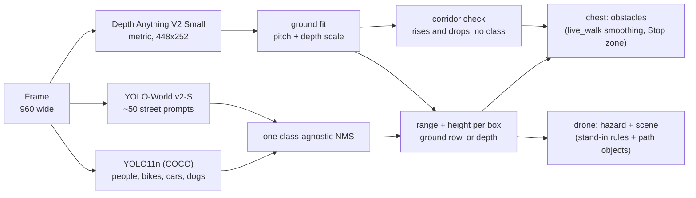
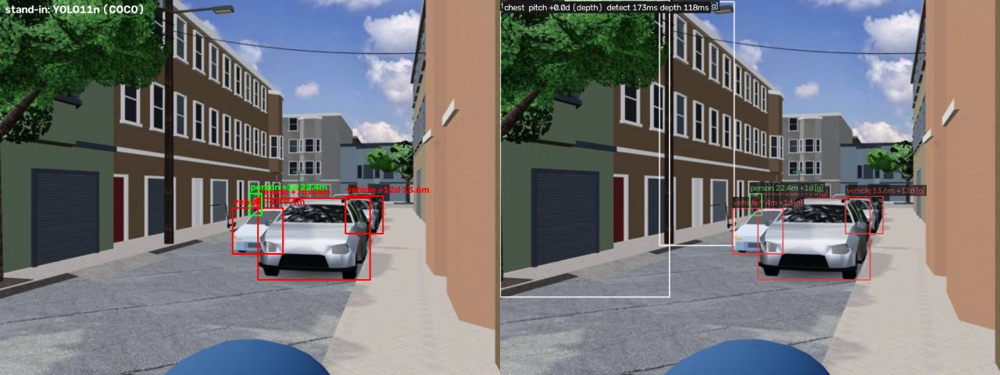
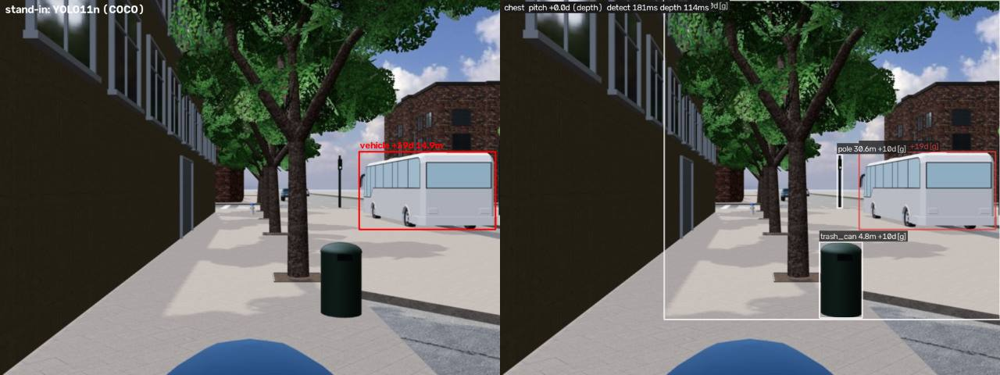
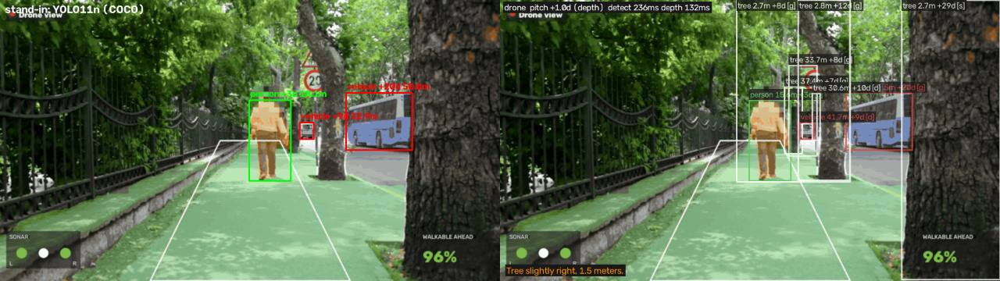
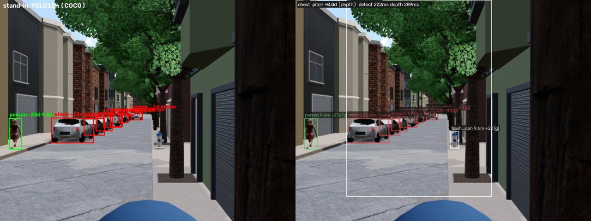
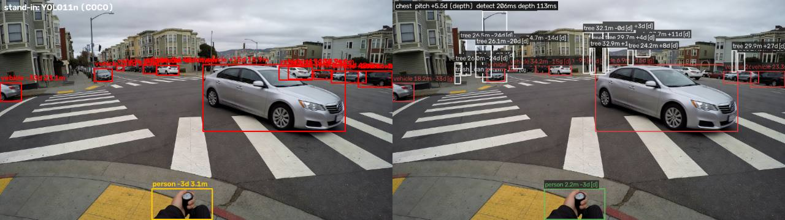
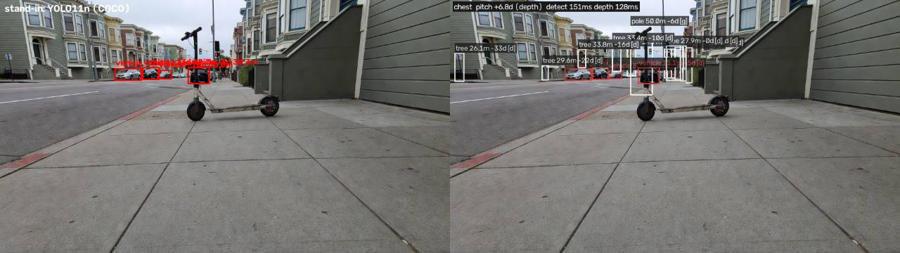
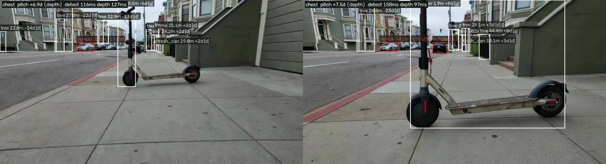
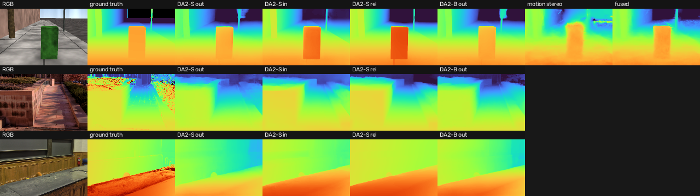

# perception/: naming the street, not just the people in it


The stand-in detector (`sim/standin_detect.py`) knows the 80 COCO classes. A blind pedestrian's day is full of things COCO has no word for: poles, bollards, trash cans, street trees, rental scooters, construction, signs at head height. This module is a drop-in replacement that names them, ranges them with metric depth, and sends exactly the same earpiece events, so nothing downstream changes.

```bash
python -m perception --download                       # once, with internet: weights into weights/ (git-ignored)
python -m perception --source data/imagined/scooter.mp4 --no-send --jsonl out/s.jsonl --overlay out/s.mp4
python -m perception --source sim:chest               # the browser sim's chest camera (relay up)
python -m perception --source webcam:iPhone           # live chest camera, through kite.sources
python -m perception --source sim:drone --seg         # drone view, plus walkable-ground hints
python -m perception --prompt "construction=orange fence,jersey barrier"   # teach it a new word
python -m perception.bench                            # the comparison below, on your machine
```

Python env, like `scripts/demo.sh`: `uv run --no-project --python 3.12 --with ultralytics --with lap --with transformers --with scipy --with opencv-python-headless --with "clip @ https://github.com/ultralytics/CLIP/archive/refs/heads/main.zip" python -m perception ...` (CLIP is only needed by `--download` and when the vocabulary changes).

## What it does



1. **Two detectors, one list.** YOLO11n keeps people, bikes, cars and dogs (the kinds that trigger "Stop." today) exactly as the stand-in sees them. YOLO-World v2-S, an open-vocabulary detector, gets a prompt list per earpiece kind (`vocab.py`): `pole` is "pole", "street light", "utility pole", "sign post", "parking meter"; `e_scooter` is "parked scooter", "rental scooter"; `tree` is "street tree"; and so on. One class-agnostic NMS merges them, so a scooter that two prompts both fire on is one object.
2. **Ground fit from depth.** Ground pixels in the lower middle of the frame lie on a plane. In camera coordinates that plane is `Y = h / cos(p) - Z tan(p)`, so a line fit over those pixels gives the camera's pitch `p` from the slope (which doesn't depend on the depth model's scale) and the depth model's scale from the intercept and the known camera height `h`. The stand-in assumes pitch 0, and the main README notes that 2 degrees of pitch error doubles a 30 m estimate; this measures the pitch every frame. On the sim, whose cameras are level, `--auto-pitch off` (the default for `sim:`) fits only the scale.
3. **Range per object.** Same flat-ground rule as the stand-in (its functions, imported read-only) when a box stands on visible ground. Depth inside the box takes over when the bottom row is cut off (and then the nearer of the two wins, so a close person never reads farther than the stand-in says), at or above the horizon, or clearly not the object's foot. A box that is wide, like a tree's crown, gets its bearing from the nearest columns at its base, which is the trunk.
4. **Height per object.** With a range, the box's top and bottom rows become heights above the ground. A fixed object whose bottom edge floats between 0.45 m and 2.1 m within 8 m becomes `overhead`: a sign or a branch the cane passes under. Above 2.1 m it is dropped. `stairs` becomes `stairs_up` or `stairs_down` by its top edge.
5. **Corridor check (no class).** With a fitted ground, every depth pixel gets a height. Within 0.6 to 4 m ahead and 0.5 m either side, enough pixels 0.3 to 2 m above the ground make an `obstacle`, and enough 0.3 m below it make a `curb` (the edge distance is corrected for the part of the lower ground the edge hides). Named objects already there suppress the generic one, so each thing gets one sound.
6. **Events.** The chest camera sends `obstacles` every frame through `sim/live_walk.py`'s `chest_step`, so smoothing, closing speed and the 1.6 m "Stop." zone are the stand-in's. The drone sends the stand-in's `crowd` and `vehicle` hazards, plus `construction`, `overhead`, `curb` and `obstacle` ("E-scooter ahead, 6 meters.") for fixed things within 10 m on the walker's line, gated the same way (3-frame onset, fixed text, ttl refresh).

### Kinds and what the earpiece does with them

The sonar has its own sounds for `person`, `vehicle`, `bike`, `curb` and `stairs_down`; every other kind plays the generic obstacle pip and is spoken as "Obstacle" (`earpiece/earpiece/sonar.py`), and "Stop. Obstacle ahead." fires for it the same way. So the new kinds cost nothing on the audio side, and their names still reach the dashboard and the judgment layer. `sonar.py` is unchanged.

| Kind sent | From | Sonar sound |
|---|---|---|
| person, bike, vehicle, dog | YOLO11n | person knock, vehicle buzz, generic |
| pole, bollard, fire_hydrant, tree, bench, trash_can, sign_board, street_furniture, stroller | YOLO-World prompts | generic obstacle pip |
| e_scooter | "parked scooter", "rental scooter", "electric scooter" | generic (a parked scooter is a fixed obstacle; `scooter` alone would alias to `bike`) |
| construction | cones, barriers, barricades, trench, scaffolding | generic; drone hazard "Construction ahead, ..." |
| overhead | any fixed box whose bottom edge floats at 0.45 to 2.1 m | generic; drone hazard "Overhead obstacle ..." |
| stairs_up, stairs_down, curb | "stairs" by height; corridor drop | glide for stairs_down and curb |
| obstacle | corridor rise with no named box | generic |

## Research: what we looked at and why we picked this

| Option | What it is | On this laptop | Verdict |
|---|---|---|---|
| YOLO11n, COCO (the stand-in) | closed set, 80 classes | fast; people at 0.9+ | kept for people, bikes, vehicles, dogs |
| **YOLO-World v2-S** ([docs](https://docs.ultralytics.com/models/yolo-world/), [paper](https://arxiv.org/abs/2401.17270)) | open vocabulary, CLIP text prompts, prompts baked into the weights offline | 116 ms median per frame in the survey (all survey numbers: M1, 8 GB, MPS, 640 px, with other jobs running) | **picked**: the only fast model that found poles (0.87 on the sim's utility pole, 0.7 to 0.88 on photo street lights), bins (0.75 to 0.96) and street trees (0.94) |
| YOLO-World v2-M and v2-L | bigger versions | not timed | on the scooter still they did no better than v2-S (the stem as a 0.19 to 0.25 street light, no scooter box); not worth the extra time |
| YOLOE-26s / 26n / 11s ([docs](https://docs.ultralytics.com/models/yoloe/), [paper](https://arxiv.org/abs/2503.07465)) | open vocabulary with instance masks | 183 / 135 / 373 ms | rejected: YOLOE-26s scored a clearly visible pedestrian 0.18 (YOLO11n: 0.93) and called the scooter "bike rack"; 26n missed most street objects; 11s slow. Still selectable with `--open-model yoloe-26s-seg.pt` (masks then sharpen depth ranges) |
| Grounding DINO tiny ([paper](https://arxiv.org/abs/2303.05499), [model](https://huggingface.co/IDEA-Research/grounding-dino-tiny)) | open-vocabulary transformer | 37 s to 13 min per frame (8 GB RAM, swapping) | put an "electric scooter" box on the scooter at 0.59 (no fast model did), along with false "hole" and "trash can" boxes on bare pavement; nowhere near live on this laptop |
| OWLv2 base ([paper](https://arxiv.org/abs/2306.09683), [model](https://huggingface.co/google/owlv2-base-patch16-ensemble)) | open-vocabulary ViT | not measured | our survey script's post-processing call failed on Transformers 5 and we did not retry it: OWLv2-B/16 at 960 px is heavier than Grounding DINO tiny, which was already far too slow |
| Depth Anything V2 Small, metric ([paper](https://arxiv.org/abs/2406.09414), [repo](https://github.com/DepthAnything/Depth-Anything-V2)) | monocular metric depth | about 100 to 160 ms at 448x252 | **picked** (outdoor fine-tune by default, `--depth indoor` for inside); the stand-in already ships the indoor one |
| Ultralytics YOLO26-sem ([docs](https://docs.ultralytics.com/tasks/semantic/)) | semantic segmentation, Cityscapes or ADE20K | the team's `sim/seg_standin.py` | reused read-only behind `--seg` for walkable-ground hints on the drone view. Its ADE20K model has sidewalk, road, pole and step classes but no curb |
| Mask2Former on Mapillary Vistas ([model](https://huggingface.co/facebook/mask2former-swin-large-mapillary-vistas-semantic)) | segmentation with curb, pole, utility pole, fire hydrant, bike rack and "wheeled slow" classes | Swin-L only on Hugging Face: seconds per frame | the right label set for sidewalks, the wrong size; Mapillary Vistas is CC BY-NC-SA |
| SegFormer-B0 ([paper](https://arxiv.org/abs/2105.15203)) on Mapillary Vistas | small transformer segmenter | needs training (no public Vistas B0 checkpoint) | the best path to a real "walkable path + curb" model after the hackathon; NVIDIA's license is non-commercial |

Assistive-navigation data we found, for training a real sidewalk model later: [Investigating YOLO models towards outdoor obstacle detection for visually impaired people](https://arxiv.org/abs/2312.07571) (compares YOLO models on an outdoor obstacle set that includes poles and warning columns), the [IEEE DataPort outdoor-mobility obstacle images](https://ieee-dataport.org/documents/image-dataset-comprising-objects-and-obstacles-outdoor-mobility-people-visual-impairment) (bins, bollards, e-scooters, advertising boards, flagged by visually impaired people), [Sidewalk Obstacle Detection on Roboflow](https://universe.roboflow.com/lamao/sod-enect) (CC BY 4.0, 22 classes including pole and curb) and the [Mendeley obstacle-avoidance set](https://data.mendeley.com/datasets/xwhnp82rhk/1) (pole, fence, bump, hole). None is wired in; fine-tuning YOLO-World or YOLO11 on them is the obvious next step.

Ideas taken from Rex's earlier project [vigil](https://github.com/parthm667/vigil) (rewritten, not copied): YOLO-World with the prompts baked into the weights before the walk so the laptop never needs the CLIP model or the internet once it is on the Tello's Wi-Fi; several prompts renamed to one class with class-agnostic NMS; weights that are never fetched at runtime. Here the baked file is `weights/world-yolov8s-worldv2-<hash of the prompt list>.pt`, so changing the vocabulary re-embeds once on first use.

## Benchmark against the stand-in

`python -m perception.bench` runs both detectors on the same frames: every still in `perception/bench_labels.json` and the five Grok Imagine clips in `data/imagined/*.mp4` (git-ignored, regenerate with `scripts/imagine_scenes.py`). Both get the frame at 960 wide, the same fx (700 for phone-like photos, 1000 for sim renders) and the same camera height (chest 1.2 m, drone 2.0 m). The stand-in runs as it does by default (no `--depth`).

**How the stills are scored.** We hand-labelled one point inside each street object that matters to a walker (59 objects in 16 frames, 27 of them "key": in or next to the walking path). A detector *names* an object when one of its boxes contains the point, and names it *right* when the kind matches. The UI screenshots in `sim/docs` (black screens, debug overlays, the old pre-drawn YOLO captures) and the stock-footage README frames with heavy overlays are left out. These labels are ours and the frames include generated ones, so read this as a careful smoke test, not a dataset score.

**Stills (16 frames, 59 labelled objects, 27 key).**

| | Stand-in | perception/ |
|---|---|---|
| Objects named with the right kind | 30 / 59 | **43 / 59** |
| Key objects named with the right kind | 12 / 27 | **18 / 27** |
| Objects detected as anything | 30 / 59 | **52 / 59** |
| People, bikes and vehicles named right (COCO kinds) | 30 / 34 | 30 / 34 (the same model) |
| Street objects named right (poles, trees, bins, hydrants, scooters, curbs) | 0 / 25 | **13 / 25** |
| Latency per still, median, M1 under load | 110 ms | 359 ms (detect 208, depth 128) |

Key objects, one row each (distance in metres, and how perception/ measured it: [ground] row, [depth], or [size]):

| Scene | Object | Stand-in (YOLO11n) | perception/ (hybrid + depth) |
|---|---|---|---|
| scooter | e_scooter (key) | missed | missed |
| scooter | pole (key) | missed | tree 12.9 m (wrong kind) [depth] |
| doorway | person (key) | person 4.0 m | person 3.6 m [ground] |
| oncoming | person (key) | person 2.9 m | person 2.8 m [size] |
| cyclist | bike (key) | bike 6.3 m | bike 5.8 m [ground] |
| cyclist | person (key) | person 9.2 m | person 8.1 m [ground] |
| car_turning | vehicle (key) | vehicle 15.9 m | vehicle 6.9 m [ground] |
| car_turning | curb (key) | missed | missed |
| seg-sidewalk | person (key) | person 18.1 m | person 15.6 m [ground] |
| seg-sidewalk | tree (key) | missed | tree 2.7 m [ground] |
| seg-sidewalk | tree (key) | missed | tree 2.7 m [size] |
| street_dressing_poles | pole (key) | missed | pole 5.0 m [ground] |
| street_dressing_poles | vehicle (key) | vehicle 6.8 m | vehicle 6.8 m [ground] |
| street_dressing_sw_sidewalk | tree (key) | missed | tree 4.3 m [ground] |
| street_dressing_sw_sidewalk | fire_hydrant (key) | missed | tree 4.3 m (wrong kind) [ground] |
| street_dressing_howard | trash_can (key) | missed | trash_can 4.8 m [ground] |
| street_dressing_howard | tree (key) | missed | tree 4.7 m [ground] |
| street_dressing_corner_se | person (key) | person 3.4 m | person 3.4 m [size] |
| osm_facades_howard | tree (key) | missed | missed |
| osm_facades_corner_chest | person (key) | person 8.7 m | person 8.7 m [ground] |
| osm_facades_corner_chest | curb (key) | missed | missed |
| osm_facades_spawn | vehicle (key) | vehicle 4.0 m | vehicle 4.0 m [ground] |
| street_dressing_spawn | vehicle (key) | missed | missed |
| hybrid_capture_osm_chest | person (key) | person 11.5 m | person 11.5 m [ground] |
| hybrid_capture_osm_chest | curb (key) | missed | missed |
| hybrid_capture_osm_drone | person (key) | person 12.3 m | person 12.3 m [ground] |
| hybrid_capture_osm_drone | vehicle (key) | missed | missed |

**Distance sanity.** No frame here has measured ground truth, so we compare with the distance each Grok Imagine scene was prompted with. Turning car, prompted at about 6 m: stand-in 15.9 m, perception/ 6.9 m (it fitted a 5.5 degree downward pitch; the stand-in assumes 0). Doorway, about 3 m: 4.0 against 3.6 m. Cyclist, about 4 m: 6.3 against 5.8 m. On the sim frames, whose cameras are level, perception/ runs with the pitch given (only the depth scale is fitted) and agrees with the stand-in to the centimetre on every grounded box; with the pitch fitted instead (an earlier run), the fit landed within 2.2 degrees of level on 7 of the 8 sim frames where it succeeded and 3.4 degrees off on the flat-shaded one; on the two frames filled by a brick wall it declined and kept the given pitch. One range we can't explain yet: in the sidewalk photo the middle street tree reads 2.7 m where it is roughly 10 m away.

<details><summary>All 59 labelled objects, and the boxes nobody labelled</summary>

| Scene | Object | Stand-in (YOLO11n) | perception/ (hybrid + depth) |
|---|---|---|---|
| scooter | e_scooter (key) | missed | missed |
| scooter | pole (key) | missed | tree 12.9 m (wrong kind) [depth] |
| scooter | pole | missed | tree 26.1 m (wrong kind) [depth] |
| scooter | vehicle | vehicle 42.6 m | vehicle 32.9 m [depth] |
| doorway | person (key) | person 4.0 m | person 3.6 m [ground] |
| doorway | bike | missed | tree 27.8 m (wrong kind) [depth] |
| oncoming | person (key) | person 2.9 m | person 2.8 m [size] |
| oncoming | person | person 3.7 m | person 3.2 m [ground] |
| oncoming | person | person 6.2 m | person 5.0 m [ground] |
| oncoming | person | person 6.4 m | person 5.2 m [ground] |
| oncoming | pole | missed | pole 31.0 m [depth] |
| cyclist | bike (key) | bike 6.3 m | bike 5.8 m [ground] |
| cyclist | person (key) | person 9.2 m | person 8.1 m [ground] |
| cyclist | pole | missed | pole 33.2 m [depth] |
| car_turning | vehicle (key) | vehicle 15.9 m | vehicle 6.9 m [ground] |
| car_turning | curb (key) | missed | missed |
| car_turning | pole | missed | pole 27.0 m [depth] |
| seg-sidewalk | person (key) | person 18.1 m | person 15.6 m [ground] |
| seg-sidewalk | tree (key) | missed | tree 2.7 m [ground] |
| seg-sidewalk | tree (key) | missed | tree 2.7 m [size] |
| seg-sidewalk | pole | missed | tree 2.7 m (wrong kind) [ground] |
| seg-sidewalk | vehicle | vehicle 50.0 m | vehicle 45.5 m [ground] |
| street_dressing_poles | pole (key) | missed | pole 5.0 m [ground] |
| street_dressing_poles | vehicle (key) | vehicle 6.8 m | vehicle 6.8 m [ground] |
| street_dressing_poles | vehicle | vehicle 9.4 m | vehicle 9.4 m [ground] |
| street_dressing_poles | person | person 22.4 m | person 22.4 m [ground] |
| street_dressing_poles | e_scooter | missed | pole 5.0 m (wrong kind) [ground] |
| street_dressing_sw_sidewalk | tree (key) | missed | tree 4.3 m [ground] |
| street_dressing_sw_sidewalk | fire_hydrant (key) | missed | tree 4.3 m (wrong kind) [ground] |
| street_dressing_sw_sidewalk | person | person 9.6 m | person 9.6 m [ground] |
| street_dressing_sw_sidewalk | vehicle | vehicle 11.4 m | vehicle 11.4 m [ground] |
| street_dressing_howard | trash_can (key) | missed | trash_can 4.8 m [ground] |
| street_dressing_howard | tree (key) | missed | tree 4.7 m [ground] |
| street_dressing_howard | tree | missed | tree 4.7 m [ground] |
| street_dressing_howard | vehicle | vehicle 14.9 m | vehicle 14.9 m [ground] |
| street_dressing_corner_se | person (key) | person 3.4 m | person 3.4 m [size] |
| street_dressing_corner_se | vehicle | vehicle 4.4 m | vehicle 4.4 m [ground] |
| street_dressing_corner_se | vehicle | vehicle 4.4 m | vehicle 4.4 m [ground] |
| street_dressing_corner_se | pole | missed | tree 19.4 m (wrong kind) [ground] |
| street_dressing_corner_se | person | person 14.9 m | person 14.9 m [ground] |
| osm_facades_howard | tree (key) | missed | missed |
| osm_facades_howard | tree | missed | tree 17.8 m [ground] |
| osm_facades_howard | vehicle | vehicle 33.8 m | vehicle 33.8 m [ground] |
| osm_facades_howard | pole | missed | pole 33.0 m [ground] |
| osm_facades_corner_chest | person (key) | person 8.7 m | person 8.7 m [ground] |
| osm_facades_corner_chest | curb (key) | missed | missed |
| osm_facades_spawn | vehicle (key) | vehicle 4.0 m | vehicle 4.0 m [ground] |
| osm_facades_spawn | person | person 22.6 m | person 22.6 m [ground] |
| osm_facades_spawn | person | missed | tree 26.8 m (wrong kind) [ground] |
| osm_facades_spawn | pole | missed | pole 25.3 m [ground] |
| street_dressing_spawn | vehicle (key) | missed | missed |
| street_dressing_spawn | vehicle | vehicle 4.6 m | vehicle 4.6 m [ground] |
| street_dressing_spawn | person | person 18.3 m | person 18.3 m [ground] |
| street_dressing_spawn | fire_hydrant | missed | tree 19.2 m (wrong kind) [ground] |
| hybrid_capture_osm_chest | person (key) | person 11.5 m | person 11.5 m [ground] |
| hybrid_capture_osm_chest | vehicle | vehicle 14.9 m | vehicle 14.9 m [ground] |
| hybrid_capture_osm_chest | curb (key) | missed | missed |
| hybrid_capture_osm_drone | person (key) | person 12.3 m | person 12.3 m [ground] |
| hybrid_capture_osm_drone | vehicle (key) | missed | missed |

| Scene | Unlabelled boxes, stand-in | Unlabelled boxes, perception/ |
|---|---|---|
| scooter | vehicle, vehicle, vehicle | tree, tree, vehicle, vehicle, tree, tree, pole, vehicle, tree, tree, tree, tree, tree |
| doorway | - | tree, tree, tree, tree, trash_can |
| oncoming | person, person, person, person, person, person, person, person, person | person, person, person, person, person, person, person, overhead, person, person |
| cyclist | vehicle, vehicle, vehicle, vehicle, vehicle | vehicle, tree, vehicle, tree, tree, vehicle, trash_can, trash_can, tree, tree, tree, tree, tree |
| car_turning | vehicle, vehicle, vehicle, vehicle, vehicle, vehicle, person, vehicle, vehicle, vehicle, vehicle | vehicle, tree, trash_can, vehicle, vehicle, vehicle, pole, tree, vehicle, tree, person, vehicle, tree, vehicle, tree, tree, tree, tree, tree, tree, tree, tree |
| seg-sidewalk | vehicle | tree, vehicle |
| street_dressing_poles | vehicle | vehicle |
| street_dressing_sw_sidewalk | vehicle, vehicle, vehicle, vehicle, vehicle, vehicle | vehicle, vehicle, vehicle, vehicle, vehicle |
| street_dressing_howard | - | pole |
| street_dressing_corner_se | vehicle | vehicle, tree, tree, tree, tree |
| osm_facades_howard | - | tree, tree |
| osm_facades_corner_chest | - | tree, tree, tree, tree, tree, tree, tree, tree, tree, tree |
| osm_facades_spawn | suitcase | tree, suitcase |
| street_dressing_spawn | vehicle, vehicle | vehicle, vehicle |
| hybrid_capture_osm_chest | vehicle | vehicle |
| hybrid_capture_osm_drone | - | - |

</details>

| Stand-in (left) and perception/ (right) on the same frame | |
|---|---|
|  |  |
|  |  |
|  |  |

**Clips (the five Grok Imagine chest-camera clips, every 2nd frame, about 12 Hz, tracking and smoothing on).** Per kind: frames it was reported in / frames it was inside the sonar's zone (within 6 m and the corridor plus margin, where the earpiece would beep), and the nearest range.

| Clip | Frames | Stand-in | perception/ | First stop, stand-in | First stop, perception/ |
|---|---|---|---|---|---|
| car_turning | 73 | vehicle 73/0, 8.5 m | pole 73/0, 25.4 m, street_furniture 4/0, 50.0 m, trash_can 71/0, 22.1 m, tree 73/0, 22.9 m, vehicle 73/4, 4.9 m | - | 3.4s STOP - vehicle 6.9 m |
| cyclist | 73 | bike 73/49, 4.2 m, person 73/12, 4.8 m, vehicle 73/0, 15.4 m | bike 73/65, 3.5 m, person 73/41, 3.9 m, pole 73/0, 5.7 m, trash_can 63/0, 14.8 m, tree 73/0, 5.7 m, vehicle 73/0, 8.2 m | - | - |
| doorway | 73 | person 73/69, 0.5 m | overhead 1/0, 28.3 m, person 73/73, 0.5 m, pole 51/0, 24.4 m, sign_board 2/0, 2.8 m, street_furniture 2/0, 34.8 m, trash_can 26/0, 3.0 m, tree 59/0, 19.1 m | 0.8s STOP - person 1.8 m | 1.1s STOP - person 2.0 m |
| oncoming | 73 | person 73/73, 0.6 m, vehicle 21/0, 20.1 m | overhead 9/0, 6.3 m, person 73/73, 0.6 m, pole 31/0, 6.8 m, trash_can 5/0, 4.4 m, tree 14/0, 5.0 m, vehicle 21/0, 8.9 m | 4.8s STOP - person 1.6 m | 5.2s STOP - person 1.5 m |
| scooter | 73 | vehicle 73/0, 29.5 m | e_scooter 24/24, 1.5 m, pole 25/3, 5.7 m, trash_can 61/0, 28.7 m, tree 73/4, 3.4 m, vehicle 73/0, 8.5 m | - | 5.8s STOP - e_scooter 1.6 m |



*The scooter clip: at 1.7 s YOLO-World only boxes the stem (as a pole); from about 4 s it names the `e_scooter`, and at 5.9 s the chest path says "Stop." for it at 1.6 m. The stand-in reports only the parked cars 30 m away.*

### What still fails

- **Curbs.** Neither detector names a curb, and at 448x252 the depth model doesn't resolve a 15 cm step: on the crosswalk still the corridor is flat to within 4 cm right across the curb. The corridor's `curb` check only fires on drops of 0.3 m or more (a trench, a loading dock, steps down). A curb model needs segmentation trained on sidewalks (Mapillary Vistas has a curb class) or a higher-resolution depth pass on the bottom of the frame.
- **The scooter at range.** In the scooter still and the first seconds of the clip, YOLO-World calls the scooter "bicycle" (0.26, dropped because COCO owns bikes) or puts a "street light" box on its stem; it names it `e_scooter` only from about 4 s into the clip. Grounding DINO named it at 0.59 but runs at seconds per frame here.
- **The wearer.** A hand or cane at the bottom of the chest frame is a person 2 m away to both detectors (car-turning still), and the sim draws the walker's head at the bottom of every chest frame; `--ignore-bottom` (default 0.1 on `sim:`) keeps it out of the corridor check, but not out of the detectors.
- **Generated video geometry.** The Grok Imagine clips were prompted as a chest camera at 1.2 m, but the scooter clip looks like it was shot from about 0.5 m: everything a method ranges assuming 1.2 m comes out roughly twice too far. The fitted pitch is trustworthy there (6.8 degrees, matching the vanishing point); the camera height is not something either detector can know.
- **"street tree" is greedy.** It is the prompt that finally found trees (0.94 on the sim's trees, 0.44 to 0.53 on the dressed street and the photo), but it also fires on far poles and lamp posts and, in two sim frames, its crown box swallowed a hydrant that then went unnamed. Most of the extra boxes in the unlabelled table are far trees. A higher `tree` threshold or a fine-tuned model is the fix; we ran out of time to re-benchmark one.
- **Stops come a little later on people in two clips** (doorway 1.1 s against 0.8 s, oncoming 5.2 s against 4.8 s): perception/ ranges close people with depth as well as the stand-in's rows, and the two disagree on these generated clips. On the car-turning clip it is the other way: the fitted 5.5 degree pitch puts the turning car at 6.9 m (the scene was prompted at about 6 m; the stand-in, assuming pitch 0, says 15.9 m), so it is close enough for the closing-speed rule to say "Stop." at 3.4 s, where the stand-in says nothing.
- **Big crowns, low prompts.** Street trees come back as boxes around the whole crown; the trunk bearing comes from depth, and without depth it is the crown's centre. Rare classes score 0.15 to 0.3, so the open-vocabulary thresholds are low (`models.OPEN_MIN_CONF`) and a far bin or pole is sometimes wrong. They are far and off the corridor, so the sonar (6 m, corridor only) ignores them, but they do show up in `scene` text.
- **Latency.** perception/ costs about 2 to 3 times the stand-in per frame on an M1 (two detectors plus depth). `--open-every 2` halves the open-vocabulary cost (fixed things barely move between frames), `--depth off` drops the depth model and everything that needs it.

## Near: priorities for what is directly ahead (`perception/near/`)

`python -m perception.near --source webcam:Logitech` answers one narrower question with more care: is something in
the 1 m wide corridor straight ahead, and is it P1 (under 2 m, or under 1.5 s to contact), P2 (2 to 5 m) or P3
(5 m or more)? It reuses this module's detectors and depth model, and adds Logitech C270 / C310 / C920 intrinsics
(spec profiles plus `python -m perception.calibrate_camera`), five fused distance cues (known size, ground contact,
ground-anchored dense depth, motion stereo from walking speed, looming time to contact), a per-track Kalman
filter, class-agnostic corridor occupancy with drop-off detection, hysteresis, three-tone park-assist beeps
(WAV only) and an earpiece mapping. Ideas adopted from Google's ARCore Depth API and DepthLab (Du et al.,
[DepthLab: Real-time 3D Interaction with Depth Maps for Mobile AR](https://github.com/googlesamples/arcore-depth-lab),
UIST 2020; Valentin et al., [Depth from motion for smartphone AR](https://research.google/pubs/depth-from-motion-for-smartphone-ar/),
SIGGRAPH Asia 2018): per-pixel depth confidence, temporal smoothing, depth from motion, depth-based collision
checks, oriented reticles and the Turbo depth view. Design, sources and accuracy: [near/README.md](near/README.md).

## Depth sources: the shoot-out (`depth_zoo.py`, `bench_depth/`)

`depth_zoo.py` puts every depth source behind one interface: `estimate(frame) -> depth in metres, a confidence map,
latency`. The sources:
- Depth Anything V2 (Metric Indoor and Outdoor, Small and Base; relative);
- Apple Depth Pro, UniDepth V2, Metric3D V2 and Video Depth Anything, if they are installed;
- our own motion stereo: depth from a single moving camera, the idea behind ARCore's Depth API;
- a flat-ground prior.

It also has wrappers that anchor any map's scale to the floor (RANSAC, the camera's known height), smooth it over
time, and fuse it with motion stereo by confidence. Run `python -m perception --depth-backend <name>` to use any of
them in the pipeline.

`python -m perception.bench_depth` scores every source against laser-scanned DIODE frames and rendered chest-camera
walks with exact depth, and writes [docs/depth_shootout.md](docs/depth_shootout.md). The verdict: Depth Anything V2
Metric Indoor Small, anchored to the floor and fused with motion stereo. It gets the priority band right 84 % of
the time on the walks, catches every P1 frame and raises a false P1 on 3 % of frames. The ScrollSafe rule scores
18 % with perfect boxes.



## Files

| File | What it is |
|---|---|
| `__main__.py` | the CLI: sources via `kite.sources` (read-only), `--jsonl`, `--no-send`, `--overlay`, vocabulary flags |
| `vocab.py` | the default vocabulary (kind -> prompts), typical heights, loading `--vocab` / `--prompt` |
| `models.py` | YOLO11n wrapper, YOLO-World / YOLOE wrapper with baked prompts, the hybrid, Depth Anything V2, `--download` |
| `fuse.py` | pure geometry: ground fit, range and height per box, the corridor check, agnostic NMS, the event fields |
| `pipeline.py` | one camera's frames -> events (chest: `obstacles`; drone: `hazard` + `scene`); models passed in |
| `hazards.py` | drone path hazards and the hazard gate |
| `overlay.py` | review overlays (never on live cameras or Street View) |
| `bench.py`, `bench_labels.json` | the comparison above |
| `depth_zoo.py` | pluggable depth sources, floor anchoring, motion stereo, temporal smoothing, confidence fusion |
| `bench_depth/` | the depth shoot-out against ground truth ([docs/depth_shootout.md](docs/depth_shootout.md)) |
| `bytetrack_open.yaml` | ByteTrack with a 0.15 start threshold, since rare street objects score low |
| `near/` | camera-only priorities P1 / P2 / P3 for the corridor ahead, beeps, calibration ([near/README.md](near/README.md)) |
| `calibrate_camera.py` | ChArUco / chessboard calibration of the chest webcam into a profile `near/` loads |
| `tests/` | 45 tests with fake models (no download): geometry, ground fit, overhead and stairs, corridor rises and drops, NMS, hazard gating, every event parsed by `earpiece.events.parse`, the CLI's guards (no overlay from a live camera) and the review overlay. `-m slow` adds a real-model test |

```bash
uv run --no-project --python 3.12 --with numpy --with scipy --with pytest python -m pytest perception/tests   # no torch needed
```

`scripts/check.sh drone` runs them too.

## Licenses

| Piece | License | Notes |
|---|---|---|
| Ultralytics (YOLO11n, YOLO-World v2 port, YOLOE, YOLO26-sem) | AGPL-3.0 | already the stand-in's license situation; a closed product would need an Ultralytics Enterprise license |
| YOLO-World (original, Tencent AI Lab) | GPL-3.0 | the Ultralytics weights are used here |
| OpenAI CLIP ViT-B/32 (text encoder, `--download` only) | MIT | embeds the prompts once; not loaded during a walk |
| Depth Anything V2 Small, metric outdoor and indoor | Apache-2.0 (the repo states Small is Apache-2.0; Base and Large are CC BY-NC 4.0) | the outdoor fine-tune was trained on Virtual KITTI 2 (CC BY-NC-SA 3.0): check before any commercial use |
| Grounding DINO tiny, OWLv2 (surveyed only) | Apache-2.0 | not downloaded by `--download` |
| Mapillary Vistas, SegFormer (surveyed only) | CC BY-NC-SA 4.0; NVIDIA non-commercial | not used |

Weights live in `weights/` (git-ignored, Hugging Face cache in `weights/hf/`). Nothing is fetched at runtime; a missing file names the `--download` command.
