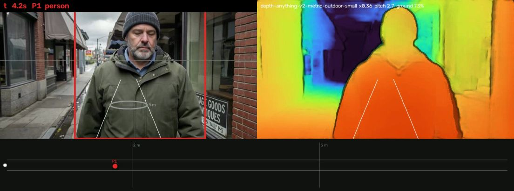
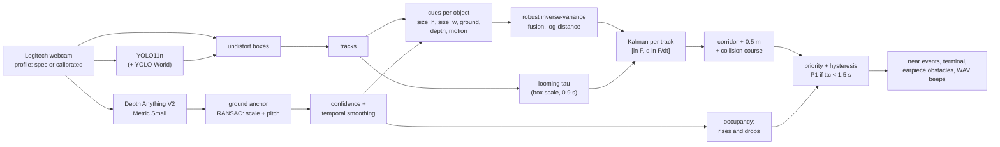

# perception/near: what is right in front of me, and how urgent is it?


A chest-worn Logitech webcam, no lidar, no radar, no second camera. For every object in a 1 m wide corridor
straight ahead, this module estimates how far away it is from several independent cues, fuses them, tracks the
result over time, and turns it into one of three priorities and one of three beeps:

| Priority | Distance (person-sized object) | Beep (WAV only) | Earpiece sonar (existing fields) |
|---|---|---|---|
| **P1** | under 2 m, or time to contact under 1.5 s | F#6 1480 Hz, every 0.20 s down to a continuous tone | ~1225 Hz every 0.13 s |
| **P2** | 2 m to under 5 m | B5 988 Hz, every 0.55 to 0.25 s | ~800 Hz every 0.57 s |
| **P3** | 5 m or more | E5 659 Hz, every 1.1 to 0.7 s | ~625 Hz every 0.81 s |

It outputs priorities, not distances, because one camera's distance is a noisy number (the tables below say how
noisy), while "something is less than 2 m ahead of you" survives a 20 % range error most of the time.

```bash
python -m perception.near --source webcam:Logitech                     # the chest C270 (Windows or macOS)
python -m perception.near --source webcam:Logitech --radar             # live ASCII radar in a terminal
python -m perception.near --source data/imagined/doorway.mp4 --no-send --hud out/doorway_hud.mp4 \
    --wav out/doorway_beeps.wav --jsonl out/doorway_near.jsonl         # a file: review video, beeps, events
python -m perception.near --list-profiles                              # the built-in camera profiles
python -m perception.near.beeper --demo out/beeps                      # p1/p2/p3/approach.wav (never played)
python -m perception.near.evaluate                                     # the numbers below, on your machine
python -m perception.calibrate_camera --print-board board.png          # then calibrate (see below)
```

Python environment, the same as `perception/`: `uv run --no-project --python 3.12 --with ultralytics --with lap
--with transformers --with scipy --with opencv-python-headless python -m perception.near ...` (weights from
`python -m perception --download` into the git-ignored `weights/`; only YOLO11n and Depth Anything V2 Metric
Small are needed). On Windows, `webcam:Logitech` falls back to DirectShow when `kite.sources` cannot list cameras
by name (install `pygrabber` to pick by name; otherwise the first camera is used and its Windows device name
still selects the profile).

On startup it says which camera it thinks it is looking through, and one fact about it:

```text
[near] Logitech C270 (from spec, calibrate for accuracy): fx 1411 / fy 1411 px at 1280x720, 48.8 x 28.6 deg;
       a 1.70 m person at 2 m stands 1199 px tall - taller than the frame, so close people are ranged by their shoulders.
[near] profile: USB name 'HD Webcam C270' matched C270
```

Then one line per change (or the radar with `--radar`):

```text
t=   1.04  P2  person ~3.0 m  conf 0.88  [size_w 1.9 | depth 3.7]
t=   4.12  P1  person ~1.9 m  ttc 2.8 s  conf 0.91  [size_w 0.8 | depth 2.3]
          |   |         8 m
          |   |
  --------|---|-------- 5 m
          |   |
  --------|---|-------- 2 m
          | 1 |
            ^  you
```



*`--hud` on the doorway clip: the corridor's two rails on the pavement, rings at 2 m and 5 m lying on the ground
(DepthLab-style oriented reticles), the anchored depth map in Turbo (dimmed where its confidence is low), and a
top-down radar.*

## Research: what "the way Tesla does it" means for one chest camera

Tesla dropped radar from Model 3 and Model Y in 2021 and has described its replacement in public talks rather
than papers. What carries over to a pedestrian's chest camera is the set of principles, not the networks:

| Principle | Where it comes from | What perception/near does with it |
|---|---|---|
| Depth and velocity from vision alone, trained against radar / lidar as labels | Andrej Karpathy, CVPR 2021 Workshop on Autonomous Driving keynote ([coverage](https://cleantechnica.com/2021/06/21/teslas-andrej-karpathy-gives-a-keynote-at-cvpo-2021-workshop-on-autonomous-driving/), [summary](https://www.notateslaapp.com/news/512/andrej-karpathy-talks-about-how-tesla-is-solving-vision-in-autopilot-at-cvpr-2021)); Tesla AI Day 2021 (auto-labelling, [review](https://towardsdatascience.com/tesla-ai-day-2021-review-part-2-training-data-how-does-a-car-learn-e8863ba3f5b0)) | a learned metric depth model (Depth Anything V2) as one cue, its scale corrected against geometry we know exactly (the ground plane) instead of against radar |
| Several independent estimates, fused, with temporal memory | AI Day 2021's multi-camera, multi-frame "vector space"; [occupancy networks](https://www.notateslaapp.com/news/3864/how-tesla-fsd-works-part-5-modeling-a-physical-world-without-lidar), Ashok Elluswamy, CVPR 2022 WAD keynote | five cues per object fused by inverse variance in log-distance; a Kalman filter per track; a class-agnostic occupancy check of the corridor from depth |
| Occupancy, not object lists, for "is the path blocked" | the same occupancy talk: predict whether space is occupied without needing to name what occupies it | `occupancy.py`: anything rising 0.18 to 2 m out of the corridor's ground is an obstacle, named or not; a break in the ground plane is a drop |
| Range and range rate from one camera, with honest error bounds | Stein, Mano, Shashua, [Vision-based ACC with a single camera: bounds on range and range rate accuracy](https://ieeexplore.ieee.org/document/1212895), IEEE IV 2003 | the ground-contact cue (their range from the image row of the road contact) with its error propagated from the pitch uncertainty: d ln F / d theta = 1 / (sin theta cos theta) |
| Time to contact from scale change, no 3D needed; collision course from position | Dagan, Mano, Stein, Shashua, [Forward collision warning with a single camera](https://cris.huji.ac.il/en/publications/forward-collision-warning-with-a-single-camera/), IEEE IV 2004 | looming: tau = s / (ds/dt) from box expansion, P1 at once under 1.5 s; the override only fires if the object's lateral track still overlaps the corridor at contact |
| tau, the visual time to collision | D. N. Lee, [A theory of visual control of braking based on information about time-to-collision](https://repositorio.ufc.br/handle/riufc/62866), Perception 5(4), 1976 | the same quantity; looming is a measurement of the Kalman filter's rate state, since d ln F / dt = -1 / tau |
| Depth from motion with one camera, per-pixel confidence, temporal smoothing | Valentin et al., [Depth from motion for smartphone AR](https://research.google/pubs/depth-from-motion-for-smartphone-ar/), SIGGRAPH Asia 2018 (ARCore's Depth API); [ARCore Raw Depth](https://codelabs.developers.google.com/codelabs/arcore-rawdepthapi) confidence images | the motion cue (walker speed x looming tau gives metric range for fixed objects); a confidence map for every depth frame; ego-motion-compensated temporal smoothing |
| Depth-based collision, oriented reticles, false-colour depth | Du et al., [DepthLab: Real-time 3D Interaction with Depth Maps for Mobile AR](https://github.com/googlesamples/arcore-depth-lab), UIST 2020 (Apache-2.0) | the corridor occupancy test is DepthLab's localized collision check run on the walker's swept volume; the HUD draws ground-oriented rings at 2 m and 5 m and the depth in [Turbo](https://research.google/blog/turbo-an-improved-rainbow-colormap-for-visualization/) |
| Calibrated geometry | standard pinhole + Brown-Conrady distortion, OpenCV calibration ([ChArUco tutorial](https://docs.opencv.org/4.13.0/da/d13/tutorial_aruco_calibration.html)) | spec intrinsics for the Logitech C270 / C310 / C920, a ChArUco or chessboard calibration tool, undistortion of every box before any geometry |

The baseline Kite should beat is [ScrollSafe](https://github.com/MrAnitude/ScrollSafe) (no licence on the repo,
so nothing is copied; its rule is reimplemented from its description inside `evaluate.py`): YOLOv8n boxes, a
"walk path" in the middle 50 % of the frame, and box height / frame height as a depth proxy (over 0.40 DANGER,
over 0.20 WARNING). It is a good idea with two problems this module exists to fix: the proxy depends on the
camera's field of view and the object's size (a child at 1.5 m and a bus at 20 m can have the same box height),
and a frame-wide "path" is an angle, not a width in metres. Its own next steps (MiDaS depth, trajectories,
directional alerts) are all in here.

## Design



### 1. Intrinsics

| Camera | Native | Diagonal FOV (spec) | f at native | at 1280x720 | H x V FOV |
|---|---|---|---|---|---|
| Logitech C270 ([spec](https://www.logitech.com/en-us/products/webcams/c270-hd-webcam.960-000694.html)) | 1280x720 | 55 deg | 1410.5 px | 1410.5 px | 48.8 x 28.6 deg |
| Logitech C310 ([spec](https://www.logitech.com/en-us/products/webcams/c310-hd-webcam.html)) | 1280x720 | 60 deg | 1271.8 px | 1271.8 px | 53.4 x 31.6 deg |
| Logitech C920 ([spec](https://www.logitech.com/en-us/products/webcams/c920-pro-hd-webcam.960-001055.html)) | 1920x1080 | 78 deg | 1360.1 px | 906.7 px | 70.4 x 43.3 deg |

f = (image diagonal / 2) / tan(dFOV / 2), square pixels, principal point at the centre, no distortion: every one
is marked "from spec, calibrate for accuracy". The C310 check: a retailer lists its horizontal FOV as 53.4 deg,
which is exactly what Logitech's 60 deg diagonal gives at 16:9. `--profile auto` reads the camera's USB name
("HD Webcam C270", "Logitech HD Webcam C270", "HD Pro Webcam C920"; C920s / C920e / C922 share the C920's lens)
and uses a calibrated profile from `data/cameras/<camera>.json` when one exists. A name that says Logitech but no
model is taken to be the team's C270. A 4:3 mode (640x480) is assumed to keep the horizontal FOV; only a
calibration at that mode can confirm it.

**The C270's narrow vertical view is the biggest geometric fact about this camera.** At chest height (1.2 m) the
pavement is only visible from h / tan(vFOV/2 + tilt) onwards:

| Tilt down | C270 (28.6 deg) | C310 (31.6 deg) | C920 at 16:9 (43.3 deg) |
|---|---|---|---|
| 0 deg (level) | 4.7 m | 4.2 m | 3.0 m |
| 10 deg | 2.7 m | 2.5 m | 2.0 m |
| 15 deg | 2.1 m | 1.9 m | 1.6 m |
| 20 deg | 1.8 m | 1.6 m | 1.3 m |

So with a level C270 nothing in P1 range ever shows its feet: the ground-contact cue cannot fire, and P1 rests on
the width prior, the depth model and looming. **Clip the C270 tilted 10 to 15 degrees down.** The pitch is fitted
from the depth map every frame, so the exact angle does not need measuring.

### 2. Cues

| Cue | Formula | Sigma (log) | Fails when |
|---|---|---|---|
| size_h | F = fy H cos(pitch) / h_px | class prior's spread (person 0.08, pole 0.6) + 2 px / h_px | the box is cut at the top or bottom |
| size_w | F = fx W / w_px | width spread (person 0.25, car 0.6: front vs side) + 2 px / w_px | cut left or right |
| ground | bottom-centre ray meets the ground plane at camera height h and the fitted pitch | (pitch sigma (1 deg fitted, 3 deg assumed) + 2 px / fy) / (sin theta cos theta), + 5 % for uneven ground | the foot is out of frame, above the horizon, or the object floats (signs) |
| depth | 25th percentile of the anchored depth in the box's middle (whole box, 10th percentile, for thin poles) | the anchor's ground residual + 12 % model floor + low confidence + the share of the frame the box fills | the box fills the frame (no context; the doorway clip's face read 3 m at ~0.9 m) |
| motion | F = v_walk x tau, fixed objects only | 25 % (walking speed unknown) + tau's own | the walker is standing, or the object moves |
| looming | tau = 1 / (d ln s / dt) over 0.9 s, minus the half-window lag | the slope's standard error; the P1 override uses the slow side | the box is cut on the axis being measured |

Class priors (`priors.py`): person 1.70 m x 0.50 m, bike 1.05 m, car 1.50 m, bus 3.1 m, pole 3.0 m (sigma 0.6:
a bollard or a street light), door 2.03 m x 0.90 m, chair 0.85 m, bin 1.0 m, e-scooter 1.15 m, hydrant 0.75 m,
and so on; unknown classes get a 0.7 log-sigma so their size cue barely counts.

### 3. Fusion and tracking

Cues are combined in log-distance: weighted median first, anything more than 2.5 sigma (or 25 %) from it is
rejected, the rest averaged by inverse variance, and the variance inflated by the reduced chi-square when the
survivors still disagree. A box cut by the frame edge contributes an upper bound. Each track then has a Kalman
filter on [ln F, d ln F / dt]: fused distances correct the first state, looming measures the second directly
(d ln(box scale) / dt = -d ln F / dt), and time to contact is -1 / (rate). Three gated-out distances in a row
reset the track.

### 4. The corridor

1.0 m wide: +-0.5 m around the camera's heading. Adult shoulders are about 0.40 to 0.46 m across, arm swing adds a
few centimetres each side and the trunk sways about +-2 to 3 cm while walking, so 1 m is what a body sweeps with
a little to spare; published travel aids use the same 0.5 m half-width (the earpiece's sonar uses 0.55 m). An
object counts when its footprint, at its fused range, overlaps the corridor; a 0.2 m soft margin beyond it is
reported as "edge" and capped at P2. The corridor widens 0.15 m per m/s of walking speed above 1 m/s.
Without any metric range it falls back to an angular cone of +-atan(0.5 / 5 m) = +-5.7 deg (what the corridor
subtends at the P2/P3 boundary): too narrow closer than 5 m (a person 0.4 m off the line at 2 m is 11 deg out) and
too wide beyond, which is why every object gets a range first.

### 5. Priorities

P1 under 2 m, P2 under 5 m, P3 beyond, each multiplied by the class's size scale ((W H / person's W H)^0.25,
clamped to 0.85 to 1.35): a car is P1 from 2.6 m, a pole from 1.8 m. Escalation needs 2 agreeing frames,
de-escalation 5 frames past a 10 % band. Time to contact under 1.5 s (on the cautious side of its estimate) is P1
at once, held until it rises past 1.9 s, but only if the object is on a collision course (its lateral track still
overlaps the corridor at contact), so a car turning across 5 m ahead is not P1 just for closing fast.
Unknown objects from the occupancy check go through the same filter and state machine.

### 6. Outputs

- **Event stream** (`--jsonl`): `{"type": "near", "t", "priority": 1|2|3|null, "kind", "id", "confidence",
  "distance_m", "ttc_s"?, "cues": {"size_h": .., "ground": .., "depth": .., ...}, "objects": [...]}`, one per
  frame, the top object being the most urgent.
- **Terminal**: one line per change, or `--radar`.
- **Earpiece**: `obstacles` messages (UDP 5010) with each priority mapped onto the sonar's existing fields: a
  canonical (distance, closing speed) per priority that lands on a fixed sonar urgency (P1 1.3 m at 1.2 m/s,
  P2 3.0 m, P3 4.0 m), confidence 1.0 (the hysteresis already demanded agreement), bearings kept in sign but
  clamped inside the sonar's corridor. A measured time to contact under the canonical one raises the closing
  speed so the sonar's own time to contact equals ours; under 1 s the sonar goes critical and says "Stop." itself.
  The test suite feeds these messages to the real `earpiece/earpiece/sonar.py` scorer and checks three distinct
  pitches and rates, highest and fastest for P1. **What the sonar would need for exact tones**: an optional
  `priority` field on `Obstacle` (`events.py` parse: integer 1 to 3, else None; every message already carries
  it), and in `Sonar._score` (and the Rust twin's scorer), when `priority` is set, `u = {1: 1.0, 2: 0.45,
  3: 0.15}[priority] * corridor` and the beep pitch taken from a per-priority table (1480 / 988 / 659 Hz) instead
  of `pitch_low_hz + span * u`, with the interval from `perception.near.beeper.interval()`. Until then the
  mapping above gives three tones that are close to those.
- **Beeps** (`beeper.py`, `--wav`): three pitches a fifth apart (659, 988, 1480 Hz), park-assist rates that rise
  inside each band, P1 continuous at 0.7 m or under 1 s to contact, panned by bearing, rendered to WAV only.

## Calibrating the real camera (10 minutes)

1. `python -m perception.calibrate_camera --print-board board.png` and print it at 100 % (or show it full screen
   on a second display). Measure one square and pass `--square-mm` (it only scales the board poses, not fx).
2. Take 20 to 40 sharp photos with the Logitech at 1280x720 (the size `kite.sources` asks for): the board 0.3 to
   1.5 m away, in the centre, all four corners and along every edge, tilted 20 to 45 degrees in different
   directions. Or record a slow 30 s video waving it around.
3. `python -m perception.calibrate_camera --images calib/` (or `--video calib.mp4`, or `--live webcam:Logitech`
   on your machine). It writes `data/cameras/logitech_c270.json` and prints the RMS reprojection error (aim for
   under 0.5 px) and how far fx is from the spec value; every size-cue range moves by that percentage.
4. Nothing else to do: `--profile auto` now prefers the calibrated file whenever the USB name says C270.

## Results

The full tables are in [`docs/eval.md`](docs/eval.md) (regenerate with `python -m perception.near.evaluate`).
RESULTS_PLACEHOLDER

## Files

| File | What it is |
|---|---|
| `__main__.py` | the CLI: sources (webcam by name on macOS and Windows, files, stills), `--hud`, `--wav`, `--jsonl`, `--radar`, earpiece sending |
| `intrinsics.py` | camera profiles: spec C270 / C310 / C920, calibrated JSON, USB-name selection, undistortion, the startup line |
| `priors.py` | per-class real heights and widths with log-spreads, size scale for thresholds |
| `geometry.py` | rays, the ground plane, pixel to (forward, lateral, height) |
| `depth.py` | the depth backend interface (`estimate(frame) -> (depth, confidence)`), DA-V2 adapter, `zoo:<name>` for `perception/depth_zoo.py`, ground anchoring (RANSAC), confidence, smoothing |
| `cues.py` | size, ground, depth, motion cues and looming |
| `fusion.py` | robust inverse-variance fusion, the log-distance Kalman filter |
| `corridor.py` | the +-0.5 m corridor and the angular fallback |
| `occupancy.py` | class-agnostic rises (obstacle, wall) and drops (curb, stairs down) |
| `priority.py` | thresholds, hysteresis, the time-to-contact override |
| `system.py` | tracks, the per-frame pipeline, collision course |
| `output.py` | terminal line and radar, the earpiece `obstacles` mapping |
| `beeper.py` | the three-tone park-assist WAV renderer |
| `hud.py` | the review video: boxes, ground rings, Turbo depth, radar |
| `synth.py` | pinhole renders with known geometry (boxes and a depth model's view) |
| `evaluate.py`, `near_labels.json` | the benchmark above and its hand labels |
| `../calibrate_camera.py` | ChArUco / chessboard calibration into a profile |

Tests (no camera, no sound, no model weights): `uv run --no-project --python 3.12 --with numpy --with scipy
--with opencv-python-headless --with pytest python -m pytest perception/tests` (they also run in
`scripts/check.sh`'s perception step).
